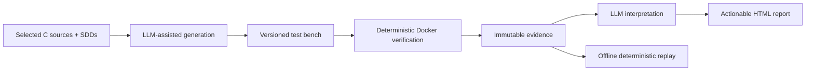

# uTest Machinery

**From embedded C and detailed design specifications to traceable, reproducible host-executed verification.**

Embedded C unit verification is often labor-intensive: engineers reconstruct target-dependent build contexts, isolate SDK dependencies, author mocks and test oracles, chase structural-coverage gaps, then manually correlate disparate reports with software detailed design (SDD) requirements. Coverage alone does not establish conformance; an apparently passing test may even assert behavior unsupported by the specification.

**uTest Machinery** aims to automate this work without relinquishing engineering judgment:

1. **Generate** — analyze selected C sources and SDDs; propose an auditable verification plan; create and maintain host-native tests, mocks, and fuzz harnesses using an embedded LLM harness.
2. **Verify** — replay the frozen test bench, without any LLM, using free deterministic tools inside a version-pinned Docker image on WSL.
3. **Interpret** — correlate immutable evidence with the SDD; identify implementation mismatches, specification ambiguities, verification gaps and environment limitations; deliver evidence-linked, actionable recommendations. Reinterpret the same evidence without rerunning tests.

## Expected benefits

| Today | With uTest Machinery (product target) |
| --- | --- |
| Manual dependency isolation and mocking | Assisted feasibility assessment and generated host adapters |
| Hand-crafted repetitive test cases | Specification-derived reusable scenarios and mocks |
| Disconnected coverage, sanitizer and mutation reports | One traceable evidence model and linked HTML report |
| Difficult test maintenance after source/SDD changes | Incremental, auditable updates |
| Unclear rationale for passed/failed requirements | Evidence-linked findings and specific proposed actions |
| Local toolchain drift | Pinned, reusable, project-agnostic container |

These benefits are **objectives, not measured performance claims**. The product is not an ISO 26262 certification tool and cannot prove arbitrary embedded software correct solely through host execution.

## Product documentation

- [Product positioning and scope](docs/product/overview.md)
- [User journeys, CLI and operations](docs/user-guide/workflows.md)
- [Architecture and product requirements](docs/architecture/architecture.md)
- [Verification strategy and tool selection](docs/architecture/verification-strategy.md)
- [Workflow-engine comparison and decision](docs/architecture/workflow-engines.md)
- [Data contracts and evidence model](docs/architecture/data-contracts.md)
- [LLM autonomy and human review](docs/architecture/automation-policy.md)
- [Qualification requirements and fixture catalog](docs/qualification/qualification.md)
- [CI and manual product test plan](docs/qualification/ci-and-manual-tests.md)
- [Step-by-step construction plan and PR gates](docs/plan/implementation.md)
- [Claude Code development instructions](CLAUDE.md)
- [Developer credentials and Beads setup](docs/development/setup.md)
- [Workflow errors and recovery](docs/architecture/workflow-failures.md)

**Status:** design/specification baseline, with development planned as six feature PRs, each requiring a separate review and explicit go-ahead before the next. The documented CLI and product runtime are **proposed interfaces**, not implemented commands. The repository contains reference demonstration inputs; generated verification results must not be presented as observed until the machinery executes them.

**Working boundary:** native C execution on Linux under WSL via Docker. QEMU/Renode and on-target testing are a future, separate stage.

**Key guarantees:** original inputs read-only; exactly one project-specific test-bench root; all persistent project state outside Docker; traceability of every verdict; no silent modification of specification-derived oracles.
