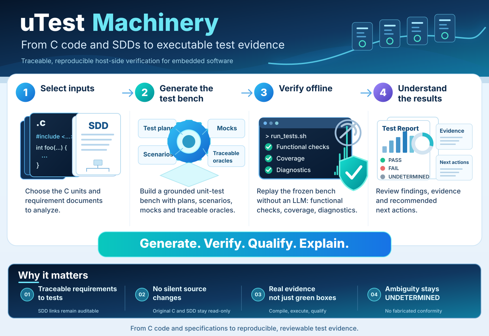
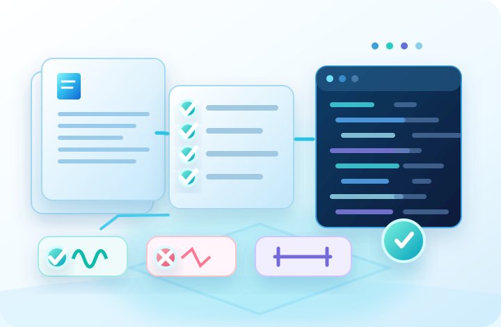
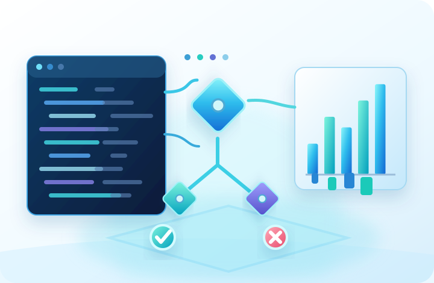
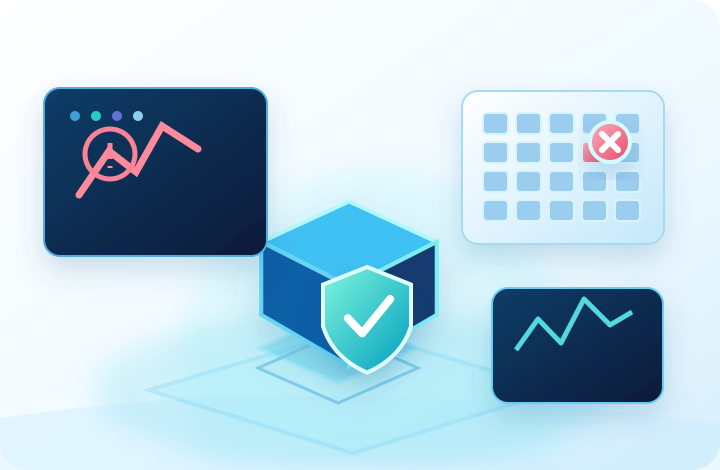
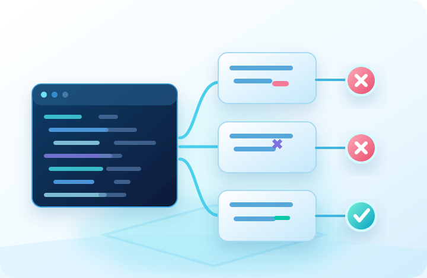
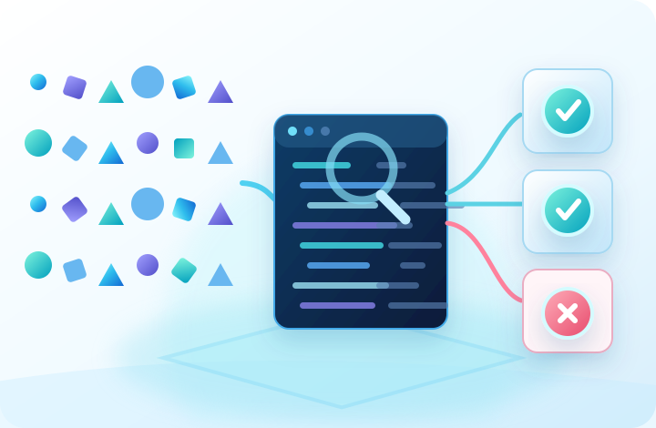
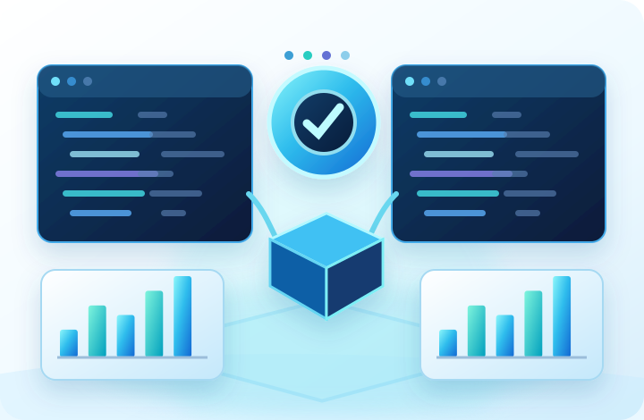
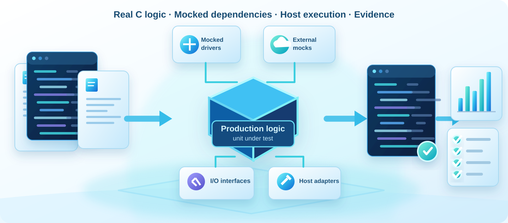
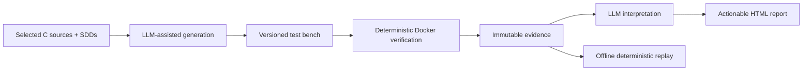

# uTest Machinery

**From embedded C and detailed design specifications to traceable, reproducible host-executed verification.**

Embedded C unit verification is often labor-intensive: engineers reconstruct target-dependent build contexts, isolate SDK dependencies, author mocks and test oracles, chase structural-coverage gaps, then manually correlate disparate reports with software detailed design (SDD) requirements. Coverage alone does not establish conformance; an apparently passing test may even assert behavior unsupported by the specification.

**uTest Machinery** aims to automate this work without relinquishing engineering judgment:

1. **Generate** — analyze selected C sources and SDDs; propose an auditable verification plan; create and maintain host-native tests, mocks, and fuzz harnesses using an embedded LLM harness.
2. **Verify** — replay the frozen test bench, without any LLM, using free deterministic tools inside a version-pinned Docker image on WSL.
3. **Interpret** — correlate immutable evidence with the SDD; identify implementation mismatches, specification ambiguities, verification gaps and environment limitations; deliver evidence-linked, actionable recommendations. Reinterpret the same evidence without rerunning tests.

## What can uTest Machinery test?

From specification-driven checks to structural coverage and defect-detection strength, uTest Machinery brings complementary C verification methods together on the development host.

<table>
<tr>
<td width="33%" align="center"> <strong>Functional &amp; robustness</strong> SDD scenarios, boundaries, state transitions, dependency failures and recovery. Ceedling · Unity · CMock</td>
<td width="33%" align="center"> <strong>Structural coverage &amp; MC/DC</strong> Lines, branches, decisions and supported independent-condition coverage. Clang · llvm-cov</td>
<td width="33%" align="center"> <strong>Memory &amp; runtime safety</strong> Memory violations, undefined behavior and applicable leak diagnostics. ASan · UBSan · LSan · Valgrind</td>
</tr>
<tr>
<td align="center"> <strong>Mutation testing</strong> Evaluate whether the tests detect deliberately introduced code defects. Mull</td>
<td align="center"> <strong>Fuzzing &amp; properties</strong> Explore generated inputs, detect crashes and reproduce problematic cases. libFuzzer · Sanitizers</td>
<td align="center"> <strong>Compilers &amp; host diagnostics</strong> Compiler/optimization variants and applicable host resource diagnostics. GCC · Clang · Valgrind</td>
</tr>
</table>

*Delivery roadmap: the functional Ceedling/Unity/CMock bench is the current foundation; offline coverage, sanitizers and host diagnostics belong to milestone 3; mutation and fuzzing belong to milestone 4. Profiles apply only when supported by the selected code and tools. See the [verification strategy](docs/architecture/verification-strategy.md).*

## How can embedded C run without the target hardware?

**Test real C logic, isolate hardware-facing dependencies.** The selected production functions and SDD requirements drive a native test bench. Hardware drivers, peripherals and external services are replaced **at their interfaces** with CMock mocks or controlled host shims/adapters where needed—not by claiming the entire target is emulated. The frozen bench runs in a pinned Docker environment, **offline and without an LLM**, and keeps test results linked to requirements and evidence.

Mocks and host execution cannot prove target-specific timing, MCU behavior, or hardware equivalence. Unsupported units and ambiguous SDD expectations remain explicitly limited or `UNDETERMINED`, not silently marked passing.

## Expected benefits

| Today | With uTest Machinery (product target) |
| --- | --- |
| Manual dependency isolation and mocking | Assisted feasibility assessment and generated host adapters |
| Hand-crafted repetitive test cases | Specification-derived reusable scenarios and mocks |
| Disconnected coverage, sanitizer and mutation reports | One traceable evidence model and linked HTML report |
| Difficult test maintenance after source/SDD changes | Incremental, auditable updates |
| Unclear rationale for passed/failed requirements | Evidence-linked findings and specific proposed actions |
| Local toolchain drift | Pinned, reusable, project-agnostic container |

These benefits are **objectives, not measured performance claims**. The product is not an ISO 26262 certification tool and cannot prove arbitrary embedded software correct solely through host execution.

## Product documentation

- [Product positioning and scope](docs/product/overview.md)
- [User journeys, CLI and operations](docs/user-guide/workflows.md)
- [Architecture and product requirements](docs/architecture/architecture.md)
- [Verification strategy and tool selection](docs/architecture/verification-strategy.md)
- [Workflow-engine comparison and decision](docs/architecture/workflow-engines.md)
- [Data contracts and evidence model](docs/architecture/data-contracts.md)
- [LLM autonomy and human review](docs/architecture/automation-policy.md)
- [Qualification requirements and fixture catalog](docs/qualification/qualification.md)
- [CI and manual product test plan](docs/qualification/ci-and-manual-tests.md)
- [Step-by-step construction plan and PR gates](docs/plan/implementation.md)
- [Risks, amplified impacts and follow-up](docs/project/risks.md)
- [Claude Code development instructions](CLAUDE.md)
- [Developer credentials and Beads setup](docs/development/setup.md)
- [Verified Claude Code development-agent workflow (roles, gates, PR recheck)](docs/development/agent-development-workflow.md)
- [LLM development RETEX — PO to GitHub, coding and review (cross-project lessons)](docs/development/llm-development-retrospective.md)
- [Workflow errors and recovery](docs/architecture/workflow-failures.md)

**Delivery status:** milestones 1–2 are merged: CLI/Docker/Dagu control and functional C bench generation with Ceedling/Unity/CMock are implemented and exercised on selected fixtures. `mtm verify`, `mtm interpret` and `mtm report` remain future milestones. Reference fixtures and green CI are not proof of universal C/SDD support or product conformance.

**Working boundary:** native C execution on Linux under WSL via Docker. QEMU/Renode and on-target testing are a future, separate stage.

**Key guarantees:** original inputs read-only; exactly one project-specific test-bench root; all persistent project state outside Docker; traceability of every verdict; no silent modification of specification-derived oracles.

## Delivery roadmap

**2 of 6 milestones delivered.** The infographic and methods above describe the **product direction**, not six already operational verification families. The next milestone is **3 — offline verification and qualification**; work on it is **not shown as started** here.

```mermaid
flowchart LR
  M1["1 · Bootstrap<br/>CLI · Docker · Dagu"] --> M2["2 · Generate<br/>SDD → Ceedling / Unity / CMock"]
  M2 --> M3["3 · Verify offline<br/>Coverage · MC/DC · Sanitizers · C fidelity"]
  M3 --> M4["4 · Strengthen<br/>Mutation · Fuzzing"]
  M4 --> M5["5 · Explain<br/>Traceability · HTML report"]
  M5 --> M6["6 · Maintain & qualify<br/>Incremental updates · Full qualification"]

  classDef delivered fill:#e2f6ed,stroke:#169b74,color:#104936,stroke-width:2px
  classDef next fill:#eaf2ff,stroke:#387edb,color:#1b457b,stroke-width:2px
  classDef planned fill:#f5f7fa,stroke:#9aa9bd,color:#46576b,stroke-width:1px
  class M1,M2 delivered
  class M3 next
  class M4,M5,M6 planned
```

**Delivered:** steps 1–2 · **Next:** step 3 · **Planned:** steps 4–6. See the [six-milestone implementation plan](docs/plan/implementation.md) for scope, qualification evidence and acceptance criteria. Each step is authorized and reviewed separately; merging a PR does not by itself qualify every possible C program or SDD.

