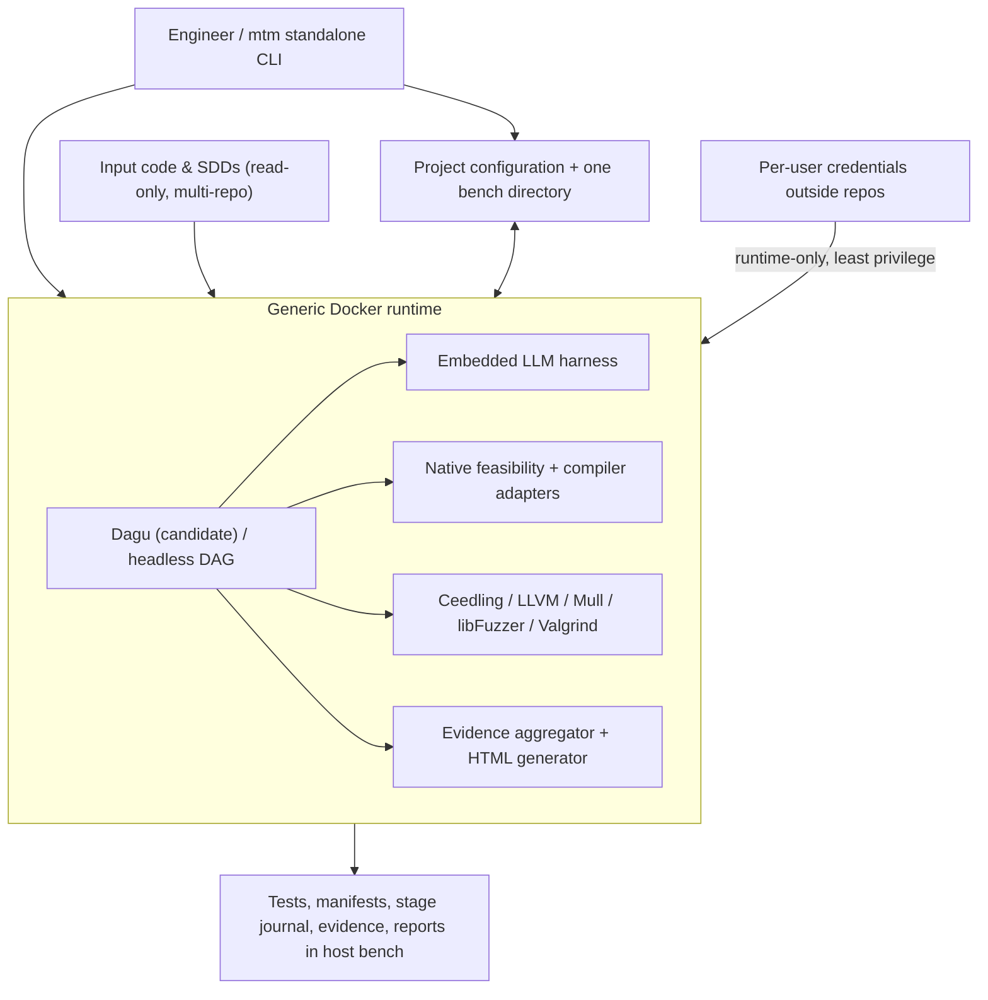
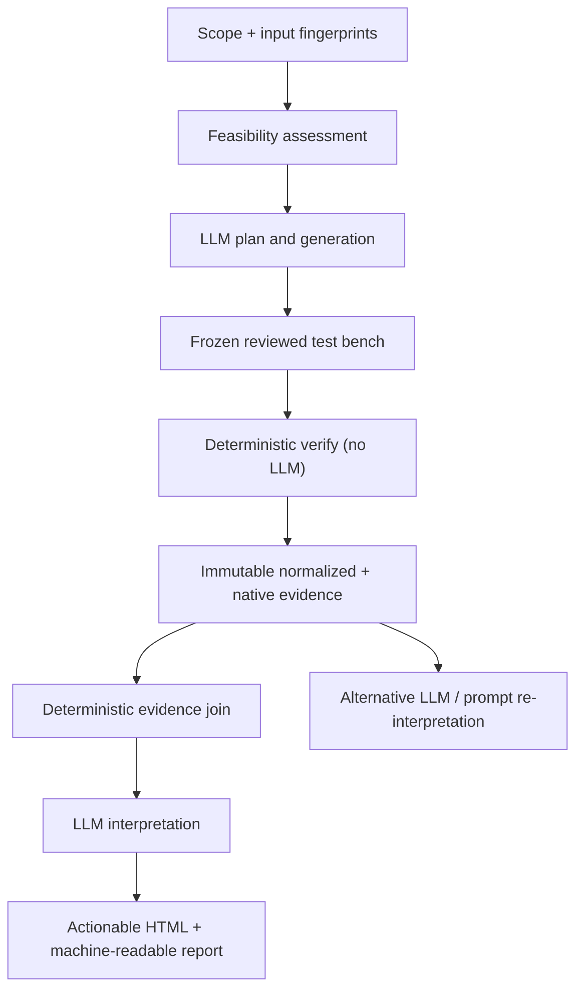
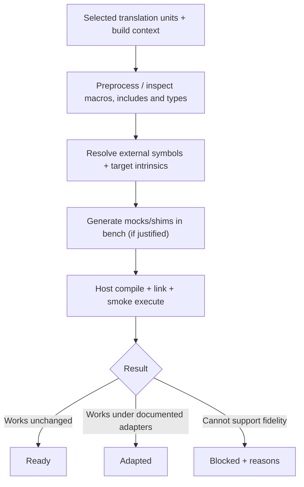

# Architecture and normative product requirements

**Status:** target specification, not an assertion of implemented behavior. Normative terms MUST/SHOULD apply to the intended system.

## Component topology



Only generic product code, tool installations and workflow templates reside in the image. **All project-specific state** is host-mounted. Persistent data include configurations, scenario IDs, plan, generated code, adaptations, hashes, findings, decisions and interpretable evidence.

## Host layout and mount policy

One workspace has exactly **one owned bench root**, either in an owning repository or in a dedicated repository for multi-repo workspaces. Inputs may be anywhere in the accessible workspace and are referenced, not moved. Resolve and reject path escapes, dangling references, undocumented external roots and overlapping ownership. A possible layout (not a rigid internal API):

```text
test-machinery/
  project.yaml
  toolchain.lock
  workflows/
  requirements/
  tests/
  mocks/
  fuzz/
  state/
  evidence/<run-id>/
  reports/<run-id>/
  build/                 # ignored/rebuildable
```

Mount all originals read-only, test-bench output with scoped write permissions, user credentials only for the LLM phase. No original files are modified; modifications in private working copies and instrumentation at compile time are allowed and tracked. Never grant Docker broad read/write access to the workspace merely for convenience.

## Logical workflows



**Independent operations:** `generate` uses a model and may alter proposed bench artifacts, `verify` uses no model and may only append run records, `interpret` uses a model but cannot change frozen evidence or approved test oracles. All allow targeted rerun and bounded, explicit retries.

## Executability assessment



Compilation and smoke runs are concrete evidence, **not proof of target equivalence**. Preserve original translation units where possible; only extract/transform isolated work copies when necessary. Link each replacement to the original target dependency and contract; register all compiler flags, ABI assumptions, conditional macros, source hashes and mock behavior.

## Formal requirements

| ID | Requirement | Acceptance evidence |
| --- | --- | --- |
| SYS-001 | The only mandatory user interface SHALL be a standalone CLI, suitable for WSL and non-interactive CI. | CLI end-to-end sample |
| SYS-002 | All test engines, workflow runtime and LLM harness SHALL be packaged in a reusable pinned Docker image. | Clean host bootstrap |
| SYS-003 | All project-specific files, journals, generated tests and outcomes SHALL be outside Docker in one project bench root. | Recreate container and resume |
| SYS-004 | Original code, SDD and other selected inputs SHALL remain byte-for-byte unchanged. | Before/after SHA-256, read-only mounts |
| SYS-005 | Multiple code/spec repositories and explicit scope additions/removals SHALL be supported without copying originals. | Multi-repository fixture |
| SYS-006 | A machine-readable, human-reviewable verification plan SHALL precede test generation. | Plan artifact and decision references |
| SYS-007 | Generated assertions SHALL carry requirement/provenance links; semantic oracle changes SHALL require review. | Rejected silent oracle-change test |
| SYS-008 | Feasibility SHALL classify units Ready, Adapted or Blocked, with diagnostics and host-fidelity limitations. | Target-specific fixture |
| SYS-009 | Existing tests SHALL be incrementally maintained with stable IDs, reproducible diffs and obsolescence records. | Revisions fixture |
| SYS-010 | `verify` SHALL recreate all deterministic test/evidence outputs without invoking any LLM. | Offline replay |
| SYS-011 | `interpret` SHALL re-analyze a frozen campaign without modifying raw evidence. | Reinterpretation diff |
| SYS-012 | The engine SHALL avoid redundant suites by reusing functional scenarios across instrumentation profiles. | Campaign manifest |
| SYS-013 | Each verdict SHALL trace input revision → SDD requirement → code/function → test → run → evidence. | Report link integrity |
| SYS-014 | Reported findings SHALL distinguish code defect, SDD gap, conflict, insufficient evidence and tool/environment failure. | Classification fixtures |
| SYS-015 | Recommendations SHALL include root cause, exact location, suggested change, expected behavior, supporting evidence, risk and validation procedure. | Actionable finding fixture |
| SYS-016 | Workflow SHALL be headless, textual, auditable, failure-resilient and optionally visually inspectable. | Crash/resume qualification |
| SYS-017 | Personal LLM credentials SHALL stay outside project repositories, Docker images, logs and saved evidence. | Secret-leak tests |
| SYS-018 | Project state and tool selections SHALL be versioned for collaboration and reproducibility. | Cross-machine replay |
| SYS-019 | Compiler, mutation and other tool errors SHALL never be misreported as passing functional results. | Injected tool failures |
| SYS-020 | Verification coverage SHALL account for selected but untested/blocked units; exclusions require explanation. | Blocked denominator test |
| SYS-021 | LLM actions SHALL use constrained, logged tool calls and bounded iteration budgets; no unrestricted host access. | Agent policy test |
| SYS-022 | UI-free workflow and GitHub-rendered diagrams SHALL be available; GUI editing SHALL never be mandatory. | Headless run + diagram review |
| SYS-023 | The report SHALL distinguish host measurements from MCU properties and avoid unearned conformity claims. | Review of target-dependent fixture |
| SYS-024 | Source, SDD and generated input content SHALL be treated as untrusted data, not agent instructions. | Prompt-injection qualification |
| SYS-025 | Every executed tool and generated artifact SHALL carry hashes/versions sufficient for auditing a frozen campaign. | Provenance replay |
| SYS-026 | A campaign SHALL record not-selected, unsupported, blocked, attempted and completed checks separately. | Completeness matrix |

## Execution semantics and security

The workflow engine invokes a small stable core API; LLM outputs are schema-validated proposals, not arbitrary commands. Treat test input and compiled C as untrusted. Use non-root containers, scoped mounts, CPU/memory/time limits, disabled network for deterministic runs, no privileged Docker socket access and explicit access control for credentials. Container isolation alone is not a complete security boundary. Write temporary outputs and publish atomically, preserving interrupted-step diagnostics. Stage cache keys include input hashes, toolchain digest, flags, mocks, harness and workflow revision. Unexpected test failure is evidence; runner crash is infrastructure failure.

## Findings and verdicts

A testcase assertion PASS has meaning only under its documented oracle. For underspecified requirements retain `UNDETERMINED` irrespective of a green test. Never edit the tested production source or quietly repair expected values. Recommendations can propose patch sketches but are not applied automatically. Require explicit rationale for exclusions and waived gaps.

## Future architecture boundary

QEMU/Renode target-architecture emulation and real MCU runs may later be implemented as distinct execution backends with independent evidence; do not conflate them with host-native validation.
