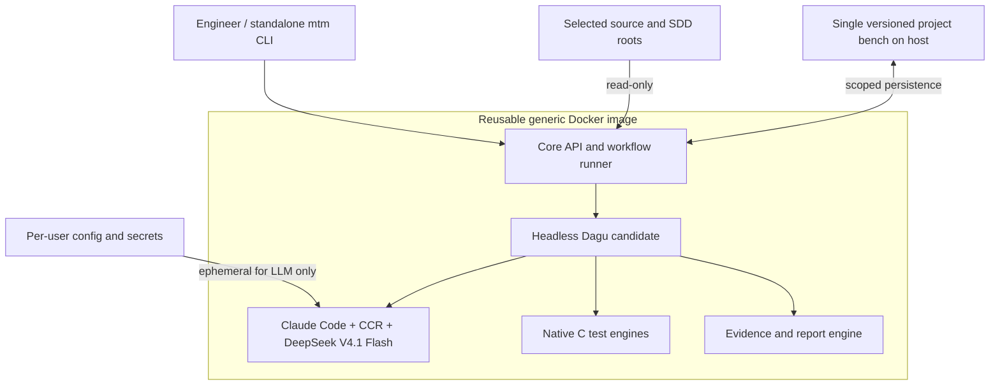
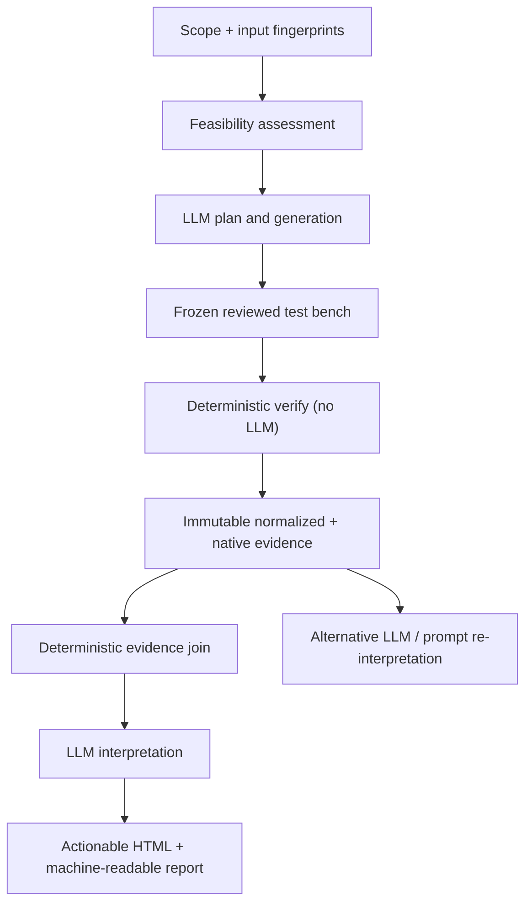
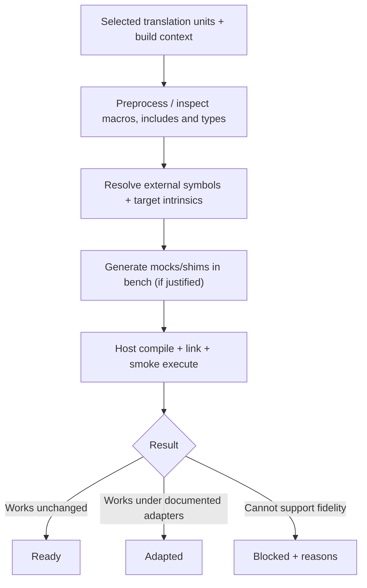

# Architecture and normative product requirements

**Status:** target specification, not an assertion of implemented behavior. Normative terms MUST/SHOULD apply to the intended system.

## Component topology



Only generic product code, tool installations and workflow templates reside in the image. **All project-specific state** is host-mounted. Persistent data include configurations, scenario IDs, plan, generated code, adaptations, hashes, findings, decisions and interpretable evidence.

## Host layout and mount policy

No automatic discovery outside explicitly configured source and specification roots is permitted. Feasibility assessment runs implicitly on scope changes and before generation; its results are exposed through plan/status and execution diagnostics, not a dedicated user-facing command. One workspace has exactly **one owned bench root**, either in an owning repository or in a dedicated repository for multi-repo workspaces. Inputs may reside in separate explicitly selected repositories and are referenced, not moved. When reproducing a historical campaign, the recorded Git revisions (including dirty-worktree content if applicable) must remain available; if bytes are missing or hashes mismatch, verification must refuse rather than silently rebuilding a different input. A content-addressed optional snapshot inside the bench may preserve selected input bytes without modifying the originals. Resolve and reject path escapes, dangling references, undocumented external roots and overlapping ownership. A possible layout (not a rigid internal API):

```text
test-machinery/
  project.yaml
  toolchain.lock
  workflows/
  requirements/
  tests/
  mocks/
  fuzz/
  state/
  evidence/<run-id>/
  reports/<run-id>/
  build/                 # ignored/rebuildable
```

Mount all originals read-only, test-bench output with scoped write permissions, user credentials only for the LLM phase. No original files are modified; modifications in private working copies and instrumentation at compile time are allowed and tracked. Never grant Docker broad read/write access to the workspace merely for convenience.

## Logical workflows



**Independent operations:** `generate` uses a model and may alter proposed bench artifacts, `verify` uses no model and may only append run records, `interpret` uses a model but cannot change frozen evidence or approved test oracles. All allow targeted rerun and bounded, explicit retries.

## Executability assessment



Compilation and smoke runs are concrete evidence, **not proof of target equivalence**. Preserve original translation units where possible; only extract/transform isolated work copies when necessary. Link each replacement to the original target dependency and contract; register all compiler flags, ABI assumptions, conditional macros, source hashes and mock behavior.

## Product requirements

Requirements below express **observable behavior**; schemas are specified in [data contracts](data-contracts.md), LLM review rules in [automation policy](automation-policy.md), test methods in [verification strategy](verification-strategy.md) and workflow-engine options in [workflow engines](workflow-engines.md). Acceptance is defined by the [CI/manual plan](../qualification/ci-and-manual-tests.md) and [C/SDD fixtures](../qualification/qualification.md).

| ID | Verifiable requirement |
| --- | --- |
| SYS-001 | A standalone WSL CLI SHALL implement documented commands and noninteractive invocation; no GUI SHALL be mandatory. |
| SYS-002 | The CLI SHALL bootstrap/check a version-pinned reusable Docker image containing workflow, LLM harness and deterministic tools. |
| SYS-003 | Every project-specific persistent file SHALL reside in one externally mounted bench root; rebuilding the image SHALL preserve it. |
| SYS-004 | Selected original inputs SHALL be mounted read-only and retain byte-identical hashes after all operations. |
| SYS-005 | The tool SHALL inspect only explicitly selected source/specification roots, including roots in multiple repositories; no unrelated workspace discovery. |
| SYS-006 | Scope add/remove SHALL persist the selection, record impact and invalidate affected derived artifacts without deleting historical evidence. |
| SYS-007 | Native feasibility SHALL run automatically for selected units, classifying READY, ADAPTED or BLOCKED with diagnostic and fidelity assumptions. |
| SYS-008 | The system SHALL persist an SDD-anchored, versioned verification plan before generating candidate test code. |
| SYS-009 | The plan viewer SHALL compare planned, generated, executed and evidence-supported scenarios and expose missing links. |
| SYS-010 | Generated tests SHALL carry SDD-grounded oracle provenance; missing/conflicting expected behavior SHALL be UNDETERMINED. |
| SYS-011 | Approved oracle semantics SHALL NOT change without an explicit recorded human approval. |
| SYS-012 | The tool SHALL generate and incrementally maintain mocks, host adaptations, test harnesses and stable test identifiers. |
| SYS-013 | The functional suite SHALL be reusable across applicable coverage, sanitizer, mutation and compiler profiles without duplicate authoring. |
| SYS-014 | Verification SHALL capture raw native tool evidence and distinguish unsupported, blocked, skipped, attempted, passed and failed checks. |
| SYS-015 | `verify` SHALL rebuild and execute the frozen suite without LLM, source edits or oracle edits. |
| SYS-016 | Each frozen run SHALL record input/test/toolchain hashes, build flags, execution environment, scenario IDs and native evidence locations. |
| SYS-017 | `interpret` SHALL create a new LLM interpretation of an existing immutable run without modifying original evidence. |
| SYS-018 | Verdicts SHALL trace requirement source → function → planned scenario → generated test → execution → raw evidence. |
| SYS-019 | A requirement SHALL NOT be marked conforming solely because an assertion passed or a structural metric reached 100%. |
| SYS-020 | Findings SHALL separate implementation defect, SDD gap, SDD conflict, insufficient evidence and tool/environment failure. |
| SYS-021 | Each actionable recommendation SHALL identify evidence, precise location, rationale, proposed change, risks and post-change acceptance test. |
| SYS-022 | Workflows SHALL execute without GUI and SHALL be human-readable text, with optional visual inspection of the same DAG/status. |
| SYS-023 | A failed/interrupted workflow SHALL persist structured error, scope, stage, cause, user action and logs outside Docker and support safe retry/restart without false success. |
| SYS-024 | Domain test failures SHALL be preserved as evidence and SHALL NOT prevent independent applicable campaigns from running. |
| SYS-025 | LLM tools SHALL be allowlisted, logged and bounded; project inputs SHALL be treated as data rather than agent instructions. |
| SYS-026 | User/CI credentials SHALL be supplied outside project data, image layers and archived logs, only to authorized LLM operations. |
| SYS-027 | Generated C and its execution SHALL use scoped non-root container permissions, time/resource limits and restricted network access. |
| SYS-028 | All project configuration, checkpoints, accepted decisions and generated test sources SHALL be Git-friendly and transferable between developers. |
| SYS-029 | Reports SHALL distinguish observed host resource/ABI properties from unverified MCU behavior. |
| SYS-030 | The CLI SHALL show stage progress and actionable diagnostics through `status` (text/JSON), `doctor` and `report` using the error contract. |
| SYS-031 | The tool SHALL publish a navigable HTML report and machine-readable results referencing immutable campaigns. |
| SYS-032 | CI and qualification SHALL exercise user workflows, failure/recovery paths, security boundaries and semantic C/SDD samples, disclosing untested scope. |
| SYS-033 | A frozen re-execution SHALL reject unavailable or hash-mismatched original selected inputs; historical viewing SHALL remain available. |
| SYS-034 | Mutations SHALL preserve an operator configuration, per-mutant identity/status and native reports; invalid/equivalent mutants SHALL be accounted for separately. |
| SYS-035 | Fuzz campaigns SHALL record corpus, seeds, budgets, properties and replayable reproductions for reported failures. |
| SYS-036 | The in-image harness SHALL initially run Claude Code through CCR to DeepSeek V4.1 Flash, matching the validated host route without copying user secrets into the image. |
| SYS-037 | All bundled testing/workflow tools SHALL be free to use internally, with reproducible versions and recorded license information. |

## Technical boundaries

- Native execution uses original C translation units when feasible; if isolated extraction is unavoidable, retain hashes, transformations and fidelity assumptions. Hardware-dependent units may remain BLOCKED, never omitted from selected-scope statistics.
- Generated oracles carry exact SDD anchors and review state; the LLM may propose a correction to code or specification but may not silently modify either.
- Only the generic engine and tool installations live in Docker. Every project configuration, source mapping, tests, journal, campaign and report belongs to the single host bench. Git-version essential configurations, generated tests, stable states and accepted reports; budget large fuzz/raw artifacts explicitly with Git LFS or content-addressed archives, without silent deletion.
- Distinguish historical **record replay** (read preserved evidence), **re-execution** (requires original selected input content and locked toolchain) and **reinterpretation** (new LLM explanation from immutable evidence).

## Workflow outcomes

The shared [error and stop policy](workflow-failures.md) defines input blockers, LLM errors, tool failures, test findings, safe retries, CLI exit codes and `mtm status --json`. A complete test campaign that detects an implementation defect is not a successful *product verification verdict* but is a valid executed workflow with preserved findings. A Dagu step must never hide tool failure under a green `continue_on` result.

## Execution semantics and security

The workflow engine invokes a small stable core API; LLM outputs are schema-validated proposals, not arbitrary commands. Treat test input and compiled C as untrusted. Use non-root containers, scoped mounts, CPU/memory/time limits, disabled network for deterministic runs, no privileged Docker socket access and explicit access control for credentials. Container isolation alone is not a complete security boundary. Write temporary outputs and publish atomically, preserving interrupted-step diagnostics. Stage cache keys include input hashes, toolchain digest, flags, mocks, harness and workflow revision. Unexpected test failure is evidence; runner crash is infrastructure failure.

## Findings and verdicts

A testcase assertion PASS has meaning only under its documented oracle. For underspecified requirements retain `UNDETERMINED` irrespective of a green test. Never edit the tested production source or quietly repair expected values. Recommendations can propose patch sketches but are not applied automatically. Require explicit rationale for exclusions and waived gaps.

## Contractual interfaces

- The public CLI is defined in [user workflows](../user-guide/workflows.md); no manual tool setup or mandatory GUI.
- [Data contracts](data-contracts.md) define files and statuses; [LLM policy](automation-policy.md) defines trusted operations and approvals.
- [Verification strategy](verification-strategy.md) specifies six complementary campaigns; [workflow choice](workflow-engines.md) retains candidate alternatives; [error handling](workflow-failures.md) defines the public stop/diagnostic contract.
- [PR gates](../plan/implementation.md) and [CI/manual checks](../qualification/ci-and-manual-tests.md) determine implementation readiness.

## Future architecture boundary

QEMU/Renode target-architecture emulation and real MCU runs may later be implemented as distinct execution backends with independent evidence; do not conflate them with host-native validation.
