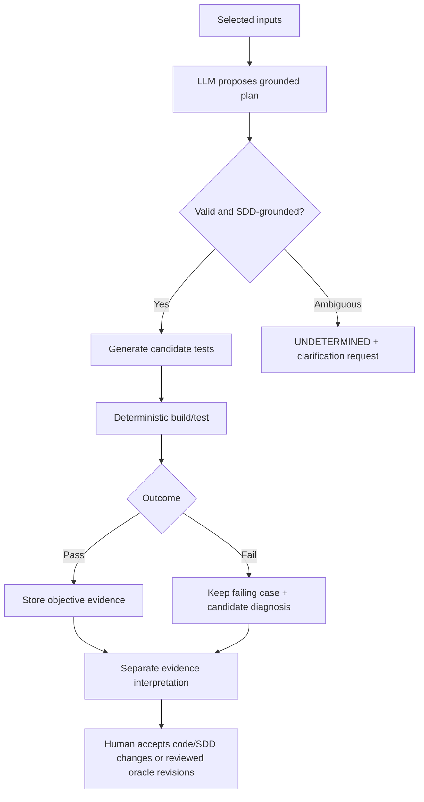

# LLM autonomy, trust boundaries and review policy

Goal: maximize unattended progress without allowing the same agent to *invent and bless its own oracle*. Decisions are reviewable and compact, recorded with evidence.

| Change/action | Automation | Safeguard |
| --- | --- | --- |
| Parse scope, compute fingerprints, compile/link, measure, report raw results | Automatic | Deterministic schema and evidence checks |
| Create test/mocks and propose SDD-derived expected values | Automatic proposal | Every oracle includes precise SDD anchor and reason |
| Revise test syntax, fixtures or mocks without changing intended behavior | Automatic within approved policy | Regression execution and auditable diff |
| Expand test inputs to close branch/MC/DC or mutation gaps | Automatic proposal | No oracle weakening, stage budget and provenance |
| Change the semantic expected behavior of an approved test | Explicit human review | Never silently update PASS/FAIL expectations |
| Invent an oracle where the SDD is missing, conflicting or ambiguous | Forbidden | Mark undetermined and request clarification |
| Change production C or original SDD | Forbidden for this product | Offer precise suggestion or patch sketch only |
| Waive a finding, exclude selected scope or change campaign acceptance criteria | Human review | Justification, author, timestamp and previous history |
| Run newly generated untrusted C | Sandbox policy | Non-root, restricted mounts/network, CPU/memory/time limits |
| Use personal credentials | LLM invocation only | Separate user config/secret channel; no log/export |

The automation SHALL preserve an explicit plan-to-test mapping, report weak/missing coverage and distinguish construction errors from implementation defects. A user may accept or reject LLM recommendations but rejected proposals remain auditable. The plan is generated before suite creation; `mtm plan` then displays both planned cases and their materialized implementations, runtime outcomes and evidence links. Review is **exception-driven**, not an approval dialog for every generated test. Failed assertions are never 'fixed' by changing the oracle to match production behavior.

## Audit trail and explanations

Record each LLM decision as a short structured proposal: source anchors, selected tool/strategy, rationale, alternatives if material, modified files, tool observations, rejected attempts, ambiguity and confidence. Capture the prompt template/model version and normalized tool I/O fingerprints. Do not require or claim access to private model reasoning. Human-facing summaries should point to these records, not reproduce entire transcripts.

## Agent safety / reproducibility

Selected C/SDD documents are untrusted input data, never executable instructions for the LLM. Tool calls are allowlisted and validated; reject out-of-scope writes and secret exfiltration. Bound retries, prompt sizes, token/time budgets and costs. A subsequent `verify` reads frozen inputs and does not call an LLM or change approved tests; `interpret` uses an LLM to create a **new** commentary on the same evidence.
