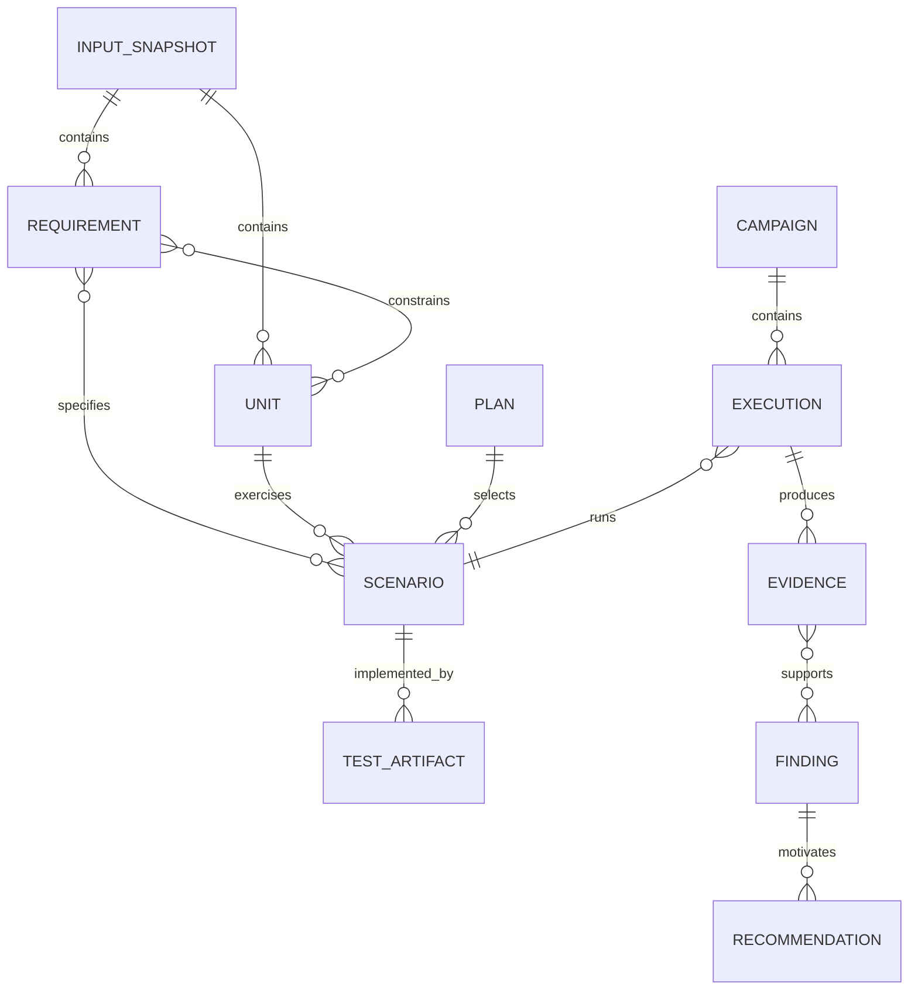

# Versioned data contracts

These are **normative semantic contracts**, not a commitment to an implementation language. Store canonical YAML/JSON in the single project bench; validate against versioned JSON Schemas before any stage consumes them. Concrete schemas are a deliverable of implementation step 1. Unknown fields and schema migrations must fail explicitly or use a documented migration.



| Object | Mandatory fields and semantics |
| --- | --- |
| **ProjectConfig** | `schema_version`, bench ID, selected source/SDD roots and selectors, explicit include/build-context roots, relative workspace/repository references, campaign policies. Never persist secrets. Paths must resolve within explicitly selected mounts. |
| **InputSnapshot** | Snapshot ID, content-addressed hash, source repository/revision, canonical selected path, hash, include/build context and time. Originals are referenced, never moved; optional content-addressed copies in the bench or reproducible Git revisions are required for historical re-execution after inputs change. |
| **Requirement** | Stable ID, snapshot/source anchor (document, section and text span), normative statement, interpreted behavior, ambiguity/conflict markers, review decision. |
| **Unit** | Stable ID, source path/snapshot/hash, symbol/signature, translation unit, build macros/options, dependency IDs, native feasibility `READY/ADAPTED/BLOCKED`, adaptation assumptions. |
| **Scenario** | Stable ID, linked requirement IDs and unit IDs, precondition/input/mock sequence, independently stated oracle and provenance, technique/objective, applicability, review state. If no SDD-grounded oracle: `UNDETERMINED`. |
| **Plan** | Version, snapshot hash, selected/omitted scenarios, method/objective per scenario, justifications, anticipated tests, applicability, model/prompt/agent identity, locked/reviewed oracle status. |
| **OracleAssessment (milestone 3)** | A read-only qualification assessment linked to a frozen plan/snapshot and each checked scenario/case/expected observable (return, output, dependency call or boundary): exact SDD anchor/clause, expected value and applicable conditions, explanation or independent reference, assessor/provenance, result `SUPPORTED_BY_SDD/CONTRADICTED_BY_SDD/INDETERMINATE/NOT_CHECKED`, and evidence links. This does **not** overwrite `Scenario`, its oracle, the generated test or native execution records; no second authoritative plan is created. |
| **CTypeResolution (derived, not another persistent plan)** | Within the existing generation/feasibility artifact provenance: selected TU/header and declaration locations, resolved canonical type/qualifiers/pointer/alias relation for relevant parameters, effective include/define/compiler options, pinned Clang/libclang version and diagnostics; links back to the existing unit/scenario identities. Missing or unsupported resolution is an explicit typed limitation, never a guessed type. No separate AST store or competing authoritative type map. |
| **TestArtifact** | Stable scenario links, paths/hashes to generated C, mocks, harness and build config, generation provenance, changed/obsolete status. |
| **Campaign** | Unique run ID, frozen plan and test-bench hashes, pinned image digest, tools/flags/OS/ABI, selected profiles, seeds/time budgets, start/end and final status. Read-only after finalization. |
| **Execution** | Scenario and profile IDs, command fingerprint, exit/timeout signal, attempted/completed status, timestamps, retry count and source-anchored output references. |
| **Evidence** | Raw tool artifact path/hash, format/version, parsed metric/status, applicability denominator, source locations, interpretation-independent provenance. |
| **Finding** | Stable ID, category `IMPLEMENTATION_DEFECT/SDD_GAP/SDD_CONFLICT/INSUFFICIENT_EVIDENCE/TOOL_FAILURE`, severity, evidence IDs, SDD/code anchors, confidence, unresolved assumptions. |
| **Recommendation** | Finding ID, cause and justification, proposed precise edit or clarification with location, before/after behavior, risk/impact, verification command and expected acceptance, human disposition. |
| **StageJournal** | DAG/stage version, dependency and output fingerprints, status `PENDING/RUNNING/SUCCEEDED/FAILED/BLOCKED/SKIPPED/INTERRUPTED`, attempt counter and latest [error record](workflow-failures.md) with repair/retry action. |

## Rules

- Generated IDs remain stable across non-semantic changes; never reuse a retired ID for a different meaning.
- Every `PASS` asserting SDD conformance must trace through an accepted SDD oracle to an executed observation. If oracle provenance is absent, mark `UNDETERMINED` regardless of green harness status.
- **Milestone-3 R04 qualification:** the existence of a valid requirement ID establishes reference integrity **only**; it is not proof that a concrete `expected`, output parameter or mock-call assertion is entailed by the cited SDD text. Associate each checked observable with its exact clause, relevant preconditions and explanation/reference. Independent fixture expected outcomes must remain unavailable to the generation model. A disagreement yields a separately preserved oracle-quality discrepancy and **no qualified conformity/implementation-defect claim from that unsupported assertion**, even if the C test passes or fails.
- `OracleAssessment` is a separate, versioned and provenance-linked **quality conclusion** over an unchanged generated plan. `NOT_CHECKED` is not equivalent to `SUPPORTED_BY_SDD`; a semantic ambiguity may require human review. An independent semantic qualification does not run inside the no-LLM `verify` command, silently repair existing oracle values or retroactively add a stage-2 acceptance gate.
- One requirement can map to many units and tests; missing mappings are visible. Planned, generated, executed, covered and requirement-satisfied are **different counts**.
- Separate runtime `PASS/FAIL/ERROR/SKIPPED` from requirement-level `SUPPORTED/CONTRADICTED/UNDETERMINED/INSUFFICIENT`.
- Never merge metrics with unlike denominators (e.g. MC/DC, mutation, requirement count). Preserve raw reports.
- Plan coverage is recorded as separate planned/implemented/executed/evidenced dimensions per scenario. Deleted or waived requirements retain identifiers and justification, and never vanish from the historical denominator.
- A new LLM interpretation references an immutable campaign and produces its own versioned interpretation ID; never rewrite raw observations.
- `toolchain.lock` records container digest, compiler versions and compatibility (including matching **Clang 18/libclang 18 bindings** for semantic C extraction), Ceedling plugins/preprocessing configuration, mutation operators, fuzz parameters and workflow engine version. Type-dependent generation and compilation use the same effective selected host build context; failures to resolve type/context are explicit limitations or tool faults, not silent fallbacks to regex reconstruction.
- A scope removal invalidates active links but retains history. On snapshot change, cache invalidation uses both source dependencies and test/oracle relationships.
- Re-execution requires the frozen suite, **the same original source/SDD bytes**, scope snapshot, build flags, seeds/time bounds, toolchain and staged mocks. If changed files cannot be restored from Git or an optional content-addressed bench snapshot, return STALE_INPUT and do not claim replay. Archived evidence may still be inspected and reinterpreted. Real LLM generation is **traceable**, not assumed bit-reproducible.

## Error and result interchange

The CLI, workflow steps and HTML report read **one machine-readable result format** with operation/run ID, stage, affected unit, status, error code/category, cause, user action, retryability and log path. The canonical list of categories, stop criteria and exit codes is [workflow failures](workflow-failures.md); do not define a second error taxonomy here. Generated scenarios can pass while requirement-level verdict is UNDETERMINED; store these as separate fields.

## Stable operation outputs

| Operation | Reads | May write | Must not write |
| --- | --- | --- | --- |
| `init/scope` | User selection, workspace references | Project config and scope journal | Original inputs |
| `generate` | Selected originals, previous plan, LLM configuration | New plan, candidate tests/mocks and change manifest | Originals, approved oracle semantics without review |
| `verify` | Frozen suite, matching selected input snapshot, toolchain lock | New immutable run, raw evidence and status index | Generated test content, previous runs, LLM records |
| `interpret` | Existing frozen run and evidence | New interpretation and report revision | Raw evidence, executed test verdicts, original SDD |
| `report/plan/status` | Project state | None (except optional local render cache) | Any canonical records |

## Minimal illustrative result

```yaml
schema_version: 1
campaign_id: run-20261017-example
scenario_id: SAT-002-B1
requirement_ids: [SAT-002]
status:
  execution: FAIL
  requirement: CONTRADICTED
evidence:
  - profile: functional
    source: evidence/run-20261017-example/unity.xml
    sha256: "<computed by engine>"
finding:
  category: IMPLEMENTATION_DEFECT
  evidence_required: true
```

This is a **shape example**, not an actual run. The implementation must use proper JSON Schema and a consistent complete envelope.
