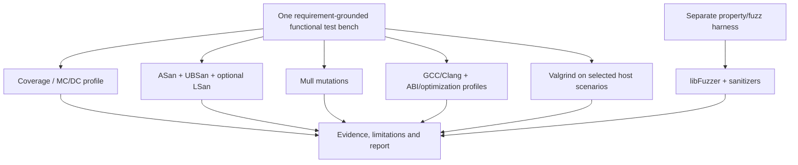

# Verification strategy — minimal complementary evidence

The goal is **coverage of relevant verification objectives**, not running every named test methodology. No finite dynamic suite guarantees arbitrary C correctness or a complete ISO 26262 safety case.

| Campaign | Test objectives consolidated | Toolchain | What the evidence establishes | Important limitations |
| --- | --- | --- | --- | --- |
| Functional/robustness | SDD scenarios, equivalence partitions, boundaries, decisions, state transitions, valid/invalid inputs, dependency errors, sequences, recovery, repeatability | Ceedling/Unity/CMock | Tested expected observations and mock contracts | Oracles may be wrong; mocks differ from target |
| Structural | Functions, regions, lines, branches, decisions, MC/DC; selected loop/path goals | Clang/llvm-profdata/llvm-cov | Instrumented exercised portions and MC/DC-supported decisions | Unsupported/unreachable conditions; coverage ≠ correctness |
| Dynamic runtime | Buffer errors, invalid frees, signed-overflow/UB, leaks; optional uninitialized-read/concurrency cases | Clang ASan/UBSan/LSan; optional MSan/TSan | No violation observed on instrumented and executed paths | Only executed paths; MSan/TSan need controlled build/threads |
| Mutation sensitivity | Test response to seeded perturbations | Mull compatible with locked LLVM plugin/runtime and test runner | Per-mutant killed/survived/other results, mutation score | Operator set finite; equivalent mutants; tool integration must be validated |
| Generative | Coverage-guided exploration, invariant, metamorphic, stateful sequences and regression corpus | libFuzzer + assertions/sanitizers | Observed property/corpus outcomes for a bounded run; seeds and reproducer | No exhaustive oracle or completeness proof |
| Host portability/resources | Compiler/optimization variants, selected 32-bit ABI where available, profiling, allocations and host instruction counts | GCC/Clang, Valgrind Memcheck/Callgrind/Massif | Host-observed consistency and resource estimates | Not target ABI, WCET, real ISR/peripheral fidelity |

**Conditional test profiles** are enabled only where applicable: LSan for allocation, TSan for actual concurrency, MSan only when fully instrumentable, Valgrind resource tooling when useful, special endian/vector or float tests for corresponding types. Pairwise, exhaustive small-domain tests, decision tables and state-machine runs use the *same Unity framework*; no dedicated platform is needed. If selected pairwise tooling becomes justified, ACTS remains optional.

## Selection and non-redundancy rules

The *same* scenario definitions serve functional assertions, instrumentation, mutation and compiler variants; only fuzzing needs a separate input generator/properties. Include each selected function in the scope denominator even if it is BLOCKED, not instrumentable or lacking an oracle. Mark campaign applicability and reasons explicitly instead of fabricating 100% scores. Instrumented builds are independent profiles with their own compiler flags and tool outputs.

Clang/llvm-cov MC/DC must show actual supported decisions and version-dependent limits. Neither MC/DC nor branch coverage certifies correctness. Valgrind and sanitizer profiles are separate where instrumentation interferes. Allocation-free and concurrency-free functions do not need irrelevant LSan/TSan passes. Use native test-engine metrics rather than custom coverage or mutation algorithms.

## Test planning contract

Each function/requirement receives a plan with: SDD source location and version, accepted interpretations, inputs and partitions, boundary values, expected outcomes, required mock behavior, fault scenarios, state preconditions, relevant campaigns, oracle origin, target-fidelity assessment and exclusions. Coverage cannot substitute for requirements traceability. The LLM may propose but must not invent an oracle when SDD is silent.

## Mutation manifest

Freeze the mutation operator set/configuration and an inventory of **generated** mutants before execution: stable mutant ID, input source location, operator, affected function and source hash. First validate that the chosen Mull build can enumerate the planned mutants before execution. If it cannot, disclose the limitation or generate a faithful derived inventory without claiming advance knowledge. Track generated, attempted, killed by assertion, crashed, timed-out, survived, equivalent (justified), skipped/invalid separately. Record native Mull outputs, tool version and mapping to SDD via function/test links. Report raw and justified scores transparently; do not silently remove survivors.

## Toolchain selection gate

Select only free tools, pin versions proven compatible: Ceedling/Unity/CMock (use original translation units and supported partials), Clang/llvm-profdata/llvm-cov with `-fcoverage-mcdc`, ASan/UBSan and optional LSan, Mull matched to LLVM, libFuzzer, GCC and Valgrind. Do not rewrite originals. References: [LLVM coverage](https://clang.llvm.org/docs/SourceBasedCodeCoverage.html), [Ceedling](https://github.com/ThrowTheSwitch/Ceedling), [Mull](https://mull-project.com/). Failed tool compatibility blocks claims about that campaign, not all independent testing.

> **Milestone-3 architecture amendment (approved 18 October 2026):** Existing Ceedling/CMock stays; pin **Clang 18/libclang 18** in the product image for a **narrow semantic type/declaration adapter**, using the same effective selected host C build context that feeds the generated bench. Resolve `typedef`, pointer levels, qualifiers, record/enum identity and prototype locations from libclang; do not extend regex-based preprocessor/include-guard heuristics. Use Ceedling's native mock-only header preprocessing (`:use_test_preprocessor: :mocks`) when required, preserve original interfaces, avoid duplicate inline type definitions and validate generated mocks/tests with real compilation. Failure of clang/build-context/harness is reported as BLOCKED/UNSUPPORTED or TOOL_FAILURE, **never** a defect in the unit under test. Qualification uses the existing few representative type, header, valid/faulty SUT contrasts and records skipped/excluded cases; no new parser framework or permanent qualification campaign. See [milestone 3](../plan/implementation.md) and [product architecture](architecture.md).

> **Implementation note (PR 2):** the generated functional suite is a standard **Ceedling + CMock** project. The deterministic generator emits `project.yml`, the in-scope sources (copied under a private revision directory), one private interface header per mocked dependency, the plan's shims and one Unity test file per unit; CMock generates the mocks and Ceedling generates the runner, compiles, links and executes — **inside the product image**, so no host Ruby is needed. Unity/CMock arrive through Ceedling (2.7.2). The generator still refuses any plan case it cannot materialise faithfully, recording a limitation rather than a defaulted assertion. See [`worklog/decisions/0012-ceedling-cmock-adopted.md`](../../worklog/decisions/0012-ceedling-cmock-adopted.md) (which supersedes 0010).

## Campaign reproducibility

Separate immutable runs for ordinary functional, coverage, sanitizer, mutation and fuzz/instrumentation profiles. Save raw tool reports and normalized links; identical source hash alone is insufficient—also freeze mocks, generated test code, flags, compiler version, build context and container digest. `verify` neither calls LLM APIs nor changes approved test code. LLM interpretation adds a sibling artifact with model identity, prompt version, evidence set, citations and uncertainty.

## Verdict policy

- **Verified under assumptions:** relevant assertions passed and adequate evidence provided for the stated check.
- **Fail:** requirement-grounded expected behavior contradicted by observed execution, with reproducible testcase.
- **Undetermined:** SDD lacks, conflicts on or ambiguously expresses the oracle.
- **Insufficient evidence:** untested paths, survivors, mocks, blocked functions or unmet criteria remain.
- **Tool/environment failure:** workflow, build, compiler, infrastructure or harness failure prevents evaluation.

A host timing comparison is a **host timing comparison**, never WCET or proof of MCU compliance. Emulation and on-target verification belong to later backend scopes.
