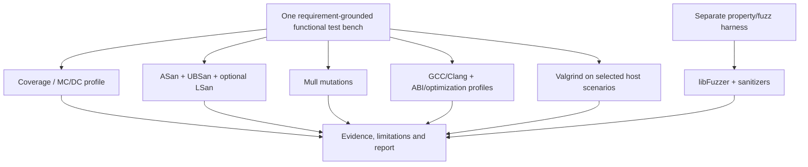

# Verification strategy — minimal complementary evidence

The goal is **coverage of relevant verification objectives**, not running every named test methodology. No finite dynamic suite guarantees arbitrary C correctness or a complete ISO 26262 safety case.

| Campaign | Test objectives consolidated | Toolchain | Evidence guaranteed when successful | Important limitations |
| --- | --- | --- | --- | --- |
| Functional/robustness | SDD scenarios, equivalence partitions, boundaries, decisions, state transitions, valid/invalid inputs, dependency errors, sequences, recovery, repeatability | Ceedling/Unity/CMock | Tested expected observations and mock contracts | Oracles may be wrong; mocks differ from target |
| Structural | Functions, regions, lines, branches, decisions, MC/DC; selected loop/path goals | Clang/llvm-profdata/llvm-cov | Instrumented exercised portions and MC/DC-supported decisions | Unsupported/unreachable conditions; coverage ≠ correctness |
| Dynamic runtime | Buffer errors, invalid frees, signed-overflow/UB, leaks; optional uninitialized-read/concurrency cases | Clang ASan/UBSan/LSan; optional MSan/TSan | No observed instrumented violation on executed inputs | Only executed paths; MSan/TSan need controlled build/threads |
| Mutation sensitivity | Test response to seeded perturbations | Mull matching LLVM release | Per-mutant killed/survived/other results, mutation score | Operator set finite; equivalent mutants; tool integration must be validated |
| Generative | Coverage-guided exploration, invariant, metamorphic, stateful sequences and regression corpus | libFuzzer + assertions/sanitizers | No discovered property violation during bounded campaign; reproducible corpus | No exhaustive oracle or completeness proof |
| Host portability/resources | Compiler/optimization variants, selected 32-bit ABI where available, profiling, allocations and host instruction counts | GCC/Clang, Valgrind Memcheck/Callgrind/Massif | Host-observed consistency and resource estimates | Not target ABI, WCET, real ISR/peripheral fidelity |

**Conditional test profiles** are enabled only where applicable: LSan for allocation, TSan for actual concurrency, MSan only when fully instrumentable, Valgrind resource tooling when useful, special endian/vector or float tests for corresponding types. Pairwise, exhaustive small-domain tests, decision tables and state-machine runs use the *same Unity framework*; no dedicated platform is needed. If selected pairwise tooling becomes justified, ACTS remains optional.

## Test planning contract

Each function/requirement receives a plan with: SDD source location and version, accepted interpretations, inputs and partitions, boundary values, expected outcomes, required mock behavior, fault scenarios, state preconditions, relevant campaigns, oracle origin, target-fidelity assessment and exclusions. Coverage cannot substitute for requirements traceability. The LLM may propose but must not invent an oracle when SDD is silent.

## Mutation manifest

Freeze the mutation operator set/configuration and an inventory of **generated** mutants before execution: stable mutant ID, input source location, operator, affected function and source hash. Track generated, attempted, killed by assertion, crashed, timed-out, survived, equivalent (justified), skipped/invalid separately. Record native Mull outputs, tool version and mapping to SDD via function/test links. Report raw and justified scores transparently; do not silently remove survivors.

## Campaign reproducibility

Separate immutable runs for ordinary functional, coverage, sanitizer, mutation and fuzz/instrumentation profiles. Save raw tool reports and normalized links; identical source hash alone is insufficient—also freeze mocks, generated test code, flags, compiler version, build context and container digest. `verify` neither calls LLM APIs nor changes approved test code. LLM interpretation adds a sibling artifact with model identity, prompt version, evidence set, citations and uncertainty.

## Verdict policy

- **Verified under assumptions:** relevant assertions passed and adequate evidence provided for the stated check.
- **Fail:** requirement-grounded expected behavior contradicted by observed execution, with reproducible testcase.
- **Undetermined:** SDD lacks, conflicts on or ambiguously expresses the oracle.
- **Insufficient evidence:** untested paths, survivors, mocks, blocked functions or unmet criteria remain.
- **Tool/environment failure:** workflow, build, compiler, infrastructure or harness failure prevents evaluation.

A host timing comparison is a **host timing comparison**, never WCET or proof of MCU compliance. Emulation and on-target verification belong to later backend scopes.
