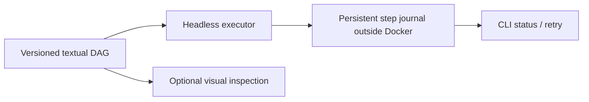

# Workflow engine — alternatives and decision record

## Requirements

The orchestration engine MUST run **headless by default** in Docker, use **human-readable text-defined workflows**, be **editable by both engineers and an LLM**, expose stage/status/retry/failure diagnostics to the CLI, and permit **optional graphical workflow inspection**. It must not require a graphical editor, create an opaque second source of truth, or keep irreplaceable project state only inside the image/container.

## Alternatives (architectural options retained)

| Engine | Authoring | Headless | Visual audit | Operational complexity for this project | Assessment |
| --- | --- | --- | --- | --- | --- |
| **Dagu** | Human-readable YAML | Yes | Optional native Web UI / DAG | Low–medium | **Preferred candidate** |
| Prefect | Python | Yes | Optional Web UI | Medium | Viable fallback, broader service/runtime surface |
| Dagster | Python | Yes | Rich Web UI | Medium–high | Strong but heavier than required |
| GNU Make / Ninja | Make/build descriptions | Yes | Graph exports / extra tooling | Low for build, medium for stateful agent workflows | Suitable for builds, not sole orchestrator |
| Python state machine + Mermaid | Python/YAML | Yes | Generated Mermaid | Medium–high maintenance burden | Fallback if existing engines fail |
| n8n | UI-centric JSON workflows | Yes after setup | Built-in visual editor | **High for human/LLM text audit** | Not recommended; poor hand-auditable source representation |

## Provisional decision: Dagu

Dagu is the preferred **separate executable** inside Docker: textual YAML DAGs, headless execution, stage dependencies, errors, retries and optional UI align with both machine autonomy and manual review. The tool is intended for internal use; respect the selected engine license and keep it as a separate executable.

**Not yet final adoption.** Validate the documented Dagu CLI version (including start/status/retry/dry commands) before relying on resume semantics; the [official CLI reference](https://docs.dagu.sh/getting-started/cli) is the starting point. Prove: (1) no server/UI required, (2) deterministic and explicit step failure policies, (3) resumability after container interruption, (4) workflow/state export/import with no hidden source of truth, (5) CLI progress and optional DAG display, (6) per-project state on host volume, (7) compatible image/license/version pinning. If any acceptance gate fails, reconsider Prefect or a deliberately small Python orchestrator. Keep this comparison and reasons in source control.

## Failure and recovery contract

Use the common [stop/error contract](workflow-failures.md) for all statuses, retries and actionable diagnostics. Dagu is a **headless executor**, not an extra repository or a second source of truth.

- Keep authored DAG YAML and project run journal on the host bench; optional UI only for observation.
- Only transient, idempotent steps may be retried automatically within a bounded budget; workflow-wide scheduler retries are not required.
- Failed assertions and mutant survivors are findings captured by the step wrapper, **not** execution errors. A failed tool/build/runtime is a distinct failure status; independent stages may still contribute evidence.
- `continue_on` must never hide error provenance or mark tool failure as PASS.
- Before accepting Dagu, demonstrate restart after an interrupted container, correct statuses in the CLI and a text-to-diagram representation; fall back to an alternative only with evidence.

## Visual workflow source

Store an auditable YAML DAG and a Mermaid description derived from or reconciled with it. Check in the Mermaid `.md` diagram for GitHub-native rendering; generating SVG via Mermaid CLI is optional. Avoid maintaining two independently editable conflicting workflow definitions.
