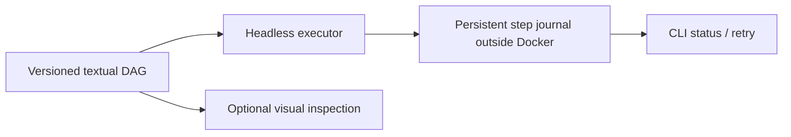

# Workflow engine — alternatives and decision record

## Requirements

The orchestration engine MUST run **headless by default** in Docker, use **human-readable text-defined workflows**, be **editable by both engineers and an LLM**, expose stage/status/retry/failure diagnostics to the CLI, and permit **optional graphical workflow inspection**. It must not require a graphical editor, create an opaque second source of truth, or keep irreplaceable project state only inside the image/container.

## Alternatives (architectural options retained)

| Engine | Authoring | Headless | Visual audit | Operational complexity for this project | Assessment |
| --- | --- | --- | --- | --- | --- |
| **Dagu** | Human-readable YAML | Yes | Optional native Web UI / DAG | Low–medium | **Preferred candidate** |
| Prefect | Python | Yes | Optional Web UI | Medium | Viable fallback, broader service/runtime surface |
| Dagster | Python | Yes | Rich Web UI | Medium–high | Strong but heavier than required |
| GNU Make / Ninja | Make/build descriptions | Yes | Graph exports / extra tooling | Low for build, medium for stateful agent workflows | Suitable for builds, not sole orchestrator |
| Python state machine + Mermaid | Python/YAML | Yes | Generated Mermaid | Medium–high maintenance burden | Fallback if existing engines fail |
| n8n | UI-centric JSON workflows | Yes after setup | Built-in visual editor | **High for human/LLM text audit** | Not recommended; poor hand-auditable source representation |

## Provisional decision: Dagu

Dagu is the preferred **separate executable** inside Docker: textual YAML DAGs, headless execution, stage dependencies, errors, retries and optional UI align with both machine autonomy and manual review. Internal-only use reduces distribution/licensing concerns, though license obligations still apply.

**Not yet final adoption.** Prove: (1) no server/UI required, (2) deterministic and explicit step failure policies, (3) resumability after container interruption, (4) workflow/state export/import with no hidden source of truth, (5) CLI progress and optional DAG display, (6) per-project state on host volume, (7) compatible image/license/version pinning. If any acceptance gate fails, reconsider Prefect or a deliberately small Python orchestrator. Keep this comparison and reasons in source control.

## Failure policy

- Every step records stable ID, declared inputs/outputs, hashes, version, status, start/end timestamps and attempts.
- Domain test failure is **data**, not necessarily workflow-engine failure; continue independent evidence collection.
- Infrastructure/tool failure is explicit, may retry only when safe, and cannot become `PASS`.
- Use idempotent stages or per-attempt temp outputs with atomic publication after validation.
- Replay only when step inputs/tool versions match its recorded fingerprint; otherwise invalidate downstream steps.
- On interruption, the journal survives and a developer can inspect, resume or restart.
- Human or LLM modifications to workflow definitions go through Git diff and validation.
- Optional UI is for observation, **not authoring source of truth**.

## Visual workflow source

Store an auditable YAML DAG and a Mermaid description derived from or reconciled with it. Check in the Mermaid `.md` diagram for GitHub-native rendering; generating SVG via Mermaid CLI is optional. Avoid maintaining two independently editable conflicting workflow definitions.
