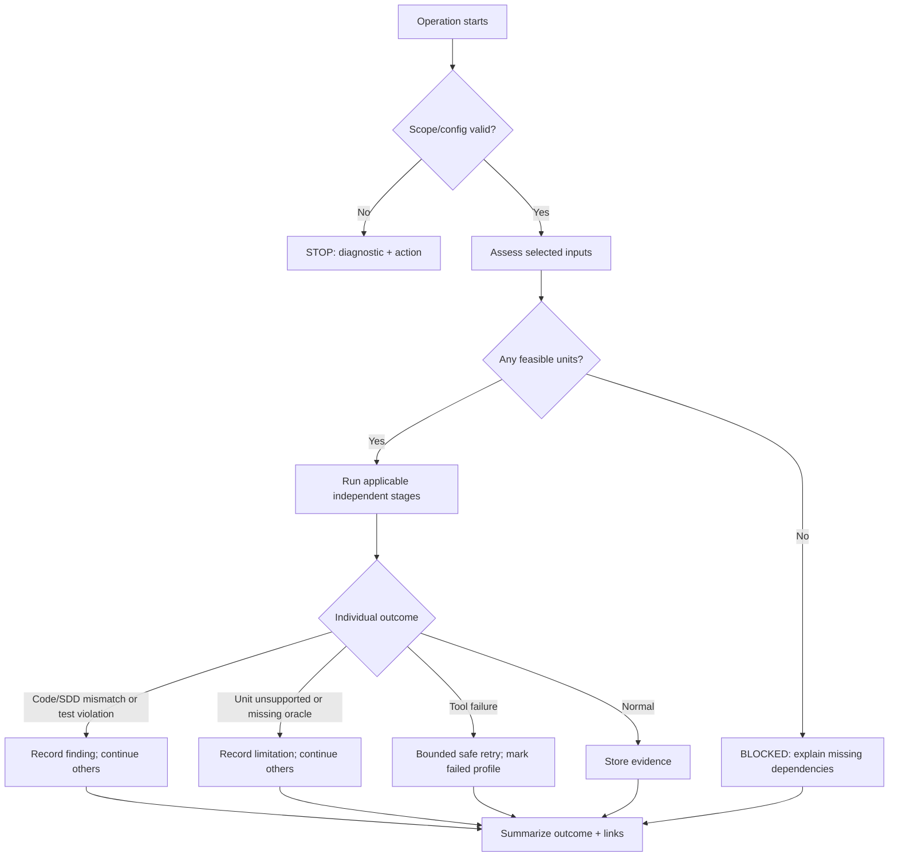

# Workflow failures, stopping rules and diagnostics

This page specifies the **user-visible failure contract** shared by the CLI, the headless Dagu workflow and the reports. The workflow engine is an internal implementation detail. Distinguish **workflow failure** from a successful test campaign that found defects in the code under test.



## Required classes and responses

| Error class / examples | Response | User action |
| --- | --- | --- |
| `CONFIG_INVALID`, `INPUT_MISSING`, paths outside selected scope, permission denied | **STOP operation** before execution; no implicit workspace scan | Correct `project.yaml`, path or access |
| `SNAPSHOT_MISMATCH`, missing recorded source revision | **STOP verify**, preserve prior runs | Restore exact input revision/snapshot or run `generate` on new inputs |
| `HOST_UNSUPPORTED`, missing proprietary SDK header, target intrinsic or ABI assumption | **BLOCK affected unit**; continue independent units; if none feasible, stop the campaign as blocked | Provide headers/build context, refine mock contract or accept explicit limitation |
| `SDD_GAP`, `SDD_CONFLICT` | No unsupported expected-value assertion; **UNDETERMINED requirement**, continue others | Clarify SDD and regenerate impacted tests |
| `LLM_AUTH`, `LLM_CONFIG`, invalid model route | **STOP LLM operation**; offline `verify` remains available | Fix user credential/CCR configuration |
| `LLM_NETWORK`, rate limit, transient upstream error | **Bounded retry**, then stop LLM operation and preserve proposals | Retry after connectivity/quota recovery |
| `TEST_ASSERTION`, sanitizer violation, reproducible fuzzer crash, mutant survivor | **Finding, not workflow failure**; preserve raw evidence and continue applicable independent checks | Inspect code/SDD recommendations and reproduction |
| `TEST_HARNESS_INVALID`, generated mocks/suite do not compile | Bounded repair of **generated** test code only; if exhausted, mark unit blocked or profile failed | Inspect generated bench and build diagnostics |
| `TOOL_FAILED`, incompatible LLVM/Mull version, runner crash, output parsing error | Mark profile `FAILED`; continue independent profiles if safe; final run **PARTIAL/FAILED**, never PASS | Inspect tool version, stderr, command and environment |
| `WORKFLOW_INTERRUPTED`, timeout, exhausted disk/memory, missing container | Checkpoint and atomically retain completed outputs; interrupted run remains non-successful | `mtm status`, fix issue and safely rerun |
| `EVIDENCE_INVALID`, corrupted manifest/failed atomic publication, secret detected in report | **STOP finalization**; never publish a conforming report | Restore/check storage, fix pipeline and rerun |

Retry only retryable infrastructure/network failures, with a **declared small limit** and reproducible attempt log. No automatic repeated retry of failed assertions, source code defects or missing SDD oracles. If a mutation/fuzz test exceeds its declared budget, mark `TIMED_OUT`, not `KILLED` or `PASS`.

Dagu's `retry_policy`, `continue_on`, timeouts and lifecycle hooks may implement these policies, but do not turn `continue_on` into an artificial SUCCESS. The wrapper must write a structured result for each step; dependent stages consume that result, not a raw shell exit code alone. Global retry requiring a scheduler is **not** a headless prerequisite. See [Dagu error handling](https://docs.dagu.sh/writing-workflows/error-handling) and [durable execution](https://docs.dagu.sh/writing-workflows/durable-execution).

## Public error interface

Every started operation returns a compact CLI message and, when a bench exists, saves its most recent status and details in `state/last-operation.json`; completed attempts also retain an immutable `evidence/<run-id>/status.json` and logs. `mtm status` displays current stage and last failure; `mtm status --json` emits the same machine-readable record. `mtm doctor` diagnoses host/Docker/CCR prerequisites, and `mtm report <run-id>` links failures and remediation.

Minimum error object: `operation_id`, `run_id` (when available), `stage`, `scope_id`, `status`, `category`, stable `code`, short `message`, `cause`, `action`, `retryable`, `attempts`, `log_path`, `input_reference` and `tool_name/version` when relevant. Report machine paths only within the project bench; redact tokens and sensitive headers.

```json
{
  "operation_id": "op-example",
  "stage": "native-compile",
  "scope_id": "platform_logic",
  "status": "BLOCKED",
  "category": "INPUT_LIMITATION",
  "code": "HOST_UNSUPPORTED",
  "message": "SDK interface unavailable for host compilation",
  "action": "Provide compatible header or approve the proposed mock assumptions",
  "retryable": false,
  "log_path": "state/logs/op-example.log"
}
```

Illustrative schema shape, **not an observed result**.

## Minimal CLI exit contract

| Exit code | Meaning |
| --- | --- |
| `0` | Operation completed with no blocking issues (the report remains authoritative about quality) |
| `10` | Verification completed and **found code/test failures**, preserved as evidence |
| `20` | Partial/incomplete verification due to blocked/undetermined selected scope |
| `30` | Tool, workflow, evidence or container failure |
| `40` | Invalid configuration/input snapshot or missing LLM authorization |
| `130` | Cancelled/interrupted by user |

When multiple conditions occur, surface the most severe operation-blocking category as the exit code and preserve **all** findings in JSON. `verify` does not depend on a reachable LLM. Interpretation can optionally explain technical errors using available evidence; its diagnosis is explicitly a **suggestion**, never a replacement for the deterministic error code.

A failed operation must finish with enough information for a developer to act without reading internal Dagu logs unless deeper investigation is needed.
