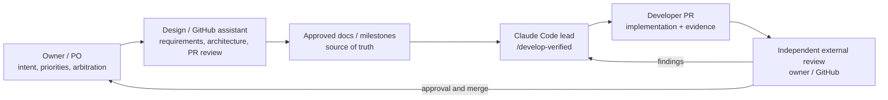
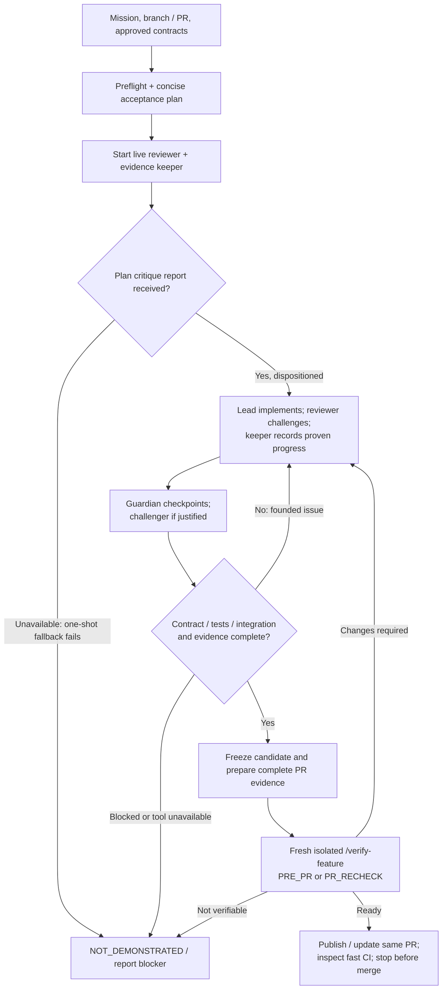

# Verified development agent — operating guide

> **Audience:** engineer operating Claude Code, reviewers, product owner (PO), and any assistant preparing development work.
> **Scope:** describes the *development process* currently versioned in this repository, **not** the uTest Machinery product's in-Docker test-generation agent. For a process rule conflict, [`CLAUDE.md`](../../CLAUDE.md), the [approved implementation plan](../plan/implementation.md), and applicable normative `docs/` take precedence. This page is explanatory, not a second specification.

## Where this agent sits in the end-to-end workflow



The owner explains the desired **outcome and constraints**, reviews trade-offs, and alone authorizes scope changes and progression to the next product milestone. An assistant may help formulate product architecture and specifications, edit GitHub documentation, propose implementation boundaries, and review PRs. Such edits only become approved requirements through the applicable owner decision and the normative repository documents; a chat response, PR comment, or agent hypothesis is not automatically a requirement. The developer agent implements the **approved** scope, not speculative product strategy. The [cross-project RETEX](llm-development-retrospective.md) discusses the whole chain and its failure modes.

This workflow is specific to the repository; the underlying roles and gates can be adapted to other projects without copying the embedded-C, Beads, WSL, or CCR implementation choices.

## Start: one command

Prerequisites: a cleanly understood local checkout; Claude Code, CCR, the configured provider and Beads installed/configured under the project's [developer setup](setup.md); GitHub access to the intended PR if handling feedback. Confirm installed versions and provider routing rather than assuming the terminal banner independently proves the upstream route.

From the repository root, in a **new interactive terminal session**:

```bash
CLAUDE_CODE_EXPERIMENTAL_AGENT_TEAMS=1 ccr "Claude DeepSeek Flash" cli
```

Inside Claude Code, supply a **single mission**:

```text
/develop-verified Implement the next approved milestone
/develop-verified Address all substantive review findings on PR #14
```

The user does **not** have to issue a second `/verify-feature` or `/goal` prompt. The lead follows [`.claude/skills/develop-verified/SKILL.md`](../../.claude/skills/develop-verified/SKILL.md), invoking review automatically. A user may still call `/verify-feature` explicitly for a standalone review; it is not a required extra step of this workflow.

**Mission modes:**

- **New approved feature (PRE_PR):** select exactly one current approved product milestone from the plan, develop a complete feature and open one PR after the appropriate acceptance gates.
- **Existing open PR (PR_RECHECK):** gather review bodies, inline threads, replies and PR discussion; correlate findings to the reviewed revision; fix the general violated contracts; add relevant contrasting tests; update **the same PR and Beads issue**. Do not start the next milestone.
- **Docs-only changes:** a standalone documentary task outside `/develop-verified` can follow its separate policy; **within `/develop-verified`, a fresh final independent LLM review is mandatory** even for docs-only implementation/correction. Truthful evidence, scope, privacy and owner/merge boundaries still apply.

## Who does what

| Actor | Starts when | Reads / checks | Writes | Authority / restriction |
| --- | --- | --- | --- | --- |
| **Lead developer** (main Claude Code conversation) | At entry | Scope, architecture, current branch/PR, Beads, test outcomes, agent findings | Product code, tests, required docs, PR content and Git operations | Integrates evidence, resolves justified findings, **never silently changes scope or merges** |
| **`implementation-reviewer`** (named teammate) | Plan and candidate checkpoints | Approved contracts, real PR merge-base, stable code and review feedback | Only its ignored atomic checkpoint report, no tracked writes | Independent bounded counterexamples, never another full qualification run; reports consumable without native messages |
| **`evidence-keeper`** (named teammate) | Early, parallel | Beads status, executed command/exit, inputs/revision, artifacts and evidence gaps | Ignored ownership ACK/RELEASE report; Beads and `worklog/` ONLY after lead-confirmed ACK | Single writer until release; never runs tests, idle does not release ownership |
| **`convergence-guardian`** (fresh, targeted subagent) | Plan, structural change, stall, before PR | Actual remote-base diff, rework and existing evidence | Nothing | Audits drift/stalls/minimality, no full pytest/Docker campaign |
| **`task-runner`** (optional background subagent or teammate) | When a bounded multi-step task can progress independently of useful lead work | Goal, stable inputs, permitted commands, isolation/budget | Only scoped scratch outputs; no tracked product/Beads/PR edits | Investigates or executes independently and returns actual results; never a substitute for native Bash background |
| **`test-challenger`** (fresh, optional subagent) | Material correctness risks | Normative inputs, SDD/oracles, negative/mixed cases and weak tests | Nothing | Suggests discriminating **in-domain** tests; does not impose optional edge cases |
| **`contract-reviewer`** (fresh independent NON-Team subagent via `/verify-feature`) | **Always** on stable `/develop-verified` candidate, including docs-only | Contracts, exact candidate fingerprint, revision-bound evidence and PR feedback | Only returns structured result; lead persists ignored copy | Bounded targeted checks; verdict READY / CHANGES_REQUIRED / NOT_VERIFIED before turn limit |
| **Owner / GitHub reviewer** | After PR opened/updated | User-visible behavior, design, actual evidence, risk and review feedback | Owner decisions and review/merge actions | Accepts or rejects scope changes; authorizes the next milestone separately |

Agent definitions are versioned under [`.claude/agents/`](../../.claude/agents/). A teammate can reason critically yet remain fallible; an isolated reviewer working with the same model is not mathematically or organizationally independent of that model. The instructions restricting `Bash` writes are **prompt constraints**, not an operating-system sandbox; apply isolated working directories, restricted mounts and permissions for untrusted or write-producing tests.

## End-to-end execution and gates



1. **Preflight:** inspect `git status`, base/head, merged changes, open PR and all substantive feedback; reconcile applicable `main` instructions, the approved milestone, Beads and the actual implementation. Never infer completion solely from an old checklist.
2. **Acceptance contract before coding:** identify required behavior, a small set of critical invariants and the command/observation needed to prove each one. Distinguish approved requirements from assumptions, ambiguities and optional suggestions. A reviewer can criticize the plan immediately.
3. **Checkpointed concurrent work:** lead first assigns distinct session-local ignored report paths and checkpoint IDs. The reviewer atomically writes its independent plan critique; the lead reads/dispositions it **before substantive implementation**. At a stable candidate, reviewer writes a separate candidate critique which the lead must consume before final verification. Native teammate messages merely notify; a quiet UI or `idle` is not proof of failure. Keeper atomically writes ACCEPTED/RELEASED ownership reports, and the lead confirms handoff before changing Beads/worklog writer. Use at most one bounded retry, inspect available inbox/state, then one-shot independent fallback if necessary; never resend identical ACKs repeatedly or permit two writers.
4. **Review-driven correction:** reproduce significant findings; repair the underlying contract, not only the reported example. Test neighboring cases when relevant (invalid/valid, mixed failures, state transitions, changed selection, persistence, tool crash).
5. **Convergence checkpoints:** ask the guardian for a proof-backed minimal correction when it sees out-of-scope edits, repeated fruitless iterations, unnecessary layers, weak tests or evidence tied to an older revision. *Minimal sufficient diff* includes required tests and documentation; it does not mean minimum line count.
6. **Qualification and asynchronous tests:** run targeted regressions during corrections, then a full applicable campaign on a stable candidate owned by lead or explicitly delegated task-runner. Reuse existing command/exit/revision/artifact results, not another suite per reviewer. Perform applicable local checks before CI. Run straightforward slow commands with native background Bash, whether tests or other jobs. Delegate to a `task-runner` only if it can independently perform meaningful multi-step work while the lead advances elsewhere; isolate mutable inputs and written outputs when needed. Join both kinds of results and rerun invalidated checks before the final gate. Where AP-02 applies, show at least one user-facing traversal of the **real** WSL/Docker/runner/LLM or distribution boundary. A simulated/mock response does not establish a real provider invocation. For C/SDD, protect original inputs and independently anchored test oracles.
7. **Evidence and candidate freeze:** pin current base/head or uncommitted file hashes; re-run affected tests after any later edits; record the actual command, output/exit code and evidence revision. Sync the single Beads item and worklog, reconcile risk/limitations, and prepare a complete PR description **before** the final review.
8. **Fresh final verification — ALWAYS:** invoke a fresh isolated, non-Team independent LLM on **every** `/develop-verified` stable candidate (including docs-only). Provide exact true merge-base/head, hashes of uncommitted inputs/evidence and PR comment snapshot as CANDIDATE_FINGERPRINT. Require an explicit returned structured verdict for that fingerprint before turns exhaust; never repeatedly resume an unchanged broad stress sweep. Invoke the existing [`/verify-feature`](../../.claude/skills/verify-feature/SKILL.md) / [`contract-reviewer`](../../.claude/agents/contract-reviewer.md), **not** the continuous reviewer. PRE_PR derives independent contract counterexamples; PR_RECHECK retrieves and classifies *all material PR comments* and corrections since the reviewed revision. `READY` with all mandatory local proof => PASS; `CHANGES_REQUIRED` => FAIL/BLOCKED and correction; `NOT_VERIFIED` or missing output => UNVERIFIED/BLOCKED. Material changes invalidate the prior fingerprint, affected test evidence and reviewer verdict; a revised stable candidate needs a fresh one-shot final review. The lead persists the received report in ignored scratch.
9. **Delivery boundary:** commit/push and open one PR or update the same open PR when mandatory gates pass; inspect short, credential-free CI. If a correction changes the candidate, invalidate and refresh relevant evidence. **Never auto-merge; never start the next product milestone without explicit owner approval.** After PR submission stop for external review.

This is a skill-described orchestration, **not** a guaranteed always-running background service, enforcement engine or fully isolated sandbox. The reviewer's LLM judgement remains probabilistic; the final gate's invocation, identity, input binding and outcome handling are the systematic part. If the live team cannot spawn or deliver a matching checkpoint artifact (for example with a CCR/provider integration), inspect its assigned report then available native inbox/status before declaring failure. After one bounded retry, use a fresh isolated one-shot subagent fallback and disclose degraded parallelism; never infer failure from a silent notification or fabricate communication. If fresh final verification, material PR feedback, mandatory tooling or evidence cannot be obtained, report the relevant gate as `NOT_DEMONSTRATED`.

## Evidence and document ownership

| Location | Purpose | Source of authority / how it is used |
| --- | --- | --- |
| `docs/` | Approved product architecture, requirements, interfaces and qualification | **Normative product authority**; owner arbitration must be reconciled here |
| `docs/plan/implementation.md` | Milestones and acceptance boundaries | Scope authority for the **current** milestone |
| `CLAUDE.md` and `.claude/` | Developer-agent policy, roles, skill implementation | Normative developer session procedure, subordinate to approved product scope |
| `worklog/log/`, `worklog/decisions/` | Dated observations, rejected attempts, decisions, superseded records | Detailed versioned developer memory; not a second product spec |
| Beads / `.beads/issues.jsonl` | Feature status, brief arbitration rationale, acceptance evidence by criterion | Beads is execution tracking; JSONL is an **export**, not a complete Dolt backup |
| GitHub PR | Delivered diff, changed behavior, executed checks, links to Beads and remaining limits | Reviewable delivery; does not replace source specs |
| `docs/project/risks.md` | Cross-PR risks and impact families | Independent risk review only; normal developer agents do not edit it |

Example compact evidence hand-off to the keeper (illustrative, **not** a claim that these commands ran):

```text
REVISION: base=<commit>; candidate=<commit or file hashes>
CRITERION: AP-01/feature-R2
COMMAND: <exact local command>
PROVENANCE: executor=<lead or task-runner>; exit=0; <relevant result/artifact path>
STATUS: DEMONSTRATED | NOT_DEMONSTRATED
FINDING: PR comment URL -> RESOLVED/PARTIAL/...; adjacent test
INVALIDATES: <earlier test or draft proof, if candidate changed>
```

Scratch checkpoint protocol: use ignored `.claude/.runtime-reports/<session-id>/`, distinct reporter-owned files, atomic write/rename, CHECKPOINT_ID and reviewed fingerprint. The lead consumes matching reports before proceeding. Only substantive disposition/evidence is promoted to Beads/worklog; scratch is neither a permanent report nor a new tracker. The final one-shot reviewer returns its report directly to the lead, which stores `final-verification.md` under that session directory. Don't commit scratch or include private runtime details in PRs.

The keeper checks run provenance rather than rerunning tests, and records only genuine state changes and essential links, not repeated narrative or pasted full logs. Keeper ACKs exclusive writer ownership and explicitly RELEASES it; lead fallback requires confirmed handoff/termination, not silence or idle. A final review cannot certify stale evidence: **revision changes invalidate the corresponding checks**. The lead must independently confirm important Beads/worklog claims at delivery.

## Operational guardrails

- Work within the repository and permitted local venv/container; request authorization before host/global installations or host configuration changes.
- Keep original C/headers/SDDs immutable and prevent silent oracle weakening. No accidental activation of product, router or application verbose logging; `worklog/` is **developer memory**, not runtime logs.
- No tokens, credentials, private gateway URLs, private host paths or unnecessary network details in commits or public PR evidence; review all added/tracked artifacts before publication (AP-05).
- Do not let the reviewer, guardian or challenger silently create new requirements, or let developer implementation claims become acceptance evidence by repetition.
- A failing workflow/tool is not a passing feature. A mandatory `NOT_DEMONSTRATED` blocks `READY` even if unit tests or CI are green.
- Do not require tests for unimplemented later milestones. Use bounded, risk-proportional independent checks, not combinatorial matrices as default.

## What is demonstrated — and what remains to be proved

**Observed in disposable local laboratory:** native teammate messaging (experiment 3); standalone `/goal` operation (experiment 5); parallel live reviewer, corrections and recheck (experiment 6); one-prompt developer/reviewer/keeper/challenger and fresh verifier with real Beads/worklog (experiment 7). In experiment 7, final local checks reported **21/21** unit tests and **12/12** separate contract checks; final verification reached `READY` **on its third pass** after PR-draft/evidence corrections. The experimental log was extensive and included revision-bound rechecks.

**Not established by these experiments:** a controlled improvement in real-project elapsed time or defect escape rate; reliable upstream CCR model attribution from every call; multi-agent safety enforcement by the OS; and an end-to-end run of this exact integrated skill on uTest Machinery PR feedback, publishing real GitHub corrections. The skill was integrated by [PR #18](https://github.com/aradenac/utest-machinery/pull/18); successful repository CI for that configuration is **not** proof that each agent path has run here.

See [RETEX across the entire PO → specification → implementation → review process](llm-development-retrospective.md) for the evidence, anti-patterns, transferable recommendations and measurement plan.

## Choose background Bash or a parallel task-runner

The default for a slow **single command** (tests, build, Docker run, download or local probe) is the built-in Claude Code Bash background task: launch, retain its task ID, continue with independent work if available, then inspect actual exit code/output. Do not spawn an LLM just to wait. If the result is a prerequisite for the next meaningful step, await it rather than inventing parallelism.

An optional [`task-runner`](../../.claude/agents/task-runner.md) is justified **only when all three conditions hold**: (1) the lead has useful independent work to do, (2) the long task can be isolated from concurrent edits and resource conflicts, and (3) autonomous multi-step execution or investigation adds value beyond one background shell command. Examples: a bounded multi-command qualification, comparative build diagnostic or independent dependency/environment investigation. Prefer a background subagent when a final result suffices, or a named teammate only when intermediate messages/coordination materially help. The worker returns completed facts and artifacts; it is neither an extra coder nor the final verifier.

Source revision safety is proportional: read-only investigation on stable files may use documented hashes; if the lead might change consumed inputs, use an isolated committed worktree **or a reproducible snapshot including necessary uncommitted inputs**. Outputs must remain separate. Evidence from revision A does not validate revision B. The lead joins mandatory results, asks the keeper to record only observed proofs, re-runs checks invalidated by edits and still calls fresh final verification. If delegation is unavailable, native Bash background mode remains the fallback. No detached daemon or new tracking system is required; real CCR + Agent Teams execution still needs validation.

## Reuse test results instead of re-running the same suite

A **single executor** (lead or assigned task-runner) owns each complete test/build/Docker campaign for a given input revision, command and environment profile. After a correction run targeted regressions; run the applicable complete campaign on a stable candidate and reuse its exact command/exit/artifacts in independent reviews. Other agents can challenge the contracts and assertions, or run *small distinct isolated probes* when a material claim is not demonstrated; they must not repeat the full campaign. A guardian's scope/diff audit should normally require **zero** test executions. The keeper records proof provenance without executing code. When changes invalidate relevant evidence, selectively rerun affected checks; do not cite old green logs for a newer candidate.

The final reviewer must be invoked systematically, classify the known material PR findings and return a structured verdict for the exact stable candidate fingerprint while turns remain. A credible incomplete check becomes NOT_VERIFIED with the smallest next step; repeatedly resuming an open-ended sweep without new evidence is not convergence. A teammate's `idle` status does not change assignment or Beads ownership.
