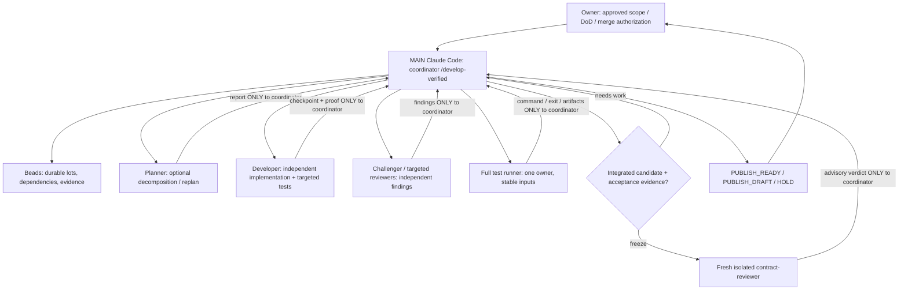

# Coordinator-led verified development — operating guide

> **Audience:** engineer operating Claude Code, independent reviewers and project owner. This is the *development workflow*, NOT the uTest Machinery product's in-container test-generation agent. The authoritative rules are [`CLAUDE.md`](../../CLAUDE.md), [`/develop-verified`](../../.claude/skills/develop-verified/SKILL.md) and approved product/qualification docs. This guide explains those rules without changing scope.

## Operating model



**One coordinator; no peer-to-peer specialist communication.** The coordinator translates approved acceptance into a small set of coherent lots, writes and owns Beads, assigns work, monitors state and proof, reprioritizes with minimal interruptions, integrates results, triggers tests and decides publication. The developer is a genuine autonomous technical specialist: it chooses its implementation and may refute findings with evidence, but it cannot change overall priorities, the approved requirements, Beads, PR or run full qualification on its own. Reviewers return exact evidence to the coordinator, not to the developer. The coordinator evaluates material objections `ACCEPT/REJECT/DEFER` without a vote or reflexive patch; only the owner changes normative scope or authorizes a merge.

**Do not turn delegation into a ceremony.** One developer is default; optional planner for uncertain decomposition or changed strategy, early test-challenger when substantive correctness risk exists, targeted reviewer on meaningful stable snapshots, guardian only on actual drift/stall, and one mandatory fresh bounded final verifier. Team agents are experimental; simple isolated one-shot tasks may suffice. If delegation fails, report the limitation rather than simulating an agent or having the coordinator silently develop.

## Start: one prompt

From a cleanly understood repository checkout in WSL:

```bash
CLAUDE_CODE_EXPERIMENTAL_AGENT_TEAMS=1 ccr "Claude DeepSeek Flash" cli
```

Agent Teams is **optional** and must be verified against the installed Claude Code + CCR + provider; do not assume the CLI banner proves the underlying model or Teams delivery. Then request exactly one approved job:

```text
/develop-verified Implement the next approved milestone
/develop-verified Correct the substantive remaining findings of PR #14
```

No separate user `/verify-feature` prompt is needed. `NEW_FEATURE` implements one approved milestone and opens ONE PR; `PR_RECHECK` reads relevant reviews, corrects and updates the SAME PR. The coordinator **stops after PR publication**, awaits owner review and never auto-merges or starts the next milestone.

## Plan → Beads → specialist missions

1. **Preflight:** inspect true remote merge-base, local changes, existing PR/review context, merged instructions, product DoD, current Beads feature item and previous worklog/evidence.
2. **Finite contract:** enumerate approved criteria, invariants, contrasting successful/faulty cases and proof needed. A speculative reviewer suggestion is not a new requirement.
3. **Backlog:** coordinator reuses a few durable Beads work items, groups findings by common cause/invariant, considers dependencies and cost; optional native Tasks reflect only current session's executable assignments. A planner can propose but cannot write tasks. Do not atomize into one issue per assertion/reviewer comment.
4. **Dispatch:** each mission specifies `MISSION_ID`, lot/Beads ID, technical goal, approved contract, stable snapshot/hash, exclusive edit/output paths, budget, report location and finish condition. Default one developer. For true parallel code edits, use isolated worktrees and disjoint file ownership; coordinator integrates.
5. **Event-driven reconciliation:** at reports, completed Tasks, meaningful checkpoints, test results or detected blockers, coordinator reads actual agent state and fingerprint-bound reports, updates Beads once for meaningful changes, decides continue / reprioritize / targeted review / integrate. An IDLE notification means waiting, not proof of completion. No continuous ping or status narration.
6. **Convergence:** after two different failed correction strategies, request bounded plan reevaluation/guardian and change approach; do not repeat a serial review-patch loop. New proved mandatory regressions matter; old hypotheses without new proof do not reopen resolved work.

## Central report routing and bounded recovery

Specialists communicate ONLY with the coordinator through native task results/messages and, when Agent Teams support it, atomic ignored reports. Reports state `MISSION_ID`, `FINGERPRINT`, `STATUS`, findings or produced files/commands/true exits, and necessary next decision. The coordinator forwards only relevant accepted work to developer after checking what it is currently doing; developer may challenge the technical claim and return counter-evidence to coordinator.

Use ignored `.claude/.runtime-reports/<team-name>/` for **optional** Team receipts; it is a short-lived checkpoint area, never a new backlog, not committed. Coordinator may write `missions/<teammate-name>.json`:

```json
{"active":true,"mission_id":"m-01","fingerprint":"commit-or-effective-input-hash","report":".claude/.runtime-reports/<team-name>/developer-m01.md"}
```

The teammate's **atomic** report contains these literal headers, followed by proof:

```text
MISSION_ID: m-01
FINGERPRINT: commit-or-effective-input-hash
STATUS: COMPLETED
```

The **project-level** `TeammateIdle` command hook (installed in `.claude/settings.json` so teammates can load it) checks an *explicitly assigned* active receipt: if it cannot find a matching completed report, it requests **one** immediate handback (exit 2) and creates one ignored retry marker per mission/fingerprint. Subsequent idle is allowed. This does **not** prove the agent finished, wake a stalled model, monitor elapsed time, or guarantee that the hook runs in a teammate's process; inspect actual `/hooks` and Team behavior under CCR. The coordinator owns further recovery: read report then task/teammate state, make one bounded resume request, terminate or confirm takeover before replacing an agent, use one isolated fallback when essential and otherwise declare `NOT_VERIFIED`/DRAFT/HOLD. Optional advice never blocks. **Do not regard missing native messages as missing files or IDLE as crash.** The existing `SubagentStop` (short handback), opt-in native Task `Proof-file:` and `Stop` (READY while active background tasks) remain.

Star routing is a **workflow contract**, not an OS permission guarantee. Claude Code can technically permit direct teammate messaging. Verify compliance in real sessions; a bypass is not a valid task or Beads instruction. Do not change global Claude configuration, launch a polling daemon or invent a persistent queue.

## Tests, reviews and decision ownership

| Stage | When | Executor / proof |
| --- | --- | --- |
| **Focused checks** | Developer finishes coupled surfaces of a lot | Developer executes isolated positive/negative regressions with command/exit/snapshot, free to iterate without coordinator approval on each test. |
| **Early independent challenge** | Material oracle/type/scope/state risk | Coordinator launches one `test-challenger` on contract and stable inputs; finding returns to coordinator, not directly to developer. |
| **Targeted critique** | Stable lot checkpoint; only when useful | `implementation-reviewer` inspects exact fingerprint without full-suite rerun; developer can work on a disjoint lot. |
| **Full campaign** | Coordinator integrated/froze suitable candidate | ONE designated owner: native background Bash for one command or isolated `task-runner` for multi-step test campaign. Never duplicate concurrent Docker/pytest/CI work. |
| **Final gate** | DoD evidence joined and candidate frozen | ONE fresh independent non-Team `contract-reviewer` via `/verify-feature` OR equivalent direct Task. Advisory READY/CHANGES_REQUIRED/NOT_VERIFIED. At most one fallback if no usable handback. |

**Revision fidelity:** freeze remote merge-base, effective tracked/untracked source and test/config hashes, profile, flags, container/compiler version and evidence inputs. If a full campaign is slow, isolate a committed/snapshotted worktree or stop editing consumed files; compare effective-input fingerprints **before AND after**. An exit-0 on moved inputs is stale, not final proof. Metadata-only worklog/Beads/PR text changes do not invalidate unchanged executable test evidence. Reuse affected/unaffected proof appropriately, do not repeat full suites per review.

**Meaningful quality:** real C/Unity/Ceedling compilation + behavioral correct/faulty SUT contrasts for generator type/call/oracle changes; AP-01 acceptance evidence, AP-02 real user/environment path, AP-03 state transitions, AP-04 concise work memory, AP-05 no secret leakage. Critiques do not invent new mandatory gates and never independently run full suites. R04/R22/R24 boundaries and original C/SDD immutability remain.

The coordinator chooses `PUBLISH_READY` only with complete applicable mandatory proofs, no objectively unresolved mandatory defects and a usable fresh final independent review. A false reviewer objection may be technically rejected with evidence; missing proof or an unavailable review requires `PUBLISH_DRAFT` with explicit gaps or `HOLD`. Normal fast CI follows PR creation if required, **not** as a debugging/test replacement. Explicit owner instructions can request a merge without waiting on CI; otherwise stop for owner review.

## Existing mechanisms retained

- **Beads** is the durable feature backlog/evidence; `worklog/` is dated working memory; PR is delivery; `docs/` is normative product authority. An optional evidence-keeper may write Beads/worklog ONLY after exclusive `ACCEPTED` and before `RELEASED`, with no parallel coordinator write; it never modifies code/tests.
- **Tests:** one runner per full campaign; targeted tests by developer; genuine correct/faulty counterexamples; actual compiler/host/LLM proof where applicable; no new custom test framework.
- **Review:** early challenger, optional stable-snapshot critiques, guardian when actually stuck, independent bounded final gate, explicit proof-backed `ACCEPT/REJECT/DEFER`. No reviewer veto or unbounded retries.
- **Async:** native background Bash for a single long command, isolated `task-runner` for bounded multi-step tasks. Task state can lag; check artifacts and native state rather than blindly trusting status. One-shot agent results are a valid fallback if Agent Teams/CCR delivery fails.
- **Release:** coordinator prepares one PR, performs diff hygiene and credential review, reports exact checks and gaps, and stops before owner-authorized merge.

This process is **not** an always-running autonomous service or automatic permission isolation. The observed PR #14 convergence problems motivate the refactor but do **not** demonstrate that the new workflow is faster: compare actual wait/retry cycles, stale reviews, full-suite duplicates, defect discovery timing and human intervention during the next approved feature. Do not add another tracker or a dedicated background supervisor just to measure it.
