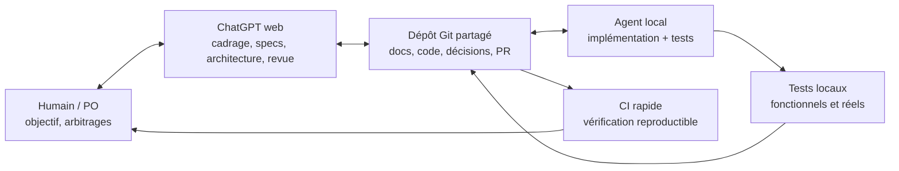

# RETEX — Développer un produit logiciel avec des LLM

**Question de départ :** si je crée demain un autre produit, dans n'importe quel langage ou domaine, comment exploiter les LLM pour arriver **le plus vite possible au produit réellement voulu** ?

Ce retour d'expérience concerne **l'organisation du travail**, pas un modèle ni un projet particulier. L'objectif est de réduire le temps entre une intention approuvée et un incrément **utilisable, vérifié et accepté** — pas de maximiser le code, les agents ou les tokens. Les avantages décrits sont qualitatifs, pas des gains de performance mesurés.

## 1. L'organisation recommandée

**Oui : ChatGPT web + agent local + dépôt Git partagé + Beads (ou issues) + tests locaux + CI est une combinaison efficace en principe.** Sa force vient de la **séparation des responsabilités** et de la mémoire partagée, pas d'une magie multi-agent.

| Élément | Rôle souhaitable |
| --- | --- |
| **Humain / PO** | Dire **quoi** obtenir et **pourquoi**, clarifier les priorités, arbitrer les options, accepter ou refuser les écarts. |
| **ChatGPT web** | Partenaire de réflexion : transformer l'intention en exigences, architecture, critères de succès, plan de livraison et modifications documentaires GitHub ; aider à relire les PR. Il ne présume pas les décisions du PO. |
| **Agent de développement local** | Lire le vrai dépôt, planifier brièvement, coder, exécuter les tests, corriger et préparer une PR. Il a de l'autonomie sur **comment** réaliser le scope approuvé. |
| **Git et PR** | Interface et **source de vérité versionnée** entre les deux LLM et l'humain. Une décision importante doit être retrouvable ici, pas seulement dans un chat. |
| **Beads / issue tracker** | Mémoire **d'exécution** : tâche active, état, dépendances, findings, arbitrages et preuves de réception. Les spécifications restent dans les docs ; les logs détaillés éventuels restent ailleurs. |
| **Tests locaux / CI / revue** | L'agent vérifie localement les cas et parcours réels avant la PR ; la CI reproduit rapidement les contrôles essentiels ; la revue indépendante puis humaine juge les contrats et les limites. |

**Limite structurante :** ChatGPT web voit les décisions et GitHub ; l'agent local voit le code, ses outils et ses résultats d'exécution. Ils n'ont pas automatiquement le même contexte. **Le dépôt, les tickets et les PR servent de contrat de transfert.** Ne pas se fier à la mémoire conversationnelle pour synchroniser les deux.

## 2. Ce qui a bien fonctionné : à conserver

- **Dialogue PO ↔ assistant souple et progressif.** Explorer des variantes, corriger une proposition et changer d'avis avant de coder est rapide ; l'assistant doit distinguer *décidé*, *proposé* et *à clarifier*.
- **Architecture et specs versionnées, mais concises.** Écrire le comportement observable, les interfaces, les erreurs importantes et les critères d'acceptation. Les choix retenus sont ensuite lisibles par tous les agents et reviewers.
- **Un incrément utile à la fois et une PR cohérente.** Implémenter une capacité complète, corriger **la même PR** après revue, attendre un accord avant le prochain jalon.
- **Agent local autonome, orienté preuves.** Un seul prompt peut lui faire préparer le plan, implémenter, tester et documenter les résultats. Les tests doivent concerner la vraie utilisation, pas seulement les fonctions internes.
- **Beads pour la reprise sans perte de contexte.** Associer l'issue au jalon, aux décisions et aux critères réellement démontrés. Cela facilite changements de session, corrections longues et synchronisation avec GitHub.
- **Revue critique indépendante.** Un autre contexte peut révéler des cas manquants avant la PR et recontrôler les correctifs ; la revue humaine reste nécessaire pour accepter le produit et son périmètre.
- **Tests locaux approfondis, CI courte.** Déboguer près du code ; garder la CI rapide, déterministe et sans secrets. Une CI verte ne remplace pas un test d'installation, d'intégration ou de service réel quand celui-ci est pertinent.

## 3. Ce qui a ralenti la convergence

| Écueil | Correction de méthode |
| --- | --- |
| **Décisions laissées dans le chat ou documents contradictoires** | Après chaque arbitrage, mettre à jour **une seule source normative** dans Git. Le ticket suit l'avancement, il ne redéfinit pas le produit. |
| **Exigences « raisonnables » inventées par l'assistant ou le reviewer** | Partir du besoin exprimé. Soumettre toute nouvelle contrainte comme **option**, sans l'imposer dans les specs ou les tests. |
| **Trop de conception, de règles et d'outils trop tôt** | Spécifier le **prochain incrément**, réutiliser les outils existants ; n'ajouter couche ou agent que s'il résout un obstacle observé. |
| **Tests verts mais parcours utilisateur non prouvé** | Vérifier les frontières réelles : installation, configuration, permissions, erreurs, état persistant et services, selon le produit. Ne pas confondre mocks et environnement réel. |
| **Correctifs limités au symptôme d'une revue** | Identifier le **contrat général violé**, tester des cas voisins/contraires pertinents et relancer les régressions avant de demander une nouvelle revue. |
| **Preuves et journaux volumineux ou périmés** | **Beads = état et critères ; PR = livraison ; journal éventuel = chronologie.** Référencer commits/hashes et résultats observés, sans recopier toutes les traces. |
| **Trop d'agents ou d'allers-retours entre LLM** | Un lead responsable ; reviewers ponctuels aux jalons ; messages courts : *constat → preuve → correction minimale*. Un agent `idle` est normal, pas une panne. |
| **PR relue avant d'être vraiment prête** | Finaliser code, tests, Beads et description de PR **avant** la vérification finale ; tout changement significatif invalide les preuves concernées. |

Le ralentissement majeur est souvent **la découverte tardive d'un mauvais contrat ou d'une preuve incomplète**, plus que le temps nécessaire pour écrire le code.

## 4. Si je recommence demain : procédure simple

**1 — Cadrer avec ChatGPT web.** Décrire le problème, les utilisateurs, le premier résultat utile et les contraintes explicites. Examiner les options d'architecture, puis choisir. Ne pas laisser l'assistant transformer ses hypothèses en exigences.

**2 — Créer le minimum de documentation dans Git.** Un `README` (but/usage), quelques exigences et critères observables, les choix d'architecture essentiels, une liste d'incréments, une instruction d'agent (`AGENTS.md`, `CLAUDE.md` ou équivalent). Pour un petit utilitaire, plusieurs de ces éléments peuvent tenir dans un seul fichier.

**3 — Initialiser Beads ou des issues.** Un ticket par capacité ou correction significative, avec statut, dépendances, décision utile et critères de réception. Ne pas dupliquer les specs. Pour un projet minuscule, une simple liste GitHub Issues suffit ; Beads prend surtout de la valeur avec plusieurs sessions et des agents autonomes.

**4 — Donner une seule mission claire à l'agent local.** Périmètre approuvé, contraintes, résultat observable, commandes/preuves attendues, fichiers à préserver, livraison sous forme de PR. L'agent inspecte Git, fait un plan court, puis implémente et vérifie sans demander une instruction humaine à chaque détail.

**5 — Tester avant publication.** Exécuter localement les tests ciblés et au moins un parcours utilisateur réel lorsque le changement touche une interface ou un environnement. Préparer les preuves dans le ticket et la PR. Laisser la CI rejouer rapidement les vérifications reproductibles.

**6 — Relire et corriger sur la même PR.** ChatGPT web ou un reviewer examine le besoin, le diff, les tests et les cas manquants ; chaque finding fondé conduit à un correctif du contrat et à un test pertinent. Ne pas fusionner automatiquement au seul motif que l'agent ou la CI annonce « OK ».

**7 — Améliorer la méthode seulement après observation.** Si plusieurs boucles échouent, revoir le contrat, les tests ou l'orchestration. Ajouter éventuellement un reviewer de plan, un **evidence keeper** ou un **convergence guardian**, mais pas tous par réflexe. Transformer les enseignements durables en consignes courtes versionnées.

## 5. Le critère pour savoir si cette méthode est efficace

Observer prioritairement **le temps écoulé jusqu'à une PR réellement acceptable**, puis **le nombre de tours de correction/revue** et **les défauts découverts tardivement**. Suivre aussi le temps perdu à synchroniser ChatGPT, l'agent, GitHub et Beads. Les tokens et les lignes modifiées sont des coûts, **pas** une mesure directe de réussite.

Une orchestration multi-agent n'est meilleure que si ses vérifications précoces **évitent plus de reprises qu'elles ne créent de coordination**. Aucun dispositif ne dispense le PO d'arbitrer le besoin ni ne transforme une vérification LLM en preuve infaillible.

**Principe à retenir :** *dialoguer librement pour définir le bon produit ; figer uniquement les décisions acceptées dans Git ; déléguer l'exécution à un agent local ; suivre le travail dans Beads ; accepter chaque incrément sur des tests et des preuves réels, puis corriger la méthode là où les retours montrent un ralentissement.*
