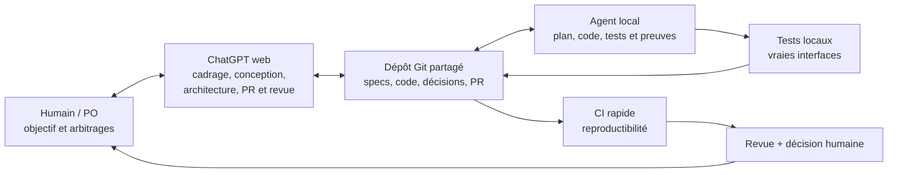

# RETEX — Comment développer efficacement un logiciel avec des LLM ?

**Question :** si je démarre demain un autre projet, avec un langage, un métier et des objectifs différents, comment organiser les LLM pour obtenir le **bon produit le plus vite possible** ?

Ce document retient les leçons **de méthode** issues d'une pratique de développement assisté par LLM. Ce n'est ni un journal d'incidents, ni une recommandation de modèle particulier, ni une spécification de projet. Les bénéfices sont des constats qualitatifs et des hypothèses à éprouver ; aucun gain chiffré de productivité n'est établi.

## 1. Le verdict : une chaîne d'outils complémentaire, pas un « super-agent »

**Oui, l'organisation « ChatGPT web + agent de développement local + dépôt Git partagé + gestion des tâches + tests locaux + CI » est pertinente.** Elle sépare la **définition du bon produit** de son **implémentation**, tout en laissant des artefacts vérifiables entre les deux. Le dépôt partagé est la mémoire commune durable ; la conversation ne doit pas être la seule source de vérité.

| Acteur / outil | Sa valeur principale | À ne pas lui demander |
| --- | --- | --- |
| **Humain / PO** | Exprimer le besoin, corriger la trajectoire, choisir les compromis et accepter les résultats | Décrire chaque détail d'implémentation ou rejouer les tests de l'agent |
| **ChatGPT web** | Transformer des échanges en objectifs, options, exigences, architecture, plan et contenu GitHub ; aider à relire les PR | Déduire des exigences non exprimées, confondre proposition et décision, certifier un test local qu'il n'a pas exécuté |
| **Agent local** | Lire le vrai code, implémenter, exécuter les outils et tests, corriger les erreurs, produire une PR avec preuves | Changer silencieusement le besoin ou l'architecture, s'auto-déclarer accepté |
| **Git + PR** | Point de passage partagé, versionné et révisable entre conversation, conception et exécution | Servir uniquement de stockage de code : les décisions importantes et critères doivent aussi y être retrouvables |
| **Beads (ou autre issue tracker)** | Suivre tâche active, dépendances, état des findings, décisions utiles et preuves de réception | Devenir un deuxième cahier des charges ou un copier-coller de chaque log |
| **Tests locaux + CI** | Tests locaux complets et rapides à itérer ; CI courte pour reproduire indépendamment les contrôles essentiels | Faire croire qu'une CI verte prouve tous les parcours et contraintes du produit |

Cette répartition est efficace **si le transfert entre acteurs est explicite**. Deux conversations LLM ne partagent ni automatiquement les mêmes hypothèses ni les mêmes preuves. Git, issues et PR réduisent cette rupture ; ils ne la suppriment pas.

## 2. Ce qui fonctionne : à conserver

- **Discuter librement du produit avec un assistant de conception.** Le PO peut décrire un résultat, réagir à une proposition, demander des alternatives, changer d'avis. Cette souplesse est plus productive qu'exiger un cahier des charges parfait dès le premier message.
- **Écrire les décisions dans le dépôt.** Une spécification concise, une architecture et des critères d'acceptation versionnés permettent au développeur de repartir d'un contrat vérifiable, sans dépendre de la longueur ou de la mémoire du chat web.
- **Faire intervenir l'agent local sur un périmètre approuvé.** Il connaît l'état réel du dépôt, peut construire, tester, inspecter le diff et corriger immédiatement. Un prompt de mission clair peut déclencher plan, implémentation, vérification et préparation de PR.
- **Découper par incréments utilisables.** Une capacité visible et ses cas d'erreur, livrée dans une PR cohérente, est plus facile à accepter qu'un empilement de couches techniques ou dix PR artificiellement minuscules.
- **Employer Beads pour la continuité de travail.** Un ticket garde le *quoi*, l'état courant, les décisions pertinentes, les écarts ouverts et les preuves associées aux critères. C'est particulièrement utile quand l'agent change de session, perd son contexte ou reprend une PR après plusieurs revues.
- **Séparer tests locaux et CI.** L'agent développeur doit faire tourner *avant publication* les vérifications pertinentes, y compris un vrai parcours d'utilisation lorsque nécessaire. La CI refait rapidement des checks déterministes et sans secrets ; elle ne sert pas de premier environnement de débogage.
- **Réviser les contrats indépendamment de l'auteur du correctif.** Un reviewer à contexte neuf peut trouver un cas oublié ; les commentaires de PR donnent une boucle de correction traçable. L'acceptation finale reste humaine.
- **Versionner les consignes de l'agent.** Une instruction courte sur son autonomie, les contraintes, la preuve attendue et les règles Git vaut mieux que répéter le protocole complet à chaque mission.

## 3. Les principaux ralentissements et leurs remèdes

| Écueil | Pourquoi il ralentit | Réponse pratique |
| --- | --- | --- |
| **Le PO et l'assistant pensent être d'accord, mais la décision reste dans le chat.** | L'agent et la revue travaillent sur des contrats différents ; le même sujet est rediscuté. | À chaque arbitrage réel, mettre à jour la **source normative** dans Git ; distinguer clairement *décidé*, *proposé* et *à clarifier*. |
| **L'assistant invente des besoins « raisonnables ».** | Un périmètre trop large fait perdre du temps et augmente la maintenance. | Formuler objectif, entrées/sorties, contraintes **demandées** et critères de succès ; présenter le reste comme des options, pas des obligations. |
| **Trop de conception ou de documentation avant un premier usage.** | Le travail s'étend sans retour concret ; plusieurs documents redisent les mêmes choses. | Spécifier juste assez pour développer et vérifier le prochain incrément ; documenter les contrats durables, pas chaque discussion. |
| **Une PR passe les tests mais échoue à l'usage.** | Les tests de fonctions ignorent installation, configuration, permissions, vrais services et transitions d'état. | Exiger au moins un **parcours représentatif de bout en bout** pour chaque frontière nouvelle ; distinguer mode mock et système réel. |
| **Les correctifs répondent au symptôme de la revue.** | Les variantes voisines réapparaissent, provoquant plusieurs cycles de relecture. | Pour chaque finding : identifier l'**invariant violé**, corriger la cause et tester quelques cas contrastés/mixtes pertinents. |
| **Le reviewer ajoute des exigences qu'aucun utilisateur n'a demandées.** | Surqualité, abstractions et cas limites artificiels. | Classer les retours : défaut prouvé / manque de preuve / ambiguïté / suggestion facultative. Le PO tranche les extensions de scope. |
| **Les preuves sont recopiées partout ou deviennent périmées.** | Beads, journal, PR et commentaires se contredisent ; la revue porte sur une autre révision. | **Beads = état et critères ; worklog éventuel = historique ; PR = livraison.** Lier les preuves aux commits/hashes ; réévaluer après changement. |
| **Trop d'agents discutent au lieu de converger.** | Coordination, tokens et retours redondants dépassent la valeur des findings. | Un **lead responsable**, des rôles limités, des reviewers déclenchés aux jalons ; un agent `idle` est normal. Ajouter un guardian seulement si dérive ou boucles récurrentes. |
| **Le web et l'agent local ont des visions divergentes du dépôt.** | Instructions obsolètes, branches non réconciliées, PR commentée sur un ancien commit. | GitHub comme point de synchronisation : consulter `main`, branche, PR, commentaires et état Beads **avant** chaque reprise ; ne pas se fier au résumé du chat. |
| **Outils ou modèles instables, permissions mal définies.** | Relances inutiles, appels qui échouent, résultats non reproductibles et accès hôte non souhaité. | Vérifier routage/version/droits en début de session, sandboxer, borner retries et prévoir un repli honnête ; ne jamais déclarer une délégation ou un test réussi sans résultat. |

Le ralentissement **le plus coûteux** n'est souvent pas l'écriture du code : c'est découvrir tard que le travail ne correspondait pas à la bonne exigence, ou qu'une vérification avait testé autre chose que le parcours attendu.

## 4. Si je recommence un projet demain : méthode de démarrage

**1 — Définir le produit, pas la solution.** Avec ChatGPT web, préciser les utilisateurs, le problème, le premier résultat réellement utilisable, les contraintes explicites et ce qui ne doit *pas* être fait. Faire proposer des choix d'architecture si nécessaire, puis les arbitrer en tant que PO. Le chat sert à raisonner ; les décisions acceptées vont dans Git.

**2 — Créer un dépôt minimal mais durable.** Au départ, suffisent généralement : un `README` de vision/usage ; une courte page de **besoins et critères d'acceptation** ; les **choix d'architecture** qui ont un impact réel ; un **plan d'incréments** ; un `CLAUDE.md` / `AGENTS.md` ou équivalent pour les règles de l'agent. Adapter la quantité de documents à la taille du projet : un utilitaire de deux jours ne nécessite pas le dispositif d'un produit industriel.

**3 — Créer les tâches et les liaisons.** Dans **Beads** (ou GitHub Issues/autre outil), conserver un item par incrément ou correction significative, son état, les dépendances, les décisions courtes et les critères/observations de réception. **Les specs restent dans les docs** ; Beads sert à savoir *où l'on en est* et à reprendre après interruption. Un journal chronologique séparé peut être utile pour les travaux complexes, pas obligatoire pour tous les projets.

**4 — Donner une mission complète à l'agent local.** Lui faire lire les docs et l'issue, vérifier l'état de Git, proposer un **plan bref** et les preuves à produire *avant* de coder. Ensuite il implémente, teste, corrige et prépare **une PR**. Le PO ne doit pas micromanager chaque ligne ; il intervient sur les arbitrages de produit ou les changements majeurs.

**5 — Vérifier en deux temps.** D'abord l'agent exécute localement les tests ciblés et, quand nécessaire, un scénario **réel de bout en bout**. Ensuite la CI rejoue un sous-ensemble rapide, reproductible et adapté au risque. Une CI verte sans preuve locale suffisante ne clôt pas le besoin.

**6 — Relire la PR comme un contrat.** Avec ChatGPT web et/ou un reviewer indépendant, examiner la conformité au besoin, les écarts d'architecture, les cas oubliés, le diff inutile et les preuves réellement exécutées. Pour chaque problème : commentaire GitHub précis → correction **sur la même PR** → nouveaux tests → nouvelle revue. L'agent ne fusionne pas de son propre chef.

**7 — Capitaliser seulement l'enseignement réutilisable.** Après un détour coûteux, décider si la cause relève d'une spécification ambiguë, d'une mauvaise séparation des responsabilités, d'un manque de test ou d'un outil fragile. Corriger **le bon endroit** (spec, instruction agent, suite de tests, workflow), plutôt qu'ajouter une règle partout.

## 5. Règles de pilotage pour converger vite

- **Le PO décide quoi et pourquoi ; l'agent décide comment dans le cadre approuvé.** ChatGPT web aide à faire le pont, mais ne remplace pas l'arbitrage du PO.
- **Le plus petit changement *suffisant* gagne.** Le diff justifié inclut les tests, les correctifs d'erreur et les documents nécessaires ; il exclut les abstractions anticipées et les cas hors scope.
- **La preuve doit précéder la déclaration « prêt ».** Un critère obligatoire non démontré reste explicitement ouvert. La revue finale ne doit intervenir qu'après préparation complète du candidat (code, tests, décisions, Beads, description de PR).
- **L'indépendance est graduelle.** Un deuxième LLM apporte un autre contexte et des contre-exemples, pas une garantie d'impartialité ; conserver des tests déterministes et une décision humaine.
- **Ne pas automatiser par principe.** Reviewer parallèle, keeper, guardian et skills ont de la valeur lorsqu'ils évitent plus de reprises qu'ils ne coûtent de coordination. Commencer simple, ajouter un rôle sur un problème répété et mesuré.
- **Mesurer le bon résultat :** temps de l'intention approuvée à une PR réellement acceptable, nombre de tours de revue, défauts découverts tardivement et charge de synchronisation. Tokens et lignes de code sont des coûts secondaires, pas la définition du succès.

### Bilan en une phrase

**La bonne exploitation des LLM consiste à faire dialoguer librement l'humain avec un assistant de conception, formaliser leurs décisions dans un dépôt partagé, déléguer l'exécution à un agent local autonome mais borné, et accepter le travail sur des preuves réelles — pas sur l'assurance d'un modèle ni sur une CI simplement verte.**
