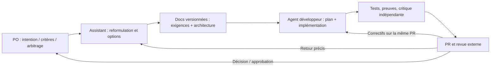

# RETEX — Développer un produit avec des LLM : converger vite vers le **bon résultat**

> **Périmètre :** retour d'expérience transversal sur la collaboration **commanditaire / Product Owner (PO) → assistant d'analyse et de conception → GitHub et documentation → agent de développement → vérification → revue externe → arbitrage du PO**. Il ne s'agit **pas** d'un RETEX sur le seul générateur de tests C, ni d'une règle supplémentaire pour uTest Machinery.
>
> **État des preuves :** observations de PR réelles et de laboratoires isolés disponibles au **18 octobre 2026** ; conclusions générales et pistes d'amélioration signalées séparément. Les chiffres ne constituent pas une comparaison statistique à méthode constante. Le [guide de l'agent](agent-development-workflow.md) décrit le fonctionnement technique en vigueur dans ce dépôt.

## 1. La cible : la convergence, pas la production de code

L'objectif n'est ni le maximum de lignes générées, ni le minimum de tokens, ni une démonstration spectaculaire d'autonomie. Il est de **réduire le temps écoulé entre une intention métier et un changement effectivement acceptable**, conforme au besoin, aux décisions du PO, à l'architecture retenue, aux contraintes techniques et à des preuves de fonctionnement reproductibles.

Une PR peut être *verte* et **ne pas être prête** ; une implémentation très courte peut être insuffisante ; une multitude d'agents peut consommer plus de temps en coordination qu'elle n'en épargne. Le bon optimum est un **diff minimalement suffisant** (comportement + tests + documentation/preuves nécessaires), avec une détection précoce des mauvaises hypothèses et une possibilité de reprendre le travail sans perdre les décisions.

**Boucle complète à optimiser :**

Chaque passage ajoute une possibilité de malentendu, de dérive de périmètre, de preuve insuffisante ou de relecture trop tardive. Accélérer uniquement le codage ne garantit donc rien sur le délai final.

## 2. Ce qui est effectivement observé (pas encore prouvé universellement)

| Source | Observation documentée | Portée et limite |
| --- | --- | --- |
| [PR #5](https://github.com/aradenac/utest-machinery/pull/5), jalon initial | Plusieurs revues ont été nécessaires ; la [revue des risques](../project/risks.md) en retrace **quatre** avant avis favorable. Les findings concernaient notamment le parcours CLI→Docker, `status` qui détruisait son propre diagnostic, `init --force`, les droits d'accès et une wheel dépourvue de schémas. | Tests et CI localement verts **ne démontraient pas tous les parcours utilisateur ni les invariants de cycle de vie**. On ne peut pas attribuer ces défauts à une cause LLM unique. |
| [PR #14](https://github.com/aradenac/utest-machinery/pull/14), génération C/SDD | Relectures portant sur sélection réelle des sources `READY/ADAPTED/BLOCKED`, résultats mixtes outil/test, mocks, arité, oracles SDD, mode réel vs mock, transitions de compilation et modifications d'architecture. | PR **encore ouverte** lors de ce RETEX ; certaines corrections ont été annoncées et testées par l'auteur mais leur réception externe finale ne peut pas être présumée. |
| [PR #15](https://github.com/aradenac/utest-machinery/pull/15) et [PR #16](https://github.com/aradenac/utest-machinery/pull/16) | Introduction d'un `contract-reviewer` isolé en PRE_PR puis PR_RECHECK, sans second backlog et avec prise en compte des commentaires GitHub. | La mise en place d'une consigne ne prouve pas son efficacité globale ; premiers défauts supplémentaires signalés sur PR #14. |
| Expérience 6, laboratoire WSL isolé | Reviewer parallèle et échanges natifs opérationnels ; **30 tests** finaux verts. Une partie des corrections a porté sur des noms Python non conformes au domaine « identifiant ASCII » de la spécification. | Le reviewer peut créer de la **surqualité hors périmètre** et du rework, même lorsqu'il détecte de vrais défauts. Test de coordination, pas mesure de productivité. |
| Expérience 7, laboratoire WSL isolé | Un seul `/develop-verified` a orchestré développeur, reviewer, evidence keeper, challenger et vérification finale automatique ; **21/21 tests** et **12/12 contrôles indépendants** verts, Beads réel et worklog versionné. Le vérificateur final a rendu deux `CHANGES_REQUIRED` documentaires (brouillon de PR absent, puis affirmation excessive), puis `READY` à la **troisième** passe. | Le test valide une faisabilité de coordination locale, **pas** un gain comparatif de temps. Worklog ~37 Ko pour deux corrections ; multiples snapshots de preuves/draft, donc surcharge de synchronisation observable. |
| [PR #17](https://github.com/aradenac/utest-machinery/pull/17) et [PR #18](https://github.com/aradenac/utest-machinery/pull/18) | Registre d'impacts actualisé, puis versionnement d'un workflow `/develop-verified` intégrant revue continue, evidence keeper, guardian, challenger et revue finale isolée. | L'installation GitHub et la CI documentaire n'attestent **pas** encore un usage productif complet du nouveau skill sur une PR fonctionnelle réelle. |

**Contrainte de lecture :** une source GitHub, un worklog et un rapport d'agent peuvent attester des faits différents. Un correctif *annoncé* n'est pas une correction *reproduite* ; une commande *décrite* n'est pas une commande *exécutée* ; des scénarios « indépendants » dérivés du même contrat restent soumis à ses ambiguïtés.

## 3. La chaîne de responsabilité : six contrats de passage

| Interface | Responsabilité de l'émetteur | Réception avant de poursuivre |
| --- | --- | --- |
| **PO → assistant de conception** | Donner objectif, utilisateurs, contraintes explicites, priorités et droits de décision. Peut changer d'avis et arbitrer une option. | Reformulation de l'intention, séparation **exigence / hypothèse / option / question**, identification des décisions qui ont besoin d'accord ; ne pas inventer des contraintes pour remplir une fiche. |
| **Assistant → documentation GitHub** | Structurer le problème : périmètre, architecture, contrats, cas d'échec, livrables, jalons et méthodes de vérification. Garder un minimum de duplication documentaire. | Les choix acceptés sont **versionnés** dans les bons documents ; un prototype, une proposition ou un commentaire n'est pas par défaut une exigence normative. |
| **Documentation → agent développeur** | Fournir le scope courant et une définition observable du succès ; distinguer nouvelles features et corrections d'une PR existante. | Avant codage : plan court, interfaces sensibles, critères par méthode de test, contraintes de modifications de fichiers et dépendances ; pas de nouvelle architecture sans justification/accord requis. |
| **Agent → preuves** | Implémenter puis confronter le résultat à des cas nominaux, négatifs, mixtes, des transitions et de vraies frontières d'intégration lorsque pertinentes. | Commandes/résultats **effectivement observés**, reliés à une révision ; `NOT_DEMONSTRATED` explicite pour tout critère obligatoire non prouvé. |
| **Preuves → revue de PR** | Livrer diff propre, tests, décisions significatives, limites et liens Beads/worklog ; laisser une vérification à contexte neuf critiquer le candidat complet. | Commentaires matériels examinés un par un, causes générales et cas voisins testés ; différencier REVIEWED, FIXED, VERIFIED, ACCEPTED. La CI rapide n'est pas une preuve d'intégration complète. |
| **Revue → PO / fusion** | Exposer désaccords techniques, risques résiduels et recommandations sans maquiller le statut. | Le PO arbitre le scope et autorise explicitement la fusion ou le jalon suivant ; la revue LLM n'est pas une approbation humaine automatique. |

**Point de vigilance :** dans cette organisation, l'assistant de conception peut aussi manipuler GitHub et relire une PR. Ce cumul accélère le travail, mais crée un **risque d'auto-validation** : on ne doit pas traiter la réévaluation de ses propres spécifications ou sa propre PR comme une preuve d'indépendance. Le PO demeure l'arbitre du besoin ; la vérification externe du code et des hypothèses critiques doit conserver une distance suffisante.

## 4. Ce qui fonctionne et mérite d'être conservé

| Pratique | Pourquoi elle aide | Condition pour qu'elle reste utile |
| --- | --- | --- |
| **Dialogue PO ↔ assistant par petits arbitrages explicites** | Clarifie vite les intentions floues, facilite alternatives, prototypes et révisions sans figer trop tôt un choix. | À chaque arbitrage, réconcilier les **documents normatifs**, pas uniquement le dernier échange de chat. |
| **Specs et architecture avant les grandes PR** | Stabilise les interfaces, contraintes et attentes, rend les revues plus objectives et évite le bricolage opportuniste. | Autoriser l'évolution explicite du besoin ; ne pas transformer une conjecture de l'assistant en spécification acceptée. |
| **Un jalon de valeur à la fois, une PR complète** | Réduit le nombre de branches concurrentes et rend les corrections comparables à une base approuvée. | Corriger la **même PR** tant qu'elle est ouverte ; ne pas entamer silencieusement la suite. |
| **Séparation entre source normative, mémoire et livraison** | `docs/` pour l'autorité, worklog pour la chronologie, Beads pour l'état/preuves synthétiques, PR pour le diff et la revue. | Maintenir des pointeurs et états courants, **sans recopier tous les logs partout** (IMP-08). |
| **Critère → preuve exécutée (AP-01)** | Empêche le « vert » générique de masquer un contrat encore non démontré. | Associer commande, résultat, version et **pertinence** du test ; pas seulement `exit=0`. |
| **Invariants et tests contrastés (AP-03)** | Révèle ce que le happy path rate : état après échec, précédences de résultats mixtes, changement de scope, reprise, lecture/écriture. | Choisir les quelques séquences critiques ; ne pas créer une matrice exhaustive sans valeur. |
| **Vérification de la frontière réelle (AP-02)** | Évite de confondre test unitaire du composant avec parcours installable/utilisable depuis la CLI. | Un test mock/CI peut coexister avec une **preuve locale sur le vrai runtime** ; ne jamais assimiler les deux. |
| **Reviewer indépendant puis recheck de PR** | Peut proposer des contre-exemples non anticipés par l'auteur et vérifier l'effet des correctifs. | Lire d'abord le contrat ; exiger preuve et révision ; garder la revue externe après celle du sous-agent. |
| **Skills et rôles spécialisés** | Réduit le nombre de prompts manuels et délègue la tenue des preuves sans interrompre l'implémentation. | Un seul écrivain Beads, orchestration explicite, tâches à périmètre clair et repli honnête si Teams échoue. |
| **CI courte, déterministe, sans secret** | Détecte rapidement les régressions reproductibles à coût faible ; la CI ne devient pas le laboratoire de débogage. | Les tests lourds, environnements réels et appels LLM protégés sont vérifiés localement/explicitement. |

## 5. Ce qui n'a pas bien fonctionné — et le mécanisme causal à surveiller

| Anti-pattern observé | Coût sur la convergence | Réaction préventive transférable |
| --- | --- | --- |
| **Demande initiale interprétée trop largement** | Scope accru, nouvelles contraintes ou architecture non demandées ; multiplication de corrections sans valeur produit. | Contrat d'intention compact : *objectif, entrées, sorties, contraintes, non-objectifs explicites, critères observables* ; poser les arbitrages réellement bloquants, sinon expliciter l'hypothèse. |
| **Une décision reste dans la conversation, pas dans les specs** | La branche de développement et la revue ne partagent plus le même contrat ; débat « décision autorisée ou non ». | Formaliser la décision retenue, son alternative et l'impact sur docs/plan/Beads ; comparer les instructions à `main` avant livraison. |
| **Tests verts pris pour acceptation** | Parcours réel cassé malgré CI verte : CLI→Docker, installation en wheel, état après plusieurs lectures (`status`), erreurs mixtes. | Définir par critère une preuve couvrant la **vraie frontière**, et tester des séquences/états, pas seulement des fonctions isolées. |
| **Correctif symptomatique après commentaire de PR** | Apparition de variantes voisines au tour suivant ; rework et multiples revues (IMP-12). | Identifier l'invariant général, ses classes nominale/contraire/mixte et la régression produite par le correctif ; rejouer la suite ciblée. |
| **Reviewer inventant des cas obligatoires hors domaine** | Expérience 6 : complexité ajoutée autour de noms Python invalides pour l'entrée spécifiée. | Catégoriser finding = **défaut prouvé, robustesse justifiée, ambiguïté, facultatif** ; refuser l'ajout de nouveaux contrats non approuvés. |
| **Outils supplémentaires avant preuve de nécessité (R20)** | Glue, wrappers, nouveaux modèles de données et maintenance coûteuse ; PR plus grosse et plus lente à relire. | Comparer à l'outil déjà utilisé et à la solution la plus simple ; justifier toute nouvelle couche, faire inspecter le diff par un guardian. |
| **Mélange entre résultat simulé et résultat réel** | Fausse confiance sur un provider LLM, Docker, mocks ou résultat d'outil (IMP-14). | Rendre le mode explicite et tracer la frontière testée ; jamais de fallback silencieux présenté comme réussite. |
| **Preuve ou PR rédigée sur une révision périmée** | En expérience 7, deux refus de réception pour absence du draft et surdéclaration des vérifications ; relectures répétées. | **Terminer la PR candidate avant final verifier**, pinner les hashes, invalider seulement les preuves affectées par une modification ; enregistrer les vérifications avec leur véritable auteur. |
| **Journal trop bavard et confirmations en boucle** | Worklog ~37 Ko dans le laboratoire ; coordination coûteuse et information utile diluée. | Journaliser des **événements et changements d'état**, non des paraphrases ; Beads garde le statut courant, worklog l'historique ; une reprise lit la dernière révision attestée. |
| **Validation « indépendante » par les mêmes auteurs/modèles** | Risque d'erreur partagée et d'auto-congratulation, même avec plusieurs sous-agents. | Contexte neuf, contre-exemples construits avant la lecture des claims, tests déterministes et revue humaine lorsque les enjeux le justifient. |
| **Publication d'informations de l'environnement interne** | PR #5 : route/gateway privé exposé dans un dépôt public, indépendamment de l'absence de token. | Revue de diffusion avant commit ; variables de configuration et exemples génériques au lieu d'URL, tokens, chemins et topologie. |

Ces mécanismes sont observés ou corroborés par le [registre R/IMP/AP](../project/risks.md). Leur **fréquence, le gain de prévention et l'attribution au modèle** ne sont pas mesurés rigoureusement.

## 6. Améliorations recommandées, par effet attendu sur le délai

### Priorité A — éviter les retours de correction coûteux

1. **Définition de « prêt à coder ».** Le PO et l'assistant formulent le résultat observable, les exclusions pertinentes, le niveau d'autonomie de l'agent et les arbitrages déjà conclus ; les critères d'acceptation couvrent la vraie interface utilisateur et les risques majeurs. Si la spec est ambiguë, ne pas prétendre que le reviewer peut en déduire une obligation unique.
2. **Critique du plan avant la première grosse modification.** Demander au reviewer des contre-exemples et des dépendances d'intégration **pendant** que le développeur prépare l'implémentation ; éviter de découvrir tard une mauvaise frontière Docker, un oracle invalide ou une règle de persistance.
3. **Review des corrections au niveau du contrat.** Le même finding est un *symptôme* ; tester ses variantes voisines avant de redemander une revue GitHub.
4. **Une PR candidate complète avant la revue finale fraîche.** Regrouper code, tests, instructions pertinentes, Beads, worklog, preuves, brouillon PR ; sinon le verifier renverra une demande de correction documentaire prévisible.

### Priorité B — limiter la dérive et l'empêtrement

1. **Guardian événementiel**, non un agent qui scrute chaque fichier en continu : après plan, changement structurel, plusieurs échecs identiques, diff anormal ou prépublication. Son message utile se limite à **preuve → contrat → impact → correction minimale**.
2. **Politique de sortie de boucle :** si les mêmes tests échouent et les mêmes corrections se répètent sans nouvelle preuve, réexaminer hypothèse/architecture ou arrêter sur un blocage motivé. Ne pas imposer un quota de tokens qui coupe arbitrairement une résolution presque achevée.
3. **Diff justifié plutôt que petit diff :** chaque changement important sert une exigence, un défaut reproduit, un invariant, une nécessité architecturale ou une preuve. Les tests et journaux exigés ne sont pas du « bruit », mais les assertions redondantes et couches spéculatives le sont.
4. **Contexte et reprises :** checkpoints persistants par révision ; le lead peut compacter/reprendre sans redemander au PO ses arbitrages ni faire confiance à une synthèse non vérifiée.

### Priorité C — démontrer que l'organisation est vraiment meilleure

Ne pas ajouter une nouvelle couche permanente d'agents parce que les expériences isolées ont abouti. Tester le workflow sur **plusieurs PR réelles**, en comparant des tâches de portée analogue et en isolant autant que possible le coût de l'agent, la durée des outils et l'attente humaine.

| Mesure | Définition pratique | Comment éviter l'illusion |
| --- | --- | --- |
| **Délai jusqu'à PR acceptable** | Début de demande approuvée → PR ayant preuves complètes, aucun finding bloquant fondé connu et réception externe favorable | Noter l'attente humaine séparément ; une PR seulement ouverte ou CI verte n'est pas « acceptable » |
| **Tours de revue externe** | Nombre de cycles `changes requested → corrective diff → re-review` pour le **même** scope | Compter les cycles, pas seulement les commits ou messages |
| **Défauts échappés** | Findings sévères découverts après gate interne, distingués de nouvelles exigences | Normaliser par difficulté/taille des changements ; ne pas confondre changement de scope et bug |
| **Qualité des preuves** | Critères applicables avec test réel pertinent + révision, vs `NOT_DEMONSTRATED`, preuves obsolètes ou simulées | Auditer un échantillon de preuves de bout en bout |
| **Diff et complexité injustifiés** | Fichiers, abstractions et tests ajoutés sans lien établi avec le contrat ou les corrections | Revue qualitative ; **aucun seuil arbitraire** de lignes |
| **Temps perdu en coordination** | Tours agent↔agent, redemandes de preuve, revues d'un brouillon incomplet, reprises après hash périmé | Séparer travail productif, revue utile et retours administratifs |
| **Surcoût et fiabilité d'orchestration** | Temps/tokens, échecs de délégation, indisponibilité de provider, redémarrage, défauts d'isolement | Mesurer sans modifier les contraintes de confidentialité ; le coût token seul n'est pas l'objectif |

**Hypothèse falsifiable :** les sous-agents réduisent le délai de convergence *si* leur détection précoce évite plus de rework qu'ils ne créent de coordination. L'expérience 7 ne suffit ni à confirmer ni à infirmer cette hypothèse.

## 7. Kit de démarrage **portable** pour un futur projet

Conserver le **principe**, pas automatiquement les outils de ce dépôt :

1. **Contrat PO court :** destinataire, résultat attendu, contraintes réelles, exclusions validées, exemples de succès/échec, autorité d'arbitrage. L'assistant distingue constat, proposition et décision. Aucun « template complet » imposé si le besoin est simple.
2. **Documents normatifs concis :** vision/usage, architecture et interfaces, spécifications et critères observables, plan de jalons avec gates. Un responsable clair pour chaque source de vérité.
3. **Protocole de collaboration :** une demande approuvée à la fois, un auteur de PR, un reviewer indépendant, un mécanisme pour les corrections sur la même PR, règles de fusion explicites.
4. **Workflow d'exécution :** entrée unique, plan critiquable, tests pertinents, preuves par révision, réception indépendante fraîche, repli honnête en cas de délégation impossible. Plusieurs agents uniquement si leur charge justifie leur coordination.
5. **Traçabilité minimale suffisante :** statut courant + preuves, décisions durables et historique des tentatives ; ne pas dupliquer les mêmes textes dans tickets, PR et journaux.
6. **Gates de sécurité proportionnés :** test de l'environnement de destination, revue de divulgation, séparation des credentials, mode mock/real explicite, droits d'écriture bornés. Ni une consigne « read-only » ni l'absence de logs ne remplacent une isolation technique.
7. **Mesurer et ajuster :** temps jusqu'à PR réellement acceptée, reworks, défauts tardifs et surcharge documentaire. Si le guardian ou le keeper ne crée pas de valeur démontrée, simplifier leur usage plutôt que complexifier le processus.

**Exemple générique :** le PO demande une correction d'un état affiché à tort comme échec. L'assistant formalise l'invariant « consultation non mutante ; état non terminal distinct d'échec », pointe les exigences existantes, propose un critère « deux lectures après incident → diagnostic inchangé », puis l'agent corrige le système. La revue vérifie l'invariant et le parcours utilisateur, pas seulement un `if` ; le PO arbitre si un nouveau comportement de reprise doit être ajouté. La PR est validée sur une révision précise, sans transformer la suggestion de reprise en exigence implicite.

## 8. Ce qu'il ne faut pas conclure trop tôt

- **« Plus d'agents = plus de vitesse » : non démontré.** Coordination, lectures concurrentes de fichiers partiellement écrits et répétitions de preuves peuvent annuler le gain.
- **« Une revue par un deuxième LLM est indépendante » : partiellement seulement.** Le contexte peut être neuf, mais les biais de modèle, les sources de contrat et les outils peuvent être communs.
- **« Un bon skill remplace la revue externe » : faux.** La vérification automatisée est un filtre, pas l'arbitrage du PO ni la responsabilité du relecteur.
- **« Tests verts + CI verte = livraison conforme » : faux.** Des frontières d'installation, de permissions, de persistance ou de mock/real peuvent rester non vérifiées.
- **« Un diff minimal = meilleure qualité » : faux.** La minimalité utile conserve les tests et preuves nécessaires.
- **« Toutes les contraintes du projet doivent être reprises ailleurs » : faux.** Copier intégralement des politiques dans plusieurs agents ou dépôts accroît le risque de contradiction.

## 9. Décision de méthode à emporter

**Conserver :** dialogue PO interactif, arbitrages explicites, spécifications versionnées, jalons de valeur, preuves par contrat et par révision, vraie vérification d'intégration, revues de code et refus de fusion automatique par un agent.

**Corriger :** l'acceptation fondée sur la CI seule, les patchs symptomatiques, l'invention d'exigences par le reviewer, le brouillon de PR préparé après sa vérification, les preuves recopiées et vieillies, et les arbitrages laissés dans une conversation non réconciliée avec les docs.

**Expérimenter et mesurer :** revue critique dès le plan, guardian déclenché aux jalons, evidence keeper à écriture exclusive, challenger d'oracles selon le risque, revue finale isolée automatique et indicateurs de délai jusqu'à **PR réellement acceptable**.

Le dépôt versionne aujourd'hui ce choix de workflow via [PR #18](https://github.com/aradenac/utest-machinery/pull/18). Son efficacité produit sur plusieurs PR reste une **question ouverte** : ce RETEX n'est ni une certification d'une méthode universelle ni une modification des [statuts de risques et impacts](../project/risks.md).
