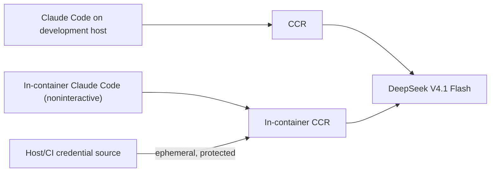

# Developer preparation (WSL and CI)

This note concerns the **development agent and the product's in-Docker LLM harness**, not a new user-facing installation requirement.

## Expected LLM chain



The initial stack is **Claude Code + `@musistudio/claude-code-router` (CCR) + `deepseek-v4.1-flash`**. Match the **working host configuration**, not its home-directory files blindly. The host setup previously used Claude Code `2.1.296`, CCR `3.1.3`, and `SCW_BASE_URL` / `SCW_BEARER_TOKEN` for the upstream gateway; **inspect and pin the currently working versions and actual provider/model route before building the image**. Those versions are starting references, not a declaration that they are still installed or compatible.

The image contains Node, Claude Code, CCR, a sanitized router configuration template and the other free verification tools. It must run the router **inside** the container: `localhost:3456` on the WSL host is not the container's localhost. Test a real request inside the image before claiming parity. Product `verify` is network-disabled and needs no token; only `generate` and `interpret` call the LLM.

## Credentials: locally

1. Preserve your working `SCW_BASE_URL` and `SCW_BEARER_TOKEN` **outside the repository**, e.g. environment provided by your shell or a protected `~/.config/utest-machinery/credentials.env` (mode `0600`). Do **not** copy `~/.claude`, `~/.claude-code-router`, OAuth caches or provider keys into the image or Git.
2. Give the Docker **LLM operation only** its required values using a narrowly scoped `--env-file` or runtime secret mount (never `ARG`, `ENV` in Dockerfile, `COPY` of credentials or verbose logs). Sanitized nonsecret CCR route configuration may be versioned in product templates.
3. Verify reachability/authentication and correct DeepSeek model routing using a short noninteractive Claude Code call from *inside* Docker, with an explicit timeout and budget. Fail `LLM_AUTH`, `LLM_NETWORK` or `LLM_CONFIG` clearly; do not quietly use another model.
4. The optional developer convenience target `make credentials` **may be implemented** to check existence/permissions of local credential sources, never to echo/save secrets. It is **not** a prerequisite for CI or a new public `mtm` command.

## Credentials: GitHub Actions

Create a protected GitHub Environment (e.g. `llm-integration`) and store `SCW_BEARER_TOKEN` as an encrypted Environment secret; `SCW_BASE_URL` as an Environment variable (or secret if sensitive). Run the real-model job only via an explicit trusted-branch/manual trigger; set permissions to read-only, budget/time caps and approval if available. No elevated secrets on fork PRs or `pull_request_target` executing PR code. The **normal PR CI has no LLM secrets**; it uses mocked/recorded LLM responses and deterministic smoke tests.

## Developer backlog: Beads

Beads is **development tracking** in this repository, not a dependency inside the user product/Docker. On first feature PR: install/pin `bd` in user/local scope, run `bd init --skip-agents` (do not overwrite `CLAUDE.md`), map the [feature milestones](../plan/implementation.md) to Beads tasks/dependencies, and reconcile already merged work. Track PR state and notes with `bd` commands.

For auditability include a refreshed `.beads/issues.jsonl` export in each PR (issues/comments/dependencies); in modern Beads this is an **export**, not the canonical Dolt history. Use the documented `bd dolt push/pull` with the repository's Git remote for full cross-machine synchronization where supported, and `bd backup` if a restorable backup is needed. Version-pin the setup and document the tested recovery procedure in the first PR. Avoid server/Dolt services unless the default embedded mode demonstrably fails the use case.

## One-prompt coordinator-led development

In an interactive WSL session, Agent Teams may be enabled **optionally** (verify runtime compatibility with the installed Claude Code + CCR version):

```bash
CLAUDE_CODE_EXPERIMENTAL_AGENT_TEAMS=1 ccr "Claude DeepSeek Flash" cli
```

Then give exactly ONE approved mission:

```text
/develop-verified Implement the next approved milestone
/develop-verified Address substantive findings on PR #14
```

The main session becomes the **coordinator**: it translates approved criteria into a small Beads backlog, optionally consults the [planner](../../.claude/agents/planner.md), dispatches a separate [developer](../../.claude/agents/developer.md) with an isolated file/worktree contract, joins specialist reports, reprioritizes and schedules the integrated test campaign, invokes one fresh independent `/verify-feature`, and alone opens/updates the PR. The coordinator **does not write product code**. Developer runs targeted tests and retains implementation autonomy, including evidence-based criticism of reviewer findings; reviewers report to the coordinator ONLY, never to the developer. Beads is durable execution tracking, native Tasks are an optional session scheduler. Parallel developers require disjoint writes and build outputs. One developer is the default. No extra user verifier prompt.

This workflow is **not** the product's in-container LLM runtime. It is also not a daemon or a guaranteed tool-enforced ban on Team peer messaging. Use only approved scope, Beads/worklog/PR (no second persistent tracker), honor owner authority to merge/start milestones, and stop after PR publication.

### Native delivery and liveness hooks

The versioned skill installs **session-scoped** Python-standard-library command hooks from [`.claude/hooks/develop-verified.py`](../../.claude/hooks/develop-verified.py). Check `/hooks` and run a real Team smoke test to verify which events are delivered under the configured Claude Code/CCR. No global settings, timers, monitoring daemon or added package is needed.

- `SubagentStop`: asks once for a meaningful handback if an isolated subagent tries to stop with a very short answer (with `stop_hook_active` guard).
- `TeammateIdle`: only when the coordinator has installed an **active mission receipt** at `.claude/.runtime-reports/<team-name>/missions/<teammate-name>.json`. Checks a report's `MISSION_ID`, `FINGERPRINT`, `STATUS` headers. If missing/wrong, requests one short completion report, tracked by an ignored one-time nudge marker; a second idle passes instead of creating a loop. IDLE alone is normal; absent receipt is a no-op. The report must be written atomically, and the coordinator must reconcile the receipt to inactive when the result is consumed.
- `TaskCompleted`: optional `Proof-file: relative/path` annotation enforces presence of a task's artifact; ordinary tasks are unchanged.
- `Stop`: catches literal `PUBLISH_READY` with background commands still active, not ordinary stops or draft/hold.

These hooks do **not** detect workers that stall without emitting an event or agents whose Team process does not inherit the hook. Coordinator inspects completed reports, native agent/task state and inbox at **meaningful joins**, issues at most one bounded retry/resume and then confirms termination before replacement, or records `NOT_VERIFIED`/HOLD. Do not repeatedly poll or infer a missing report from a silent notification. The optional receipt is ignored scratch, not a second state machine/backlog. Avoid loops by giving each mission a bounded finish condition.

### Scheduling, evidence and handoff

For one long test/build command, use coordinator-owned **native background Bash** with retained task ID, true command exit and artifact. Use `task-runner` only for independent multi-step qualification/investigation with isolated inputs. The developer runs only its focused tests in its own worktree. **Exactly one executor** owns a full suite for a given revision/configuration; no reviewer or keeper runs it. A test result proves ONLY its effective input fingerprint: save code/test/config + untracked input identity **before and after** the campaign; use a frozen snapshot/worktree or refrain from editing consumed files while it runs. A green run on changed inputs is `STALE/NOT_VERIFIED`. Reuse unaffected evidence; do not rerun a complete suite for metadata-only Beads/worklog/PR edits.

For a filtered console result preserve the real test exit:

```bash
set -o pipefail
python3 -m pytest -q > "$LOG" 2>&1
rc=$?
tail -n 30 "$LOG"
exit "$rc"
```

The coordinator processes finding IDs and rationales **once** (`ACCEPT/REJECT/DEFER`), reprioritizes coherent lots rather than demanding a patch per reviewer message, and pauses a developer immediately only for a proven strategy-breaking blocker. A `contract-reviewer` independently checks the frozen candidate once, returning early with `READY/CHANGES_REQUIRED/NOT_VERIFIED`; one bounded fallback if no usable report. Complete mandatory AP-01/02/03/04/05 checks, C emitted-code compile/execution contrasts when relevant, and Beads criterion→evidence or explicit `NOT_DEMONSTRATED`. Missing mandatory proof or absent fresh review forbids PUBLISH_READY, even with green CI. No automatic merge.

For optional `evidence-keeper`, preserve exclusive Beads/worklog writer ownership: `ACCEPTED` before first delegated write, `RELEASED` (or confirmed termination) before coordinator takeover; IDLE does not release ownership. No other specialist modifies Beads, worklog, PR or normative specs. Experimentally verify reviewer message routing, liveness hook delivery and coordinator recovery in the real CCR stack; the old lab tests are not proof this new architecture works.

Local hook smoke test (not CI): `python3 -m unittest discover -s tests -p test_dev_workflow_hooks.py`.
