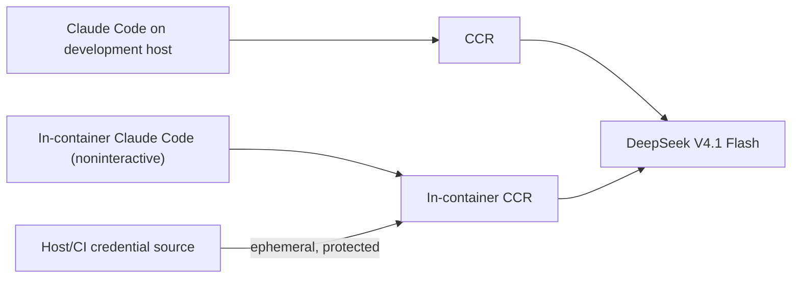

# Developer preparation (WSL and CI)

This note concerns the **development agent and the product's in-Docker LLM harness**, not a new user-facing installation requirement.

## Expected LLM chain

The initial stack is **Claude Code + `@musistudio/claude-code-router` (CCR) + `deepseek-v4.1-flash`**. Match the **working host configuration**, not its home-directory files blindly. The host setup previously used Claude Code `2.1.296`, CCR `3.1.3`, and `SCW_BASE_URL` / `SCW_BEARER_TOKEN` for the upstream gateway; **inspect and pin the currently working versions and actual provider/model route before building the image**. Those versions are starting references, not a declaration that they are still installed or compatible.

The image contains Node, Claude Code, CCR, a sanitized router configuration template and the other free verification tools. It must run the router **inside** the container: `localhost:3456` on the WSL host is not the container's localhost. Test a real request inside the image before claiming parity. Product `verify` is network-disabled and needs no token; only `generate` and `interpret` call the LLM.

## Credentials: locally

1. Preserve your working `SCW_BASE_URL` and `SCW_BEARER_TOKEN` **outside the repository**, e.g. environment provided by your shell or a protected `~/.config/utest-machinery/credentials.env` (mode `0600`). Do **not** copy `~/.claude`, `~/.claude-code-router`, OAuth caches or provider keys into the image or Git.
2. Give the Docker **LLM operation only** its required values using a narrowly scoped `--env-file` or runtime secret mount (never `ARG`, `ENV` in Dockerfile, `COPY` of credentials or verbose logs). Sanitized nonsecret CCR route configuration may be versioned in product templates.
3. Verify reachability/authentication and correct DeepSeek model routing using a short noninteractive Claude Code call from *inside* Docker, with an explicit timeout and budget. Fail `LLM_AUTH`, `LLM_NETWORK` or `LLM_CONFIG` clearly; do not quietly use another model.
4. The optional developer convenience target `make credentials` **may be implemented** to check existence/permissions of local credential sources, never to echo/save secrets. It is **not** a prerequisite for CI or a new public `mtm` command.

## Credentials: GitHub Actions

Create a protected GitHub Environment (e.g. `llm-integration`) and store `SCW_BEARER_TOKEN` as an encrypted Environment secret; `SCW_BASE_URL` as an Environment variable (or secret if sensitive). Run the real-model job only via an explicit trusted-branch/manual trigger; set permissions to read-only, budget/time caps and approval if available. No elevated secrets on fork PRs or `pull_request_target` executing PR code. The **normal PR CI has no LLM secrets**; it uses mocked/recorded LLM responses and deterministic smoke tests.

## Developer backlog: Beads

Beads is **development tracking** in this repository, not a dependency inside the user product/Docker. On first feature PR: install/pin `bd` in user/local scope, run `bd init --skip-agents` (do not overwrite `CLAUDE.md`/`AGENTS.md`), map the [feature milestones](../plan/implementation.md) to Beads tasks/dependencies, and reconcile already merged work. Track PR state and notes with `bd` commands.

For auditability include a refreshed `.beads/issues.jsonl` export in each PR (issues/comments/dependencies); in modern Beads this is an **export**, not the canonical Dolt history. Use the documented `bd dolt push/pull` with the repository's Git remote for full cross-machine synchronization where supported, and `bd backup` if a restorable backup is needed. Version-pin the setup and document the tested recovery procedure in the first PR. Avoid server/Dolt services unless the default embedded mode demonstrably fails the use case.
