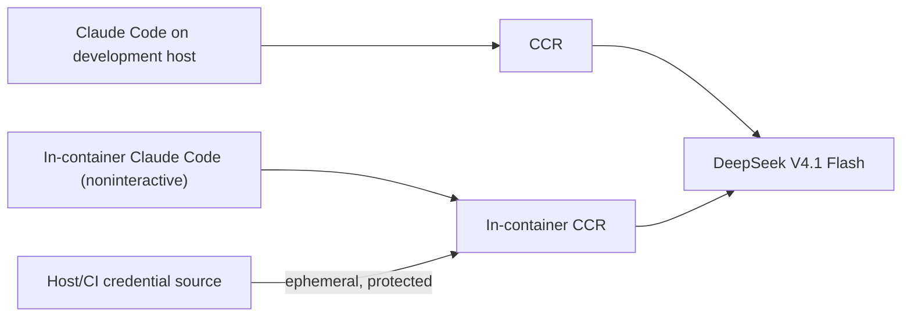

# Developer preparation (WSL and CI)

This note concerns the **development agent and the product's in-Docker LLM harness**, not a new user-facing installation requirement.

## Expected LLM chain

The initial stack is **Claude Code + `@musistudio/claude-code-router` (CCR) + `deepseek-v4.1-flash`**. Match the **working host configuration**, not its home-directory files blindly. The host setup previously used Claude Code `2.1.296`, CCR `3.1.3`, and `SCW_BASE_URL` / `SCW_BEARER_TOKEN` for the upstream gateway; **inspect and pin the currently working versions and actual provider/model route before building the image**. Those versions are starting references, not a declaration that they are still installed or compatible.

The image contains Node, Claude Code, CCR, a sanitized router configuration template and the other free verification tools. It must run the router **inside** the container: `localhost:3456` on the WSL host is not the container's localhost. Test a real request inside the image before claiming parity. Product `verify` is network-disabled and needs no token; only `generate` and `interpret` call the LLM.

## Credentials: locally

1. Preserve your working `SCW_BASE_URL` and `SCW_BEARER_TOKEN` **outside the repository**, e.g. environment provided by your shell or a protected `~/.config/utest-machinery/credentials.env` (mode `0600`). Do **not** copy `~/.claude`, `~/.claude-code-router`, OAuth caches or provider keys into the image or Git.
2. Give the Docker **LLM operation only** its required values using a narrowly scoped `--env-file` or runtime secret mount (never `ARG`, `ENV` in Dockerfile, `COPY` of credentials or verbose logs). Sanitized nonsecret CCR route configuration may be versioned in product templates.
3. Verify reachability/authentication and correct DeepSeek model routing using a short noninteractive Claude Code call from *inside* Docker, with an explicit timeout and budget. Fail `LLM_AUTH`, `LLM_NETWORK` or `LLM_CONFIG` clearly; do not quietly use another model.
4. The optional developer convenience target `make credentials` **may be implemented** to check existence/permissions of local credential sources, never to echo/save secrets. It is **not** a prerequisite for CI or a new public `mtm` command.

## Credentials: GitHub Actions

Create a protected GitHub Environment (e.g. `llm-integration`) and store `SCW_BEARER_TOKEN` as an encrypted Environment secret; `SCW_BASE_URL` as an Environment variable (or secret if sensitive). Run the real-model job only via an explicit trusted-branch/manual trigger; set permissions to read-only, budget/time caps and approval if available. No elevated secrets on fork PRs or `pull_request_target` executing PR code. The **normal PR CI has no LLM secrets**; it uses mocked/recorded LLM responses and deterministic smoke tests.

## Developer backlog: Beads

Beads is **development tracking** in this repository, not a dependency inside the user product/Docker. On first feature PR: install/pin `bd` in user/local scope, run `bd init --skip-agents` (do not overwrite `CLAUDE.md`), map the [feature milestones](../plan/implementation.md) to Beads tasks/dependencies, and reconcile already merged work. Track PR state and notes with `bd` commands.

For auditability include a refreshed `.beads/issues.jsonl` export in each PR (issues/comments/dependencies); in modern Beads this is an **export**, not the canonical Dolt history. Use the documented `bd dolt push/pull` with the repository's Git remote for full cross-machine synchronization where supported, and `bd backup` if a restorable backup is needed. Version-pin the setup and document the tested recovery procedure in the first PR. Avoid server/Dolt services unless the default embedded mode demonstrably fails the use case.

## One-prompt verified development workflow

From the repository root in an interactive WSL terminal, enable Claude Code's experimental Agent Teams **per session** (no global configuration change):

    CLAUDE_CODE_EXPERIMENTAL_AGENT_TEAMS=1 ccr "Claude DeepSeek Flash" cli

Then use ONE command, for example:

    /develop-verified Implement the next approved milestone
    /develop-verified Address all substantive findings on PR #14

The versioned .claude/skills/develop-verified/SKILL.md runs a lead-owned, finite acceptance contract. The lead can begin a clear local correction **without waiting for plan review**; a test-challenger runs early for material correctness/oracle risk. Plan and candidate critics, the convergence-guardian and the evidence-keeper are optional/conditional rather than automatic participants. Native background Bash handles straightforward long commands; a task-runner is reserved for independent multi-step work. ONE bounded fresh final verification uses /verify-feature OR an equivalent direct contract-reviewer, never both by default. You do **not** need a separate verifier prompt. Only the lead edits implementation and PR and normally updates Beads/worklog; for substantial parallel record work a delegated keeper obtains explicit ACK and exclusive ownership until RELEASED/confirmed termination. The contract reviewer remains independent of the live reviewer but must not duplicate full test campaigns. Evidence is tied to the actual revision; an edit invalidates applicable earlier acceptance claims.

This is a **developer workflow**, not a runtime service or mandatory product installation step. Experiments in a separate disposable WSL lab demonstrated team messaging, Beads 1.3.1/worklog writes and fresh-subagent review, but not this exact integrated repository end-to-end flow, actual GitHub PR publication, or improved efficiency versus a baseline; verify these in subsequent real use. The worklog is mandatory *development memory*, not application/router debug logging. Do not enable verbose logging or persist credentials. If the experimental team fails with CCR, optional isolated one-shot reviews can still run; report actual availability accurately, never fabricate successful delegation and never wait on optional plan/guardian reports as release gates. Follow CLAUDE.md's merge boundary: PR then STOP, never auto-merge or start another milestone.

### Asynchronous commands and independent delegated work

`/develop-verified` chooses the **simplest** concurrency mechanism. For a straightforward slow command (tests, Docker, build or otherwise), the lead uses Claude Code's native Bash background mode and retains the task ID/output to collect the completed result; there is no need for an LLM agent merely to wait. If nothing useful can progress meanwhile, the lead simply joins/awaits that task.

Only when the lead expects useful **independent work in parallel**, and the long task benefits from autonomous multi-step execution or analysis, can it delegate to the optional [`task-runner`](../../.claude/agents/task-runner.md). Examples include several dependent build/qualification commands, a bounded dependency investigation, or environment diagnosis while the lead develops another independent portion. The worker does not edit tracked product files, PR, Beads or worklog. It may use scoped temporary outputs.

Both modes must protect shared writes and stale inputs: a committed worktree, or an explicitly captured snapshot (including needed uncommitted files), is required when the lead's concurrent changes could affect the task's input. A stable read-only analysis need not force an extra commit or worktree. Every mandatory result is joined and tied to its actual input revision before final review; rerun any invalidated checks. Degraded delegation falls back to native background Bash, not an unnecessary forced serial runner. Claude Code background tasks are session-scoped; do not detach orphan jobs.

### Test ownership, review budgets and keeper handoff

The lead or a specifically assigned task-runner executes the full local pytest/Docker/build campaign. Reviewers and the test-challenger inspect the evidence and may run a **few distinct, targeted, isolated probes**, not another complete suite. The convergence-guardian audits the diff and existing proofs without running a broad pytest command; the keeper **never executes tests**, but inspects command, process exit, input revision/configuration and artifacts. Reuse results on unchanged inputs; after corrections run focused regressions, then complete applicable checks on a stable candidate. Final contract-review must yield a structured READY / CHANGES_REQUIRED / NOT_VERIFIED early in its turn budget; permit only one bounded direct fallback if an invocation returns no usable report, never duplicate the same review by default.

With Agent Teams, keeper sends ACK plus current Beads issue/PR and ACCEPTED write ownership. An `idle` teammate is available, not disconnected. Send compact checkpoint updates rather than polling. If no ACK arrives, make one bounded attempt to re-contact and confirm its state; lead does **not** write Beads/worklog until keeper explicitly RELEASES ownership, its termination is confirmed, or no keeper ever started. Stop and report an evidence blocker when ownership cannot be determined. No new tracker, test service or duplicated logs is needed.
