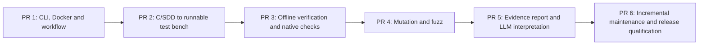

# Implementation plan — six user-visible product milestones

**Scope:** build the complete native-WSL product; no MVP reduction and no GitHub issues for planning. This page owns the **feature gates**. [CLAUDE.md](../../CLAUDE.md) owns the developer-agent session protocol; [requirements](../architecture/architecture.md), [contracts](../architecture/data-contracts.md) and [workflow failures](../architecture/workflow-failures.md) own behavior. Do not repeat those rules here.

Each numbered milestone is a **substantial feature PR**, not an arbitrary implementation layer. An agent works on **only the current milestone**, opens the PR and **stops for review**. It starts the next only after the current PR is externally merged **and** a new explicit go-ahead is received. If a PR fails review, amend that same PR.

## Features, local proof and acceptance

| PR | Delivered feature (user can do...) | Local verification method | Pass gate before review |
| --- | --- | --- | --- |
| **1 — Project bootstrap and control** | Install/check the generic image; `mtm init/scope/status/doctor/workflow view`; configure one persistent host bench and per-user settings. Headless **Dagu** orchestrates a minimal sample workflow with meaningful stop/error diagnostics. Initialize **Beads**, reconcile milestone backlog and version it. | On WSL: clean CLI bootstrap; selected-source read-only hashes; Docker delete/recreate; textual DAG/visual view; kill/restart and injected input/tool failures; run Beads recovery from fresh clone. | CLI works with no GUI or manual tool installs beyond Docker; user sees accurate error/action; state survives; all local checks reproducible. Dagu rejected only with measured documented reason. |
| **2 — Generate a functional C unit-test bench** | `mtm generate/plan`: assess **only selected** C/SDD inputs, READY/ADAPTED/BLOCKED feasibility, run **in-image Claude Code + CCR + DeepSeek V4.1 Flash**, produce grounded plan/oracles, Ceedling/Unity/CMock scenarios and generated private shims/mocks. | Mock-provider offline generation contracts; one actual **manual** in-Docker DeepSeek call with ephemeral credentials; local compile/run saturation, safety decision, sensor, state machine, vendor adapter and ambiguous/conflicting SDDs. Compare hashes and test-to-SDD links. | A fresh selected C/SDD fixture becomes an executable unit suite; intentional defect detected, unknown oracle stays UNDETERMINED; no original modifications, no silent oracle weakening, no secret leak. |
| **3 — Offline deterministic verification** | `mtm verify` rebuilds/runs the frozen bench **without LLM**, preserving independent profiles for functional/robustness, LLVM coverage/MC/DC, ASan/UBSan, optional LSan, GCC/Clang optimization and appropriate Valgrind host diagnostics. Each profile reports applicability and limits. | Remove tokens/disable network; execute repeated campaigns; inspect native raw reports and denominators, deliberately faulty parser under ASan, MC/DC decision sample; mutate input after freeze and require STALE_INPUT; test tool crashes. | Offline replay works; relevant failures diagnosed; execution, SDD applicability and tool failure are distinct; metrics match native tools; no MCU timing assertions. |
| **4 — Mutation and generative robustness** | Integrate **Mull** with matching LLVM for non-destructive mutation/statuses and **libFuzzer** with properties, budget, corpus and reproducible crash inputs, reusing existing scenarios wherever possible. | Locally run boundary mutant survivor/killed case, collect real operator list and mutant inventory; fuzz parser and replay saved crashing seed with sanitizer; simulate timeout/unsupported tool. | Native results preserved with correct denominators and survivor/invalid/equivalent statuses; no custom coverage/mutation engine; bounded repeatable fuzz scenarios. |
| **5 — Explainable consolidated report** | Aggregate native outputs deterministically into requirement ↔ function ↔ plan ↔ generated test ↔ execution ↔ evidence. `mtm interpret` uses in-image LLM on **frozen evidence** to propose precise code/SDD changes; `mtm report` renders linked HTML/JSON. | Inspect broken mapping, implementation bug, conflicting/absent oracle, blocked unit and tool failure fixtures; re-interpret same run under separate prompt/model settings; verify all references and evidence hashes unchanged. | Actions specify why, where, suggested fix, impact and reproduction; unknown never falsely PASS; `interpret` never changes raw results; HTML audit navigation works. |
| **6 — Maintain and qualify the finished product** | Incremental add/remove scope, source/SDD change impact, stable IDs/oracle approval, collaboration from clean checkout, complete C/SDD and product qualification, release/install/update guidance. | Two-clone workflow; change code and SDD; verify unchanged tests stay stable; complete Q-01–18 and SYS assessment; Docker Desktop/native WSL manual smoke; run full local matrix and approved credentialed real-model qualification. | All mandatory SYS/QD checks have recorded evidence; no critical unanswered defects; historical evidence persists; final product can be installed and operated per user guide. |

**Checks for every feature:** positive and negative scenarios, important failure path, input immutability, provenance of claims and explicit NOT_TESTED for anything outside the feature. Do not demand unrelated future checks before their milestone exists.

**Acceptance gate (AP-01):** each **applicable criterion** in the milestone's acceptance column must be backed by an **actually executed** test/command and its observed result, or be explicitly marked **NOT_DEMONSTRATED** with a reason, in the relevant **Beads feature item**. The PR references that item and the essential evidence without introducing a duplicate tracking matrix. **A mandatory criterion without adequate evidence blocks declaring the feature ready for review, regardless of green CI.** When addressing a PR review finding, verify the **underlying contract** and its relevant neighboring/contrasting scenarios, not only the reported symptom. Apply this gate only to the current milestone, without requiring later features' tests.

**Invariant gate (AP-03):** for a feature handling **persistent state, lifecycle transitions or classification/aggregation of results**, identify and test the **few critical invariants**: data preserved across relevant operations/failures, valid schema on read/write, truthful nonterminal/terminal states, and correct precedence of mixed failures where applicable. Include the executed invariant tests and results in the **same AP-01 evidence recorded in Beads**, or mark them `NOT_DEMONSTRATED` with a reason; **an applicable mandatory invariant not demonstrated blocks readiness**. Test representative sequences and contrasted cases, **not every possible transition**; no new tool, tracking matrix or requirement to test unimplemented milestones.

## CI policy — fastest safe PR gate

**Local before CI:** the agent runs the *full relevant* tests on WSL first, fixes failures locally, then opens/updates its PR with commands, logs and artifacts. CI is **not the first debugging environment**.

**Automatic PR CI:** short deterministic checks only, targeting changed code plus an essential regression smoke: formatting/schemas/links, critical unit tests, CLI contract, a small native fixture and error-path smoke. No real paid LLM and no exhaustive mutation/fuzz campaign on every push. Aim for a few minutes; measure and tune rather than promising a fixed duration.

**Full/heavy tests:** local before PR; optional manually dispatched CI or release verification for Mull/fuzz, full integration, security and real-model qualification. Record exact run evidence in PR. A stage cannot be accepted with an unrun mandatory feature gate simply because fast CI is green.

## Backlog and PR protocol

The plan above owns the **six feature boundaries**; Beads owns execution status, not a duplicate specification. On startup, compare plan, main branch, merged PRs, code/tests and Beads; create or reconcile six linked milestones, with optional subtasks and review comments, never marking unmerged work done. Use `bd prime`, `bd ready`, `bd show`, `bd update`, `bd close` as supported by the pinned release. Publish an auditable `.beads/issues.jsonl` export **in the PR**; synchronize native Dolt state through its documented Git ref where possible, since JSONL is not a full database backup. Do not create GitHub issues. See [developer setup](../development/setup.md).

Each PR includes: feature behavior, SYS/QD coverage, concise design decisions, commands/results of **local** tests, fast CI outcome, logs/links or representative artifacts, source-immutability proof, failure cases, Beads progress and residual limits. **Open PR → STOP for review.** If the PR is not merged, the next session corrects this PR; it does not start the next feature.

## Stop conditions

The workflow's runtime policy is defined exclusively in [workflow failures](../architecture/workflow-failures.md). During implementation, a **feature gate failure** is a blocker to submitting that feature as ready; a **blocked individual source unit** may be recorded and independent units still run. The agent must stop and ask for intervention when a necessary free tool is incompatible, credentials unavailable for a required one-time live proof, critical security isolation fails or acceptance criteria cannot be met. Never silently weaken the tests or reinterpret a code fault as an SDD ambiguity.

**Separate future scope:** QEMU/Renode and MCU/on-target execution.
