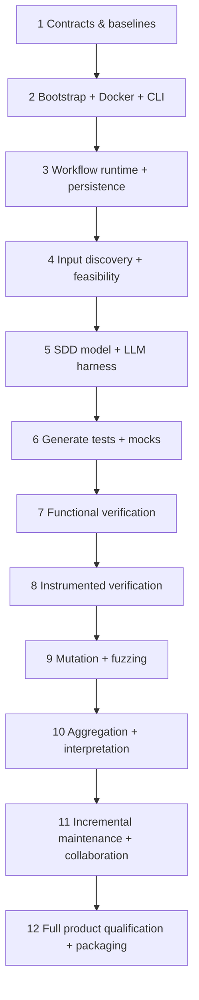

# End-to-end construction plan

This is a **functional delivery plan, not GitHub issues or a reduced MVP**. Every phase produces demonstrable deliverables and a gate before moving forward. Tasks may be implemented iteratively, but the product scope remains the full architecture.

## Stage-by-stage implementation

| Step | Build | Completion gate |
| --- | --- | --- |
| **1 — Contracts** | Define IDs/schema for input manifest, requirements, unit inventory, oracle, plan, campaign, evidence, findings, action recommendations and stage journal; version schema. | Example JSON/YAML validates, trace links complete, no undocumented verdict |
| **2 — CLI & bootstrap** | Standalone Linux CLI, `install/init/doctor`, Docker detection, image pinning, user vs project configuration, secrets policy, read-only mounts. | Fresh WSL setup; clean container reinstall preserves bench state and original hashes |
| **3 — Workflows** | Dagu text DAGs, headless CLI integration, stdout progress, immutable stage records, retries/checkpoints and optional visual audit. Evaluate alternative if Dagu fails gates. | Kill/resume test; optional UI; no project state only inside container |
| **4 — Discovery and host feasibility** | Source glob/explicit paths, multi-repo mapping, C preprocessing/compile diagnostics, symbol discovery, target-feature classification and shims on copy/overlay. | Ready/Adapted/Blocked justified on fixtures |
| **5 — Embedded LLM harness** | Configurable provider, constrained tool interface, prompt templates, model metadata, requirements extraction, ambiguity and evidence provenance, planning approval policy. | Correctly identifies missing/conflicting specifications with no fabricated oracles |
| **6 — Test generation** | Ceedling project in bench, Unity/CMock generated tests and mocks, fault scenarios, controlled test IDs, compilable host harness, no original source changes. | Nominal/defective/mocked fixtures execute; generated diff reviewable |
| **7 — Deterministic verify** | Rebuild frozen suite without LLM, independent functional/robustness campaign, retry/error semantics and archived native results. | No LLM API calls; repeatable test verdicts |
| **8 — Instrumented engines** | Pinned LLVM coverage/MC/DC; ASan/UBSan/optional LSan; GCC/Clang and Valgrind profiles; applicability rules. | Measured coverage, diagnostics and host-limits accurately reported |
| **9 — Mutation and fuzz** | Validate compatible Mull/LLVM runner, manifest generated mutants, distinguish statuses; libFuzzer harness and stable corpus/seed/reproducer. | Known mutants killed/survive as expected, induced parser bug reproduced |
| **10 — Evidence and reports** | Deterministic normalization/joins, HTML navigation, requirement/implementation/SDD gap classifications, embedded LLM evidence interpretation and actionable recommendations. | Every claim traceable and independent reinterpretation preserves raw evidence |
| **11 — Lifecycle** | Scope add/remove, SDD/code change detection, invalidation graph, approved oracle locks, stable IDs, Git-friendly checkpoints, merging and collaboration. | Two developers independently replay; scope changes do not erase history |
| **12 — Qualification & delivery** | Complete fixture catalog, failure injection, malicious inputs, time/resource profiles, docs, workflow visualization, release/upgrade/rollback guidance. | Meet qualification requirements QD-001–012; no unjustified compliance claims |

## Agent implementation instructions

Before each stage: read the relevant normative requirements and existing outputs; identify exact inputs, outputs, acceptance checks and dependencies. Produce a small plan and one coherent implementation slice; run available qualification checks; preserve any observed limitations. Prefer established free tools to bespoke coverage, mutation or fuzz calculations. Never edit demo ground truth to make generated results pass. Never silently expand the scope or rewrite original input files. Reject missing dependencies explicitly instead of pretending a stage succeeded.

For any new CLI action or schema, add user documentation, provenance semantics and a corresponding qualification fixture/test. Keep the product's Docker image generic and portable. Pin versions once compatibility has been demonstrated, especially Clang/LLVM/Mull. Ensure each workflow can be audited as text and rendered as a diagram.

## Cross-cutting acceptance gate

Every implementation stage is incomplete unless it demonstrates: (a) input preservation, (b) repository-host persistence, (c) observable CLI progress and failure diagnostics, (d) machine-readable traceable outputs, (e) deterministic offline replay for frozen stages, (f) test/SDD oracle integrity and (g) clear distinction between evidence and LLM interpretation.

## Deferred independent backend

QEMU/Renode and target execution are later separate backends; plan their interfaces but do not make them a dependency of the native WSL product.
