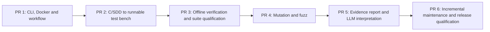

# Implementation plan — six user-visible product milestones

**Scope:** build the complete native-WSL product; no MVP reduction and no GitHub issues for planning. This page owns the **feature gates**. [CLAUDE.md](../../CLAUDE.md) owns the developer-agent session protocol; [requirements](../architecture/architecture.md), [contracts](../architecture/data-contracts.md) and [workflow failures](../architecture/workflow-failures.md) own behavior. Do not repeat those rules here.

Each numbered milestone is a **substantial feature PR**, not an arbitrary implementation layer. An agent works on **only the current milestone**, opens the PR and **stops for review**. It starts the next only after the current PR is externally merged **and** a new explicit go-ahead is received. If a PR fails review, amend that same PR.

## Features, local proof and acceptance

| PR | Delivered feature (user can do...) | Local verification method | Pass gate before review |
| --- | --- | --- | --- |
| **1 — Project bootstrap and control** | Install/check the generic image; `mtm init/scope/status/doctor/workflow view`; configure one persistent host bench and per-user settings. Headless **Dagu** orchestrates a minimal sample workflow with meaningful stop/error diagnostics. Initialize **Beads**, reconcile milestone backlog and version it. | On WSL: clean CLI bootstrap; selected-source read-only hashes; Docker delete/recreate; textual DAG/visual view; kill/restart and injected input/tool failures; run Beads recovery from fresh clone. | CLI works with no GUI or manual tool installs beyond Docker; user sees accurate error/action; state survives; all local checks reproducible. Dagu rejected only with measured documented reason. |
| **2 — Generate a functional C unit-test bench** | `mtm generate/plan`: assess **only selected** C/SDD inputs, READY/ADAPTED/BLOCKED feasibility, run **in-image Claude Code + CCR + DeepSeek V4.1 Flash**, produce grounded plan/oracles, Ceedling/Unity/CMock scenarios and generated private shims/mocks. | Mock-provider offline generation contracts; one actual **manual** in-Docker DeepSeek call with ephemeral credentials; local compile/run saturation, safety decision, sensor, state machine, vendor adapter and ambiguous/conflicting SDDs. Compare hashes and test-to-SDD links. | A fresh selected C/SDD fixture becomes an executable unit suite; intentional defect detected, unknown oracle stays UNDETERMINED; no original modifications, no silent oracle weakening, no secret leak. |
| **3 — Offline verification, C-generator fidelity and suite qualification** | `mtm verify` replays the frozen bench **without LLM** across applicable functional, coverage/MC/DC, sanitizer, compiler/optimization and host-diagnostic profiles. **Use pinned Clang/libclang as the semantic authority for C declarations and types**, and Ceedling/CMock native mock-header preprocessing instead of a growing custom `typedef`/include-guard/preprocessor parser. Preserve source, plan/oracle and test-fidelity guarantees; qualify R04 oracle justification and R22 suite sensitivity separately from raw execution. | Resume the existing PR #35 on the revised architecture, reuse unaffected verified evidence; resolve C types against the selected build context; exercise a small fixed set of pointer/alias/aggregate/header regressions and representative emitted C compile/link/run on reference-correct and independently faulty SUT; test failed/missing Clang context and honest exclusions. Also check offline replay, tool faults and R04/R22 contrasts. | Frozen no-LLM replay with truthful profiles; Clang-resolved types drive the generator and native Ceedling/CMock consumes mock interfaces. Supported generated C compiles and discriminates expected behavior, or an explicit scoped limitation is reported before verdict. No custom C grammar/guard engine, fabricated defect or silent PASS; R04/R22 evidence remains independent. |
| **4 — Mutation and generative robustness** | Integrate **Mull** with matching LLVM for non-destructive mutation/statuses and **libFuzzer** with properties, budget, corpus and reproducible crash inputs, reusing existing scenarios wherever possible. | Locally run boundary mutant survivor/killed case, collect real operator list and mutant inventory; fuzz parser and replay saved crashing seed with sanitizer; simulate timeout/unsupported tool. | Native results preserved with correct denominators and survivor/invalid/equivalent statuses; no custom coverage/mutation engine; bounded repeatable fuzz scenarios. |
| **5 — Explainable consolidated report** | Aggregate native outputs deterministically into requirement ↔ function ↔ plan ↔ generated test ↔ execution ↔ evidence. `mtm interpret` uses in-image LLM on **frozen evidence** to propose precise code/SDD changes; `mtm report` renders linked HTML/JSON. | Inspect broken mapping, implementation bug, conflicting/absent oracle, blocked unit and tool failure fixtures; re-interpret same run under separate prompt/model settings; verify all references and evidence hashes unchanged. | Actions specify why, where, suggested fix, impact and reproduction; unknown never falsely PASS; `interpret` never changes raw results; HTML audit navigation works. |
| **6 — Maintain and qualify the finished product** | Incremental add/remove scope, source/SDD change impact, stable IDs/oracle approval, collaboration from clean checkout, complete C/SDD and product qualification, release/install/update guidance. | Two-clone workflow; change code and SDD; verify unchanged tests stay stable; complete Q-01–18 and SYS assessment; Docker Desktop/native WSL manual smoke; run full local matrix and approved credentialed real-model qualification. | All mandatory SYS/QD checks have recorded evidence; no critical unanswered defects; historical evidence persists; final product can be installed and operated per user guide. |

### PR 3 — implementation contract and Definition of Done

**A · Prove generated-C test fidelity.** For a representative, finite set of existing or small independent C/SDD fixtures, verify (1) the generated call/observation/assertion matches its planned oracle, (2) the **actual generated Ceedling/Unity/CMock project compiles and links in the product image**, and (3) the unchanged assertion passes on a reference-correct SUT and fails on an independently defective SUT when the oracle is evaluable. A text-only Python golden test is insufficient for C semantics; an expected compilation failure or unsupported shape must be reported as such, **not** as an implementation defect. Keep raw compiler/runner output, hashes and commands.

**B · Replace unsound type reconstruction with one narrow Clang semantic adapter (architectural arbitration, 18 October 2026).** Use **version-pinned Clang 18/libclang 18** in the existing product image (same LLVM major as PR #35's verification toolchain) to obtain selected C translation-unit function declarations, canonical parameter/return types, pointer depth, qualifiers, `typedef`/record relationships, referenced declaration locations and diagnostics from the **effective build context**. Reuse explicitly selected include roots, `-D` macros, target/ABI flags and a selected `compile_commands.json` when provided; do not guess missing target headers or invent source types. The adapter exports only the minimal type/declaration facts needed by existing plan/generator objects; keep the original C/SDD bytes immutable and do not create a parallel persistent AST or general C parser. Remove/retire competing regex-derived semantic claims on this path rather than maintaining two independent type authorities. Existing lexical scanning may remain solely for inexpensive inventory hints, never as conclusive type truth.

**C · Make mocks and support boundaries compiler-led, not guard-heuristic-led.** Keep **Ceedling/Unity/CMock** and its private bench; use native Ceedling mock-header preprocessing (`:use_test_preprocessor: :mocks`, when mockable headers require preprocessing) with the selected compiler include/define context and existing real headers/declarations wherever usable. Generate private interfaces only as needed, with Clang-resolved *compatible* types and no duplicated inline record/enum definitions; do **not** build or extend regex include-guard/preprocessor safety classifiers such as `_header_shares_safely`. Compile generated mock/test translation units with the real toolchain as a mandatory fidelity gate, classify a build/mocking failure as a harness/configuration limitation rather than an implementation defect, and never accept unsupported code as PASS. Preserve already-required ordinary scalar/`T *`, write-through versus reassignment at `int **`, pointer `typedef` aliases, representable `void *`/`void **` and defined aggregate limitations; an unsupported aggregate `expect_out` or nonrepresentable callback/array is recorded before attempting a verdict. Avoid blanket refusal of approved supported shapes.

**Approved architecture and resumption of PR #35 (18 October 2026, owner decision).** This is **one selected implementation direction**, not a mandate for competing technology spikes or alternative parser designs. The coordinator and developer resume and update the SAME draft PR #35, reconciles current `main` specs and coordinator workflows into its branch, preserves demonstrated `verify`/R04/R22 work and valid snapshot-bound tests, and replaces only unsound C-declaration/mock sharing machinery. The previous preprocessor-guard regex patch cycle is superseded; remove dead code and redundant tests once replaced. Keep the adapter shallow (libclang API bindings rather than handwritten AST machinery), pinned to the product image; errors with missing/incompatible build context become actionable `BLOCKED`/unsupported records, not guessed C, while a broken installed Clang tool remains `TOOL_FAILED`. Compilation remains necessary but is not by itself proof of correct argument/observable semantics. No requirement to support arbitrary C, whole embedded SDKs, all preprocessor configurations or redesign the LLM, CLI, evidence schema, downstream milestones and accepted domain.

**Finite C acceptance evidence (reuse existing cases):** correct and deliberately defective SUT on (a) scalar / `T *`, (b) `typedef int *P; P *pp` and `int **` write-through **versus reassignment**, (c) representable `void *` / `void **` with explicit backing-size/type assumptions, and (d) aggregate + mock interface exposing aliased `struct`/`enum` including the former guarded/conditional-header regression class. Show matching Clang-resolved declaration → generated argument/observation → real Ceedling compilation and execution, plus at least one named limitation with no attempted implementation verdict. Check compilation diagnostics and correct selection/denominators; do not grow an exhaustive syntactic permutation matrix. Reuse R04/R22 qualification evidence without changing its meaning.

**PR 3 acceptance / DoD (record the command, true exit status, frozen revision/inputs and evidence in the existing Beads item/PR):**

1. **Offline replay:** with credentials absent and network unavailable, `mtm verify` reproduces a frozen suite without calling an LLM or changing selected sources, approved tests or oracles; changed source/SDD/scope snapshot yields `STALE_INPUT` rather than a misleading replay; changed execution configuration must also invalidate evidence rather than be silently reused. Tool faults and interrupted/partial runs do not become functional failures or successes.
2. **Profile truthfulness:** applicable functional, LLVM coverage/MC/DC, ASan/UBSan, conditional LSan, GCC/Clang and host diagnostic profiles execute or state a concrete non-applicability/tool limit; native raw reports, tool versions/flags, denominators and normalized statuses agree. No invented target-MCU timing or unsupported 100% claims.
3. **Generator fidelity:** the cases in A–C have targeted fail-before/pass-after evidence where a prior bug existed, plus Clang-resolved type/prototype facts from the selected build context, native Ceedling/CMock preprocessed mock inputs where needed, and **real compilation and execution** of representative emitted tests. Demonstrate at least one correct-C PASS, one genuinely faulty-C assertion FAIL, and correct limitation/no-fabricated-verdict behavior for an unrepresentable case. A tool/build error never counts as functional defect detection.
4. **Independent qualification:** satisfy existing R04 and R22 as specified in [qualification](../qualification/qualification.md): detect a semantically wrong oracle despite a valid requirement ID; preserve ambiguity as unqualified; run identical frozen tests/oracles on separately snapshotted correct/faulty inputs and disclose detections, misses, false positives and `NOT_EVALUABLE` cases against withheld ground truth.
5. **Closure:** every applicable check is evidenced or explicitly `NOT_DEMONSTRATED` (blocks review-ready under AP-01); open limitations name affected shapes/assumptions and their user impact. No new public CLI command, paid/LLM-dependent `verify`, automatic oracle repair or separate tracker. Mull/libFuzzer stay **PR 4**; incremental suite health and release qualification stay **PR 6**.

**Checks for every feature:** positive and negative scenarios, important failure path, input immutability, provenance of claims and explicit NOT_TESTED for anything outside the feature. Do not demand unrelated future checks before their milestone exists.

**Acceptance gate (AP-01):** each **applicable criterion** in the milestone's acceptance column must be backed by an **actually executed** test/command and its observed result, or be explicitly marked **NOT_DEMONSTRATED** with a reason, in the relevant **Beads feature item**. The PR references that item and the essential evidence without introducing a duplicate tracking matrix. **A mandatory criterion without adequate evidence blocks declaring the feature ready for review, regardless of green CI.** When addressing a PR review finding, verify the **underlying contract** and its relevant neighboring/contrasting scenarios, not only the reported symptom. Apply this gate only to the current milestone, without requiring later features' tests.

**Invariant gate (AP-03):** for a feature handling **persistent state, lifecycle transitions or classification/aggregation of results**, identify and test the **few critical invariants**: data preserved across relevant operations/failures, valid schema on read/write, truthful nonterminal/terminal states, and correct precedence of mixed failures where applicable. Include the executed invariant tests and results in the **same AP-01 evidence recorded in Beads**, or mark them `NOT_DEMONSTRATED` with a reason; **an applicable mandatory invariant not demonstrated blocks readiness**. Test representative sequences and contrasted cases, **not every possible transition**; no new tool, tracking matrix or requirement to test unimplemented milestones.

**Independent feature review (AP-01/AP-03 supplement):** run `/verify-feature` in a fresh `contract-reviewer` subagent context after relevant local checks, **before first submitting a feature PR** (**PRE_PR**) and **after substantive corrections to reviewer feedback on an already open PR**, before requesting another external review (**PR_RECHECK**). For PRE_PR, verify the current milestone's normative contracts, contrasting outcomes and actual evidence before accepting Beads claims. For PR_RECHECK, supply the **PR number/URL**; retrieve review bodies, inline comments and discussion, trace corrections since the reviewed revision, verify **every material finding's underlying contract**, targeted regressions and any new issues. The subagent returns the report to the **main coordinator**, who arbitrates findings with an autonomous developer and records concise evidence in the **same Beads feature item**. A targeted pass suffices after substantial fixes; no extra full pass for trivial edits, no second tracker, and no requirement for docs-only changes. Unavailable feedback, delegation or mandatory checks are `NOT_DEMONSTRATED`, never implicitly accepted. The external PR review is still required.

**Integration gate (AP-02):** whenever the current feature crosses a runtime or distribution boundary (installed CLI/wheel, Docker, test tool or LLM), demonstrate at least **one real, complete user-facing path** through those boundaries in the intended environment, with exact command, observed end result and applicable input read-only/permission checks recorded in the **same Beads acceptance evidence**. Component tests or a green CI alone do not prove the complete path. A mandatory unproven path blocks feature readiness, but expensive integration runs are **not** required per unit test and are not automatically added to fast PR CI.

**PR 2 risk gates (R01/R03/R04/R07/R21/R22):** apply the existing C/SDD and [qualification fixture](../qualification/qualification.md) contracts *during milestone 2*: independently anchored SDD oracles and honest `UNDETERMINED`; `READY/ADAPTED/BLOCKED` with justified mock boundaries; valid SDD↔code↔test references; and independent seeded-defect detection with reference outcomes **withheld from the generating LLM**. Prove them before submitting PR 2, **not before starting its implementation**. The required real in-Docker Claude Code/CCR/DeepSeek invocation remains a **local authorized manual acceptance check**, never a credentialed automatic PR check.

**PR 3 R04 oracle-justification gate (future enhancement; not PR 2):** independently assess concrete expected outcomes, not just SDD IDs, against withheld reference expectations for representative fixtures, including (a) a correct SDD-grounded boundary value, (b) a wrong value attached to a valid requirement ID, and (c) absent/ambiguous expected behavior. Preserve the frozen plan, test, oracle hashes and raw runtime evidence; report justified, contradicted and non-evaluable/not-checked conclusions separately from PASS/FAIL and never claim C nonconformity from an unsupported oracle. Expose the assessment through the existing plan/qualification evidence, without a new public command or LLM inside `verify`. This **adds no acceptance condition or change request to the already-running milestone 2 / PR #14**.

**PR 3 R22 qualification gate:** extend (do not replace) PR 2's minimal seeded-defect demonstration into the [independent suite-sensitivity qualification](../qualification/qualification.md) of a **frozen** generated suite. Execute the *same unchanged tests/oracles* on separately versioned correct/faulty fixture snapshots through the existing offline verification pipeline; never bypass `STALE_INPUT` by swapping the input of a frozen campaign. Evaluate functional assertion detection, missed defects, false positives and non-evaluable cases against withheld reference outcomes. Store evidence in Beads/PR under AP-01; keep the full Mull-based mutation campaign for PR 4 and regression health checks after suite changes for PR 6.

## CI policy — fastest safe PR gate

**Local before CI:** the agent runs the *full relevant* tests on WSL first, fixes failures locally, then opens/updates its PR with commands, logs and artifacts. CI is **not the first debugging environment**.

**Automatic PR CI:** short deterministic checks only, targeting changed code plus an essential regression smoke: formatting/schemas/links, critical unit tests, CLI contract, a small native fixture and error-path smoke. No real paid LLM and no exhaustive mutation/fuzz campaign on every push. Aim for a few minutes; measure and tune rather than promising a fixed duration.

**Full/heavy tests:** local before PR; optional manually dispatched CI or release verification for Mull/fuzz, full integration, security and real-model qualification. Record exact run evidence in PR. A stage cannot be accepted with an unrun mandatory feature gate simply because fast CI is green.

## Backlog and PR protocol

The plan above owns the **six feature boundaries**; Beads owns execution status, not a duplicate specification. On startup, compare plan, main branch, merged PRs, code/tests and Beads; create or reconcile six linked milestones, with optional subtasks and review comments, never marking unmerged work done. Use `bd prime`, `bd ready`, `bd show`, `bd update`, `bd close` as supported by the pinned release. Publish an auditable `.beads/issues.jsonl` export **in the PR**; synchronize native Dolt state through its documented Git ref where possible, since JSONL is not a full database backup. Do not create GitHub issues. See [developer setup](../development/setup.md).

Each PR includes: feature behavior, SYS/QD coverage, concise design decisions, commands/results of **local** tests, fast CI outcome, logs/links or representative artifacts, source-immutability proof, failure cases, Beads progress and residual limits. Before publishing, reconcile applicable rules introduced on `main` (AP-04) and inspect the diff and versioned evidence for accidental disclosure of credentials/private infrastructure (AP-05); record only significant findings, not a duplicate checklist. **Open PR → STOP for review.** If the PR is not merged, the next session corrects this PR; it does not start the next feature.

## Stop conditions

The workflow's runtime policy is defined exclusively in [workflow failures](../architecture/workflow-failures.md). During implementation, a **feature gate failure** is a blocker to submitting that feature as ready; a **blocked individual source unit** may be recorded and independent units still run. The agent must stop and ask for intervention when a necessary free tool is incompatible, credentials unavailable for a required one-time live proof, critical security isolation fails or acceptance criteria cannot be met. Never silently weaken the tests or reinterpret a code fault as an SDD ambiguity.

**Separate future scope:** QEMU/Renode and MCU/on-target execution.
