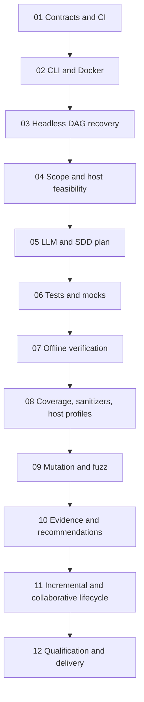

# Autonomous implementation plan — gated PRs

**Objective:** implement the entire native-WSL uTest Machinery product, not an MVP; no GitHub issues for planning. Read [AGENTS.md](../../AGENTS.md). This page owns **order, deliverables, verification methods and exit gates**; [architecture](../architecture/architecture.md) owns normative SYS requirements, [data contracts](../architecture/data-contracts.md) own data semantics, and [CI/qualification](../qualification/ci-and-manual-tests.md) owns cross-stage test coverage.

## PR protocol and agent instructions

1. **One branch + one PR per numbered stage**, based on the previous *merged* stage in `main`. Do not self-merge without explicit authorization. Each PR is independently reviewable and contains implementation, new automated tests, fixture adjustments, doc updates and gate evidence; no planning issues.
2. Before editing, review requirements and earlier artifacts, choose pinned free tool versions, and write a concise change plan. Prefer local tools/venvs; request permission for host-wide installation.
3. Develop stage CI checks concurrently with implementation. Ordinary PR checks MUST be offline and require no real LLM credentials; a separate opt-in credentialed test qualifies semantic model behavior.
4. Run **previous stage checks as regression**, followed by new positive/negative/fault tests. Attach exact commands, observed outcomes and paths to raw evidence. A test which detects an intentionally defective fixture counts as a successful qualification check, not a successful SUT run.
5. On failure, preserve artifacts and explain the blocker; do not make CI green by changing expected behavior. Move to the next dependent stage only after the previous PR has passed its gates and been merged.
6. Persist accepted implementation stage, commit, checks and artifact hashes in a Git-friendly stage manifest. Do not persist secrets or live process state. Use the [PR template](../../.github/PULL_REQUEST_TEMPLATE.md).

## Delivery, verification and acceptance per stage

The `mtm` commands below are **target product commands**, not existing executables. Prior to their implementation, use documented equivalent scripts and report which was run.

| PR stage | Required deliverables | Test method and fixtures | Exit gate |
| --- | --- | --- | --- |
| **01 Contracts + CI skeleton** | Implement versioned JSON Schemas/validators for objects in [data contracts](../architecture/data-contracts.md); stable IDs/status; migration policy; basic schema/docs/diagram CI. | Validate representative valid/invalid objects; reject broken evidence references and unknown statuses; check Markdown links and Mermaid syntax. | All schema fixtures pass; invalid records fail with reason; CI results attached. |
| **02 Bootstrap + CLI** | Standalone Linux CLI, `install/doctor/init/scope/plan/status`, pinned reusable Docker build, personal vs project config, one bench root, scoped mounts/secrets. | Clean WSL install and help smoke tests; run with read-only input and intentionally attempt write; remove/recreate container and compare project data; secret scan. | No manual installation of internal test tools; byte-identical original inputs; no secret in repo/image/log; bench persists. |
| **03 Headless orchestration** | Dagu YAML workflows (or documented selected alternative), status/progress, optional graphical inspection, persisted journal, idempotent retry/resume and atomic outputs. | Run with UI off; kill midway, inject timeout and failed independent step, corrupt stale cache fingerprint, restart; render DAG, compare journal to executions. | No false PASS, duplicate unsafe execution or project-only hidden state; valid progress and recovery. |
| **04 Scoped input + native feasibility** | Explicit selected-root glob/selector implementation, multi-repo mapping, input hash/revision snapshots, preprocessor/link/smoke diagnostics, READY/ADAPTED/BLOCKED, shims in bench. | Ready, missing-header and target-adapter fixtures; unselected-folder sentinel; path escape; dirty/unavailable Git revision; clang/gcc host compile probe. | No scanning outside scope; precise blockers/adaptations and fidelity assumptions; mismatched snapshot refuses silent replay. |
| **05 LLM harness + SDD plan** | In-image provider adapter, bounded allowlisted tool calls, prompt and response provenance, anchored requirements extraction, conflicting/missing oracle classification, plan recorded **before** generation. | Recorded/mock LLM for malformed output, injection, retries, conflicting SDD, absent oracle and scope limit; opt-in real-model trial. | Valid plan or explicit UNDETERMINED; no invented oracle or secret leak; reproducible structured provider contract. |
| **06 C tests and mocks** | Ceedling/Unity/CMock bench, generated test C and adapters, controlled fault sequences, stable scenario IDs, `plan` planned-versus-implemented view, reviewed semantic oracle changes. | Build saturation, boolean, sensor, state-machine and vendor-header fixtures; known defect MUST remain detectable; compare source hashes/diffs. | READY/ADAPTED units execute, BLOCKED justified; all generated assertions trace to SDD; originals untouched. |
| **07 Offline verify** | `verify` regenerates deterministic binaries/evidence from frozen suite, never calls LLM, creates immutable campaign, separates domain failure/tool failure, validates source/test hashes before execution. | Cut network/remove tokens; repeat run and compare normalized statuses; mutate source after freeze and require explicit invalidation; inject infrastructure fault. | Offline end-to-end replay; correct error model; original hashes unchanged; no oracle changes. |
| **08 Coverage + runtime + portability** | Clang/LLVM regions/branches/MC/DC, ASan/UBSan/conditional LSan and TSan, GCC/Clang optimization profiles, optional Valgrind Memcheck/Callgrind/Massif; applicability matrix. | Known MC/DC vector example; ASan-broken parser; compiler variants, mocked and unsupported cases; compare raw coverage and denominators. | Native-tool measures and limitations visible; expected issues found; host measurements never called MCU WCET; no custom coverage engine. |
| **09 Mutations + fuzz** | Pinned compatible Mull/LLVM; mutant operator selection, generated inventory/status/score; libFuzzer harness, seeds/corpus/budget and deterministic crash replay. | Weak-suite mutant survivor, strong-suite killed mutant; check exclusions and timeout classification; fuzz parser then replay minimised input with ASan. | No unreported mutants, no mutant tool failure misclassified as killed, property violations reproducible, generated artifacts stored. |
| **10 Consolidation + LLM recommendations** | Deterministic result join, HTML+JSON `report`, independent `interpret`, evidence-linked code/SDD defects, conflicts and gaps with precise corrective guidance. | Verify every link/hash and requirements denominator, underspecified/conflicting examples; reinterpret identical campaign with separate mock model, diff only interpretation. | Actionable findings with root cause, location, proposed modification, risks and verification; unknown never PASSED; raw unchanged. |
| **11 Incremental lifecycle** | Scope add/remove and retire, source/SDD impact graph, guarded oracle edits, project checkpoints/version migration, multiple developers Git workflow. | Change code then SDD; remove/add input; unrelated test hash unchanged; two fresh clones replay; simulate interrupted migration with rollback. | Reusable accepted tests preserved, obsolete history retained, no silent changes, cross-developer replay. |
| **12 Qualification + packaging** | Complete [Q-01–18](../qualification/qualification.md), CI/manual suite and SYS coverage matrix, release image+CLI, version/install/update/rollback documentation. | Full offline CI, opt-in real-model qualification, manual WSL Docker variants, visual DAG check, malicious input/secret scan, source immutability proof. | Every SYS/QD check PASSED or disclosed as a **release blocker**; all critical gates passed; no false certification claim. |

## Per-PR evidence required

Each PR lists the SYS/QD IDs touched; exact test command, exit/status and logs for each gate; selected fixture ground truth (outside agent input); source read-only proof; tool/image versions; unresolved limitations; and dependency readiness. **CI passing alone is not evidence of semantic correctness** when tests are generated by the same LLM.

## Stop and recovery rules

A **unit** may be BLOCKED while independent units proceed with an incomplete-scope verdict; an unfulfilled **stage gate** blocks dependent PRs. Dagu, Mull/LLVM or vendor-header compatibility must be demonstrated empirically. Do not invent outputs, weaken oracles, omit untestable units from denominators, silently change original inputs or claim host tests establish MCU timing or ISO 26262 compliance.

**Future separate workstream:** QEMU/Renode and on-target verification backends, not a prerequisite for this WSL-native product.
