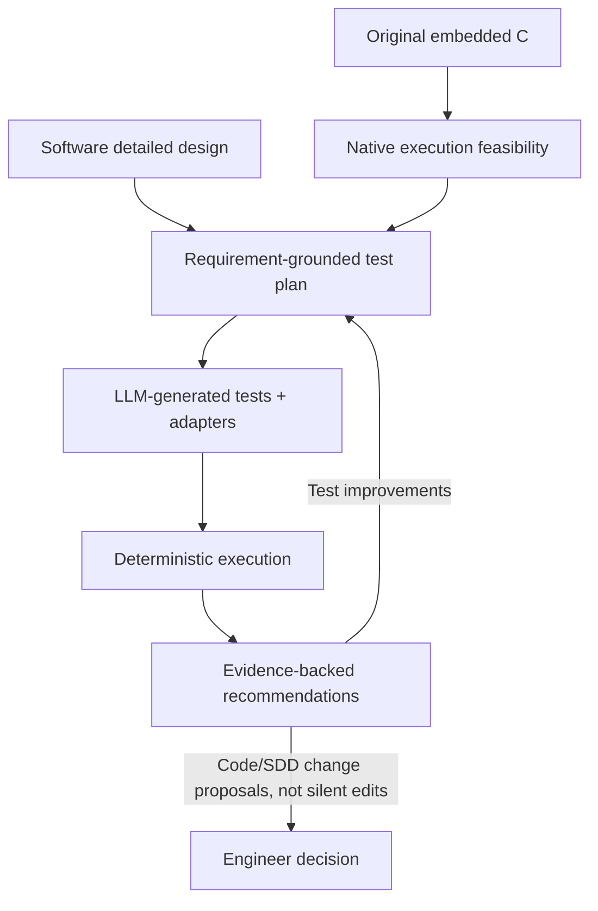

# Product overview — why uTest Machinery?

## Problem

For target-compiled embedded C, unit testing on a developer PC requires recreating enough of a missing build ecosystem to exercise real production logic. Headers, types, vendor SDKs and hardware-facing functions obstruct builds. Engineers manually write shims, mocks, scenarios and assertions; structural, runtime, fuzz and mutation findings then live in separate tools. Repeating all of this after code or SDD changes consumes engineering time, while test completeness and conformance remain difficult to substantiate.

## Positioning

uTest Machinery is a **verification workbench**, not a firmware emulator, static-code-quality checker or certification authority. It combines generative assistance for the high-effort semantic tasks with existing deterministic execution tools. It explains both **what is supported by evidence** and **what is unknown**.

## Three user promises

**Generate:** convert selected code and SDD into a maintained, reviewable test suite with explicit test oracles, dependencies, assumptions and references.

**Verify:** rebuild and run the exact suite from persistent project artifacts with the pinned container, *without an LLM*. Different execution profiles share scenarios instead of duplicating suites.

**Interpret:** read immutable execution evidence, identify likely code defects, specification gaps, conflicting expectations or insufficient evidence, and recommend concrete next steps with file/requirement/test references.

## Expected gains (to be measured during qualification)

- Less manual effort per verified requirement and per changed function.
- Shorter time from source/SDD input to an executable suite and comprehensible report.
- Consistent use of independent checks rather than one-dimensional coverage.
- Clear visibility of untestable functions, unsupported architecture assumptions and missing requirements.
- Reproducible, collaboratively versioned tests and audit trails.

Track human effort, generation success, independently replayed outcomes, valid defect detection, false allegations and trace-link correctness. **Do not invent percentages or claim guaranteed savings**.

## Boundaries

| In scope | Out of scope / future |
| --- | --- |
| WSL-native Linux execution in project-agnostic Docker | Target timing/WCET proof, hardware peripheral fidelity |
| Selected C source trees and SDDs, potentially in multiple repositories | Arbitrary-code universal compatibility |
| Generated mocks, harnesses, coverage, sanitizers, mutation, fuzzing, portability profiles | Static quality/lint/MISRA assessment for this scope |
| Persistent state and reports under one root | Remote services or mandatory graphical editor |
| CLI, optional workflow inspection UI, HTML reporting | QEMU/Renode (separate future workstream) |

A passing test does not by itself prove SDD conformance. Undefined or ambiguous expected behavior must remain **undetermined**, not be converted into a passing claim. Source-code modifications are recommended, not performed by the verification engine.
