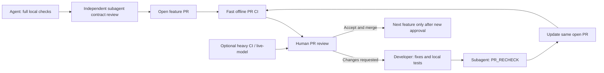

# Product verification: fast CI, deep local checks

Two different proofs are needed: (1) **uTest Machinery behaves correctly as software**, and (2) its generated tests reliably detect defects in [independent C/SDD fixtures](qualification.md). These are not interchangeable.

The `/verify-feature` subagent supports **PRE_PR** (current milestone's contracts, counterexamples and actual evidence before opening the PR) and **PR_RECHECK** (read the open PR's review comments, verify subsequent fixes against their underlying contracts and relevant regressions before updating the **same PR**). Its evidence-led report returns directly to the developer, who records dispositions and tests in the existing Beads item. This is a **local developer verification**, not a second CI job, an external approval or a substitute for GitHub review; its effectiveness remains to be measured.

## CI policy

**Do not use CI as the first test runner.** The agent runs and fixes applicable tests locally on WSL before opening the PR. The PR attaches exact commands, results and evidence. Automatic CI is **minimal, fast, deterministic, offline and credential-free**: it independently repeats a small set of merge-blocking checks. Full mutation/fuzz/stress, real-model generation and cross-machine acceptance are executed **locally** and, when necessary, in **manually dispatched** trusted CI jobs, not on every push.

| When | Automatic fast CI (minimum) | Full local evidence required before PR |
| --- | --- | --- |
| All PRs | Python/C syntax and basic unit tests, contract/schema/Markdown checks, selected input preservation, critical CLI smoke and one negative error path | All changed feature cases, failure/recovery cases, native reports and previous smoke regressions |
| PR 1: control | CLI init/status/doctor, simple headless DAG result/error | WSL installation, Docker lifecycle, interruption and recovery, optional diagram view |
| PR 2: generation | Recorded/mock LLM response → one reproducible generated-test smoke, no secret | Real direct Scaleway Chat Completions + DeepSeek request inside Docker; all relevant functional fixtures, mocks, oracle gaps |
| PR 3: verification | Offline frozen `verify` small fixture + one sanitizer/coverage check | All applicable Clang/GCC/LLVM/Valgrind profiles; intentionally faulty fixture |
| PR 4: advanced tests | Short bounded mutation/fuzz regression fixtures | Full local seeded mutation/fuzz corpus and replay evidence |
| PR 5: reports | Report links, run JSON, status/error mapping | Ambiguous SDD, defect, partial and tool-error findings plus LLM recommendation quality |
| PR 6: maintenance | Add/remove/change/restore smoke + key regressions | Two clean checkouts, full qualifying fixture set, WSL Docker variants, release workflow |

This table is the **minimal gating policy**; it is not an exhaustive catalogue of product tests. If automatic checks become slow, optimize their fixtures without weakening the mandatory acceptance proof.

## Real LLM credentials (opt-in only)

Normal PR CI uses recorded/mock provider responses and **no tokens**. A protected `llm-integration` GitHub Environment stores `SCW_BEARER_TOKEN` (secret) and `SCW_BASE_URL` (variable/secret according to sensitivity). Authorize only trusted ref/manual jobs, with time/cost budget and protected reviewers if desired. Never run fork PR code or `pull_request_target` with these credentials. No Docker build argument or layer may contain a credential. See [developer setup](../development/setup.md).

## Required manual/negative checks

- Host-mounted original sources and SDDs unchanged after failure, regeneration, and successful verification.
- WSL Docker Desktop integration **or** local Docker Engine works on supported setup.
- Workflow kill/resume, invalid path/SDK, wrong model route, tool crash and incomplete SDD all return precise `mtm status --json` errors and appropriate user actions. See [error contract](../architecture/workflow-failures.md).
- A genuine implementation defect fails its SDD oracle without automated weakening; an ambiguous requirement stays UNDETERMINED.
- Re-execute without LLM; reinterpret frozen evidence without changing the original report; validate short actionable guidance.
- Beads records match merged PRs, with a reviewable issue export and cross-machine synchronization proven in the first feature.

## Acceptance

A feature PR requires local test evidence and a green fast CI; **it is then reviewed and the agent stops**. Critical source corruption, credential disclosure, oracle weakening, missing evidence, false PASS or unrecoverable workflow corruption block acceptance. The final release requires the independent [qualification suite](qualification.md) plus documented manual checks. Full CI/qualification is not presumed complete because the small merge gate passed.
