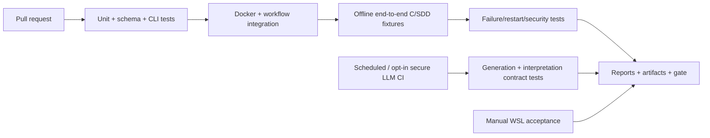
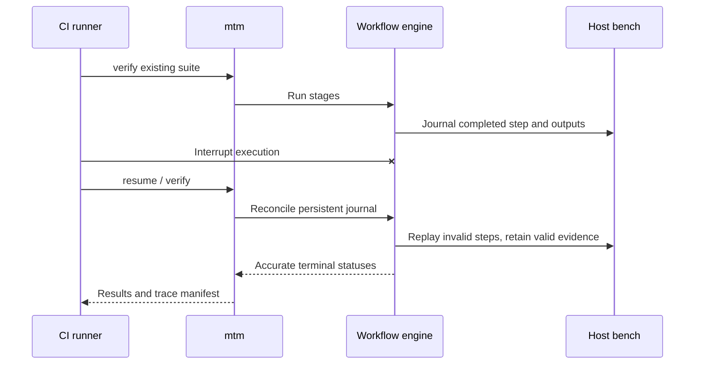

# Product CI and manual verification plan

This page tests **uTest Machinery as a product**: its CLI, workflows, persistence, security and user experience. [Fixture-based qualification](qualification.md) separately measures its ability to generate meaningful C/SDD verification and detect defects. Both are required. This is a **test plan, not an implemented pipeline**.

## Automated CI layers

| Layer | Tests | Expected verdict |
| --- | --- | --- |
| Unit/schema | Config paths/scope, input fingerprints, stable IDs, requirement/test/evidence schemas, invalidation, score normalization, status classification | Deterministic assertions |
| CLI contract | install/doctor/init/scope/plan/generate/verify/interpret/report/status/workflow view; usage/help, invalid arguments, progress, exit codes, non-interactive mode | Clear outputs and no unexpected writes |
| Docker | Image build/pin; per-user config; explicit read-only input mounts; one writable bench; image removal/recreation | Original hashes unchanged and persistent bench restored |
| Workflow | DAG syntax/visual export, step dependency order, progress, retries, cancellations, timeouts, parallel independent branches, checkpoints | No hidden state, duplicate execution or falsely successful step |
| Compilation/mocking | Native-ready, adapted, blocked C; headers/macros, external symbols, translation unit fidelity | Honest feasibility and documented adapters |
| Deterministic engines | Ceedling/Unity/CMock, LLVM branches/MC/DC, ASan/UBSan, Mull, libFuzzer, GCC/Clang, Valgrind | Pinned raw outputs, applicability/unsupported status |
| Evidence & reports | Planned/generated/executed comparison, links, manifest digests, HTML rendering, finding categorization, usable reproduction instructions | Links resolve; no unsupported conformity claims |
| Lifecycle | Add/remove roots/requirements, source/SDD revisions, protected oracles, obsolete records, collaborative cross-machine replay | Stable identities and precise invalidation |
| Isolation/security | No traversal outside selected roots, malicious C execution, prompt injection, credential leakage, network denial, resource/time limits | Fail closed; secrets absent from logs and archives |
| CI completeness | Enumerate each SYS requirement and fixture Q, map to automated/manual/blocked checks; validate Mermaid via CLI | No silently uncovered feature or broken documentation |

## CI LLM policy

**Never require a paid model for offline PR verification.** PR CI uses a recorded/mock LLM provider that exercises tool-call schemas, retries, approvals and invalid responses; it verifies product orchestration, *not* semantic ability. A separate manually dispatched or scheduled integration job may use a real model, with bounded budget, pinned model/prompt metadata, and a non-regression review of expected semantic findings.

- Supply tokens through GitHub Actions encrypted **Secrets**, preferably scoped to a protected **Environment** with approval; use short-lived credentials/OIDC where supported by the provider.
- Pass the token only to the dedicated LLM step/container as an ephemeral environment variable or secret mount; do not use it as a build argument, commit it, log it, or include it in reports and artifacts.
- Avoid untrusted pull-request code with elevated secrets (especially forked PRs). Run credentialed jobs only on trusted refs with restricted permissions and explicit trigger/approval.
- CI without credentials must still run `verify`, validate frozen artifacts and generate deterministic reports.
- LLM findings can vary. Use human-confirmed reference cases, semantic acceptance checks and trend review rather than bitwise output comparison.

## Required adversarial workflow checks

Inject crash, compiler error, test failure, timed-out mutant, malformed LLM response, missing dependency, partial report write, invalid cache hash and inaccessible Docker daemon. Test failures must be recorded as evidence while independent checking proceeds; infrastructure failure must not be interpreted as a passing test.

## Manual WSL acceptance (when automation is insufficient)

| Scenario | Operator check |
| --- | --- |
| New user | Install standalone CLI, provision Docker, initialize project from arbitrary paths, confirm no separate tool install |
| Usability | Read CLI progress, diagnose failure, inspect plan vs generated tests, follow report links and proposed code/SDD corrections |
| Optional UI | Start graphical workflow inspection only on request; compare diagram/status with YAML and CLI, no mouse-based authoring |
| Collaboration | Clone on a second WSL machine, configure personal credentials, replay the same frozen suite and inspect differences |
| Security boundaries | Verify sources cannot be modified through permitted workflow; validate credential file permissions and absence from repository |
| Interpretation review | Expert judges whether recommendations cite exact requirement/location and suggest implementable verification/correction steps |
| Platform variance | Docker Desktop WSL integration and native WSL Docker Engine, on supported configurations |

## Release criteria

Release must fail on: input modification, incorrect PASS/FAIL under deliberately ambiguous SDD, lost evidence after resume, broken trace links, secret disclosure, incorrect tool error classification, offline replay requiring LLM, or a generated regression that silently changes approved oracles. Other limits or manual-only cases must be disclosed. Store test logs, machine-readable result summaries, HTML reports and failure reproduction instructions as CI artifacts subject to retention policy; do not place volatile CI logs in source control by default.

**Ownership:** tests and workflows are maintained next to implementation. The user-facing CLI remains the only mandatory interface. All example C/SDD fixture evaluations are distinct from tests of the machinery's own infrastructure and workflows.
