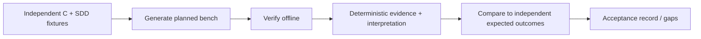

# Qualification and acceptance specification for uTest Machinery

**Purpose:** demonstrate the *product itself* handles real and intentionally faulty C/SDD inputs and produces trustworthy, actionable, reproducible evidence. Fixtures are reference **inputs**, not claims of observed successful runs. Keep every injected defect identified in independent fixture ground truth; withhold ground truth from the generating LLM when measuring independent discovery.

## Qualification pipeline

## Fixture catalog and required demonstrations

| ID | Fixture | Injected test condition | Acceptance expectation |
| --- | --- | --- | --- |
| Q-01 | Saturation arithmetic | Thresholds, inclusive boundaries, out-of-range handling | Test vectors identify erroneous edge behavior |
| Q-02 | Boolean safety decision | Multi-condition AND/OR | Branches and feasible MC/DC pairs assessed |
| Q-03 | Mocked sensor dependency | Dependency returns success/error, outlier, recovery | Verify ordering, errors and mock isolation |
| Q-04 | Stateful controller | Valid/invalid transitions and repeated calls | Test state invariants and reset |
| Q-05 | Frame parser | Zero, short, oversized, corrupted frames | ASan/fuzz can expose injected buffer bug |
| Q-06 | Target header incompatibility | Missing vendor types/register access | `Adapted` or `Blocked` with explicit assumptions |
| Q-07 | Wrong implementation | C contradicts clear SDD | Finding classified implementation defect |
| Q-08 | Missing SDD oracle | C implements edge behavior omitted by spec | `UNDETERMINED`, proposed spec clarification |
| Q-09 | Conflicting SDD | Two requirements prescribe incompatible results | Contradiction reported; not arbitrary pass |
| Q-10 | Mutant survivor | Deliberately weak assertion | Specific surviving mutant and targeted test improvement |
| Q-11 | Tool error | Compiler/runner failure | Not reported as functional failure or pass |
| Q-12 | Revision | Change C/SDD; remove and add scope | Stable IDs, obsolete records, impact-limited regeneration |
| Q-13 | Collaborative replay | Another developer / clean container | Successful offline verification of frozen suite |
| Q-14 | Input preservation | Run generation/verify with read-only inputs | Matching input SHA-256 before/after |
| Q-15 | Security and isolation | Malicious test or prompt injection in SDD | No secret leakage, unauthorized action or write to sources |
| Q-16 | Profiling/portability | Compilation flags, ABI and alloc behavior | Host-only claims, captured profile assumptions |
| Q-17 | Workflow resilience | Interrupt container during multi-step workflow | Resumable, traceable execution with no corrupted results |
| Q-18 | Interpretation reproducibility | Change LLM model on identical evidence | Immutable original data, separately recorded conclusions |

## Fixture requirements (QD)

| ID | Required property |
| --- | --- |
| QD-001 | Each fixture SHALL include C, any necessary header(s), an SDD with stable requirement IDs and an expected-observation manifest managed independently of generated tests. |
| QD-002 | The fixture library SHALL include nominal, faulty, ambiguous and environment-blocked examples. |
| QD-003 | Qualification SHALL inspect functional correctness, feasibility status, coverage denominator, mutation inventory, fuzz reproduction and reporting evidence. |
| QD-004 | A deliberate implementation defect SHALL be detected without automatic oracle weakening or source modification. |
| QD-005 | Underspecification SHALL prevent unwarranted PASS/FAIL conformity verdicts even when assertions happen to pass. |
| QD-006 | Every finding SHALL include reproduction steps, precise input/line and requirement links, proposed change and expected post-change verification. |
| QD-007 | Inputs SHALL remain unchanged and all project outputs/states SHALL remain in the one dedicated bench directory. |
| QD-008 | Deterministic replay SHALL work with no network/LLM and compare normalized results against frozen expectations. |
| QD-009 | Failure/resume SHALL retain a complete step journal and distinguish execution from domain test results. |
| QD-010 | No fixture SHALL mislabel resource estimates or architecture-host differences as target guarantees. |
| QD-011 | The assessment SHALL report missed detections, false positives, inaccurate requirements links and omitted scope, not just green outcomes. |
| QD-012 | Independent fixture ground truth SHALL be separated from generation prompts to reduce answer leakage. |

## R04 — Independent semantic qualification of SDD oracles (milestone 3)

**Goal:** verify that the **meaning** of a generated expected observation is supported by the applicable SDD requirement, not simply that its cited requirement ID exists. This is **not** an added milestone-2 gate. Reuse the existing frozen test plan, Q-01/Q-07/Q-08/Q-09 fixtures and independently maintained expected-observation manifests; do not add a separate CLI command, a second plan or a paid/LLM-dependent `verify` step.

1. **Isolated reference:** select representative requirements and concrete input/boundary cases. Keep the reference outcome/defect variants **withheld from the generating LLM** and identify the SDD clause, applicable input conditions and expected return/output/mock observation. Different expected observations in one case are assessed individually.
2. **Positive and adversarial contrasts:** compare an assertion correctly derived from the SDD with a deliberately **incorrect expectation that cites a real, correctly spelled requirement ID** (for example, SDD: `x > 10` yields 1, otherwise 0; boundary `x = 10` must expect 0, not the faulty C result 1). Also check an absent/conflicting SDD expected value: it must not become an independently validated `SPECIFIED` oracle. A wrong requirement-to-condition mapping is likewise not rescued by a matching identifier.
3. **Frozen and auditable:** assess the existing plan and emitted assertions; preserve unchanged oracle/test hashes and raw execution results. Record scenario/case/observable, the SDD anchor, observed expected value, independent reference, assessment result and explanation. A mismatch must be reported as an **oracle-quality discrepancy** and must not be converted into a proven production-code defect or a conformity PASS; a correct grounded assertion may legitimately fail on defective C.
4. **Limits:** deterministic link/schema checks cannot establish natural-language entailment. Where no independent ground truth exists, report `NOT_CHECKED`/semantic uncertainty or require an explicit human review; never certify all user-project oracles from a finite fixture sample. `verify` itself remains offline and free of LLM calls.

**Milestone-3 R04 acceptance:** demonstrate both **correct SDD oracle accepted** and **semantically false oracle with valid requirement ID detected**, with absent/ambiguous cases honestly labeled and no silent oracle revision or false code-defect attribution. Preserve exact command/fixture hashes and expected-versus-observed qualification evidence in the existing milestone-3 acceptance record. Milestone-2 generation/qualification gates are unchanged.

## R22 — Independent sensitivity qualification of generated suites (milestone 3)

**Purpose:** demonstrate that a generated suite can distinguish a correct C implementation from selected **independently seeded functional defects**, beyond merely compiling and passing. This extends the **single intentional-defect demonstration already required in milestone 2**; it does not move that gate or create a new CLI command. Reuse the existing fixtures, ground-truth manifest and offline `verify` execution; Mull mutation campaigns remain milestone 4 and health checks after suite changes remain milestone 6.

1. **Reference and isolation:** select representative fixtures (initially Q-01/Q-03/Q-04/Q-07 as applicable) with a correct reference and separately recorded, compilable faulty variants. Keep the defect description, location and independently expected outcome in the ground truth **withheld from the generating LLM**. Do not label the faulty variant as faulty in any generator-visible input.
2. **One suite, unchanged oracle:** generate/freeze the tests and SDD-grounded expected values once, without using the withheld ground truth. Run the **same test and oracle hashes** against correct and faulty fixture variants as **separate input snapshots/campaigns**, using the existing offline verification path; never alter original sources, overwrite an approved oracle or defeat `STALE_INPUT` on a frozen campaign.
3. **Independent comparison:** for each injected defect compare actual assertion outcomes with the withheld reference and classify: **DETECTED** (relevant functional assertion fails only on the faulty variant), **MISSED** (evaluated defect not detected), **FALSE_POSITIVE** (reference-correct variant triggers an unjustified failure), or **NOT_EVALUABLE** (missing/ambiguous oracle, `BLOCKED` adaptation, failed build, runner/tool fault or no valid comparison). A compile error or tool crash is **not** defect detection; preserve its own diagnostic.
4. **Evidence:** retain fixture/variant IDs and hashes, independent defect ID, frozen test/oracle hashes, commands/profiles, observed assertions, comparison result and reason for any exclusion. Count detected versus **evaluable** independent defects; disclose misses, false positives and excluded cases without transforming the sample ratio into a universal measure of suite quality.

**Milestone-3 gate:** representative reference-correct cases pass; at least one independent seeded **functional** defect is detected by an unchanged suite and a relevant assertion; the assessment includes all attempted cases and their limits. Do not impose 100% detection of a finite sample as a general correctness guarantee or require Mull/libFuzzer before milestone 4. These checks qualify the generator on reference fixtures, **not** every C/SDD suite on every user project.

## Test result criteria

Report per fixture: selected inputs, discovered units, host feasibility, generated plan, valid/invalid oracle associations, execution statuses, coverage applicability, diagnostics, mutation counts, generated artifacts, evidence hashes, observed findings versus expected findings, and review outcomes. Include human review for subjective SDD interpretation and recommendation usefulness; automated comparators must judge only deterministic facts.

## Example seeds

- [Saturation SDD](../../examples/saturation/sdd.md) and [source](../../examples/saturation/saturation.c)
- [Safety decision SDD](../../examples/safety-decision/sdd.md) and [source](../../examples/safety-decision/safety_decision.c)
- [Mocked sensor SDD](../../examples/mocked-sensor/sdd.md) and [source](../../examples/mocked-sensor/sensor.c)
- [Underspecified SDD](../../examples/underspecified/sdd.md) and [source](../../examples/underspecified/mode.c)

Additional seeds: [state-machine](../../examples/state-machine/sdd.md), [frame-parser](../../examples/frame-parser/sdd.md), [vendor-adapter](../../examples/vendor-adapter/sdd.md), [conflicting-sdd](../../examples/conflicting-sdd/sdd.md), [weak-mutation](../../examples/weak-mutation/sdd.md); [independent reference outcomes](../../examples/expected-outcomes.md) must be withheld from generation. The nine C/SDD seeds are intentionally small; the remaining Q scenarios include workflow/CI fault injection rather than necessarily new production sources. The fixture catalog is not yet complete. The construction plan requires the remainder before the product is declared qualified.
