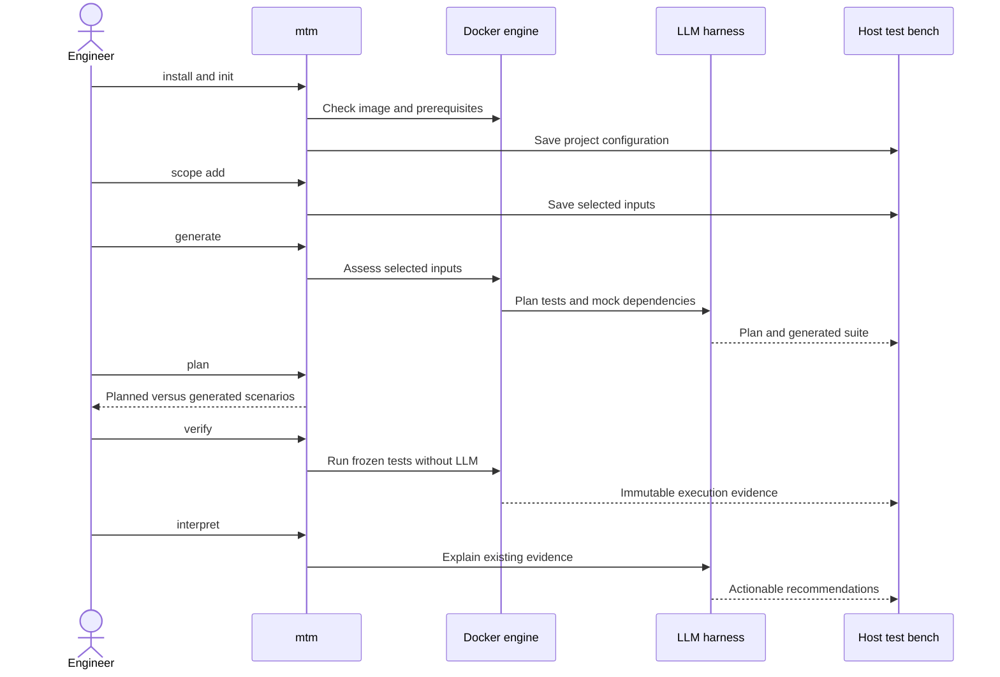
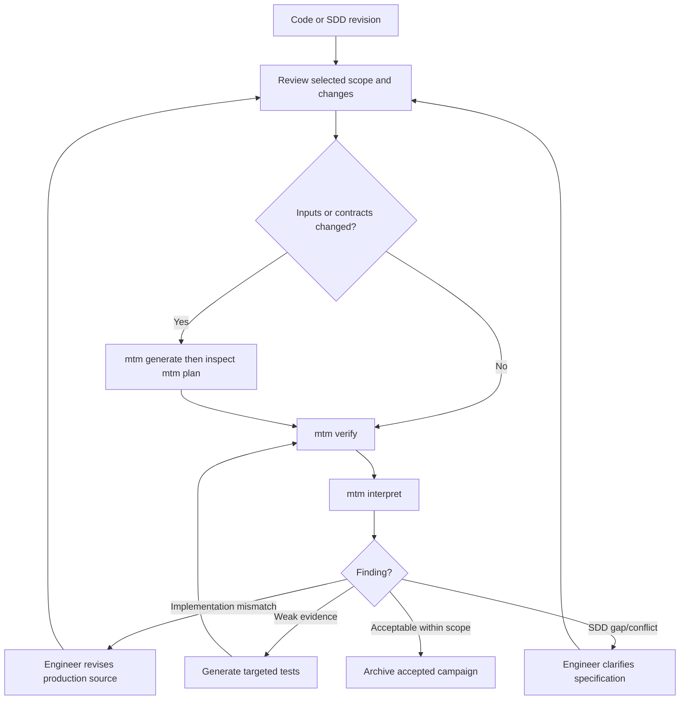

# User workflows and operation

This is a **black-box user guide** defining intended behavior; command examples are **specified CLI targets, not yet implemented**. The user never installs or configures individual test engines.

## First use



## Core CLI contract

| Command | User intent | Persistent effect |
| --- | --- | --- |
| `mtm install` | Prepare Docker image and prerequisites | User-level install metadata; never modify firmware |
| `mtm doctor` | Diagnose Docker, mounts, credentials and image | Diagnostic report |
| `mtm init` | Establish one bench for workspace | Versioned project config |
| `mtm scope list/add/remove` | Manage selected code, specs and requirements | Versioned scope, invalidation record |
| `mtm plan` | View the test strategy and planned vs generated, executed and evidenced tests | Read-only; the plan itself is versioned by generation |
| `mtm generate` | Create/update generated tests and mocks | Reviewable diffs and stable IDs |
| `mtm verify` | Rebuild and run the frozen suite on an input snapshot with matching hashes; no LLM | Immutable campaign directory |
| `mtm interpret [run-id]` | Analyze existing evidence with embedded LLM | New, separately versioned interpretation |
| `mtm report [run-id]` | Find/open summary and findings | No test changes |
| `mtm status` | Progress, completed/failed steps and next actions | No changes |
| `mtm workflow view` | Show text DAG/diagram, optionally launch read-only graphical inspection | No changes |

CLI must stream meaningful progress (stage, inputs, counts, failures, retries), support non-interactive CI, and never require a TUI. The UI for workflow inspection is **optional and disabled by default**.

## Typical ongoing use



### Why separate generate, verify and interpret?

`generate` changes the proposed suite using the LLM; `verify` only compiles and executes the frozen suite, recreating evidence offline and without changing its assertions; `interpret` uses the LLM on a selected run and may be repeated without rerunning tests. `report` opens those results. The plan view must compare **planned → implemented → executed → evidenced** tests and flag missing or weak links; coverage statistics cannot by themselves guarantee SDD correctness.

## Adding, removing and retiring scope

Scope changes never delete historical evidence. Adding an input triggers discovery, impact analysis and proposed tests. Removing an input marks related scenarios out-of-scope or obsolete, shows the impact before applying it, and preserves historical IDs. Regeneration must be incremental; never overwrite previously validated oracles silently. A developer can review proposed edits and explicitly accept or reject them.

### Direct model inference (no agent harness)

\`mtm generate --provider scaleway\` (or \`--provider auto\`) performs one
bounded direct Chat Completions request inside the product image. It neither
runs Claude Code/CCR nor mounts source files into the inference container.
\`--provider mock\` remains an explicit token-free recorded-fixture mode; it
is never selected silently after a real-provider failure. Use
\`--model scaleway/deepseek-v4.1-flash\` to select the known model.

Configure \`SCW_BASE_URL\` and \`SCW_BEARER_TOKEN\` in the existing protected
user credentials file. Optional \`MTM_LLM_REASONING_EFFORT=low\` and
\`MTM_LLM_MAX_TOKENS=8192\` tune the inference budget. The plan's model
metadata carries provider-reported token usage when available; none is
fabricated. Upstream transient failures and truncated responses do not turn
into passing tests. The ensuing \`mtm verify\` does not use an LLM.


### Selected host compilation context (milestone 3)

When source files depend on selected macros, include roots, or host C ABI flags,
declare the effective build context in the bench's existing `project.yaml`. It is
used by **host feasibility, libclang and Ceedling/CMock together**; verification
checks that it has not changed since generation.

```yaml
build_context:
  include_dirs: [include]
  defines: [FEATURE_SENSOR=1]
  args: [-std=c11]
  # Optional: explicit bench-local compile_commands.json instead of/manual plus
  # the above settings. Its selected C-unit options must be compatible.
  # compile_commands: compile_commands.json
  mock_preprocessor: auto  # auto | mocks | none
```

All include roots and a selected compilation database must live within the
bench. Supported host flags include `-std`, `-m32` / `-m64`, enum/char ABI
options, `-D` and `-U`. Unsupported target-only options, missing
compilation-database commands and incompatible per-unit contexts fail with an
explicit configuration error; they are **not** silently ignored or claimed to
be equivalent to the MCU toolchain. Ceedling mock-header preprocessing uses
its native `:mocks` mode for conditional headers (or when explicitly
selected). The compiler and native tools remain the semantic authority, not
a hand-written preprocessor.

## Routine and offline replay

- First use: install → init → scope add → generate → plan → verify → interpret → report. Native feasibility is automatic, never a separate mandatory command.
- Changed selected sources/SDDs: scope stays versioned; run generate for impacted cases, inspect `plan`, then verify. Unrelated files are not scanned.
- Pure regression: `verify` with unchanged selected hashes; repeat without internet/model.
- Reinterpret an existing run: `interpret <run-id>` (LLM), then `report <run-id>`; no test execution.
- Remove requirements/tests: adjust scope or retire via the versioned plan; inspect affected scenario and coverage gaps. Nothing historical is silently deleted.

## Diagnosing failures

A failed command prints a short reason and next action, then keeps details under the project's test-bench folder. Run `mtm status` for current/last operation, `mtm status --json` for structured error codes, `mtm doctor` for environment/CCR issues and `mtm report <run-id>` for completed or partial campaigns. A failed C assertion is preserved as evidence; a missing header may block only that function; authentication or corrupted input snapshots stop the affected operation. See [error categories and recovery](../architecture/workflow-failures.md).

## Outputs and audit navigation

- HTML summary: applicability, requirement status, campaign metrics, findings and actionable corrections.
- Requirement details: SDD excerpt/location, expected behavior, test cases, executed evidence and limitations.
- Function details: original location/hash, native adaptation/mocks, tested code, uncovered decisions and relevant mutants.
- Campaign manifest: tool/image versions, flags, inputs, suite hash, environment, statuses, exclusions and artifacts.
- Workflow trace: steps, dependencies, input/output hashes, decisions, retry attempts and root-cause diagnostics.
- Generated assets: C tests, mocks, fuzz harnesses, pinned configuration; reproducible by `mtm verify` without LLM.

Each recommendation should state **why**, **exactly where**, **what change is suggested**, **example acceptance behavior/test**, **risk/side effects**, **supporting evidence** and **confidence/remaining uncertainty**. A recommendation is not an authorized source modification.

## Constraints and user responsibilities

Only explicitly selected roots are inspected (including any explicitly selected dependencies or headers); the tool SHALL NOT scan unrelated workspace files. Adding/removing scope triggers feasibility checks internally; Ready/Adapted/Blocked diagnostics appear in generate, plan and status rather than a dedicated assess command. The user provides accessible code and SDDs, selects scope, and resolves unresolved behavioral ambiguities. The engine can decline a unit when compilation, mocking or host fidelity cannot be justified. A frozen suite SHALL NOT silently execute against changed inputs: the user must regenerate for the current snapshot or restore the recorded Git revision and dependencies. An earlier run's evidence remains archived even when inputs evolve. Docker does not establish target equivalence. SDD-derived oracles require provenance and controlled change. Credentials remain per-user outside the repository. Original inputs are mounted read-only.
