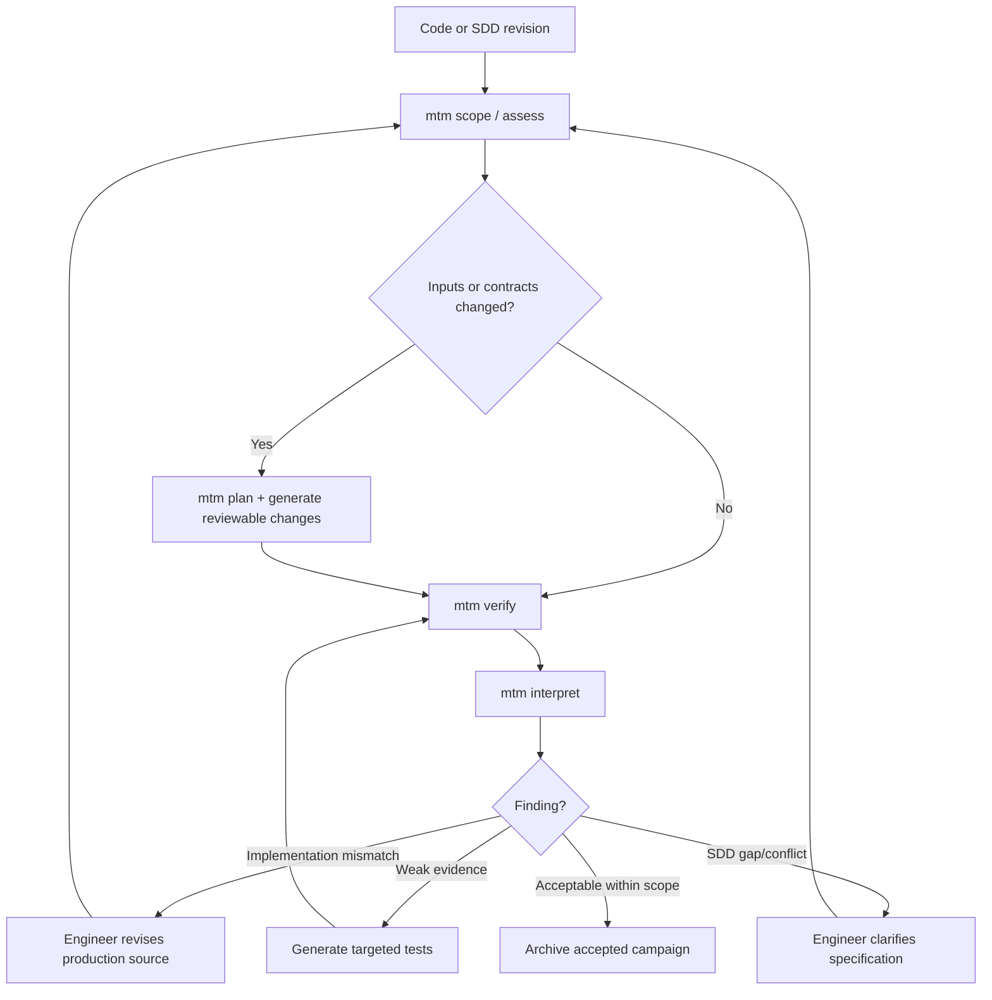

# User workflows and operation

This is a **black-box user guide** defining intended behavior; command examples are **specified CLI targets, not yet implemented**. The user never installs or configures individual test engines.

## First use

```mermaid
sequenceDiagram
  actor U as Engineer
  participant CLI as mtm CLI
  participant D as Docker runtime
  participant L as Embedded LLM harness
  participant W as Project bench (host)
  U->>CLI: mtm install
  CLI->>D: Check Docker / pull pinned image
  U->>CLI: mtm init
  CLI->>W: Create single bench + project config
  U->>CLI: mtm scope add sources/specs
  CLI->>W: Version selections and baselines
  U->>CLI: mtm assess
  CLI->>D: Inspect and try native compilation
  D-->>CLI: Ready / Adapted / Blocked with reasons
  U->>CLI: mtm generate
  CLI->>D: Start generation workflow
  D->>L: Interpret SDD; propose plan, oracles, adapters
  L-->>W: Proposed plan and generated test files
  CLI-->>U: Plan and unresolved assumptions
  U->>CLI: mtm verify
  CLI->>D: Deterministic replay, no LLM
  D-->>W: Evidence, manifests, logs, HTML
  U->>CLI: mtm interpret
  CLI->>L: Interpret frozen evidence
  L-->>W: Prioritized evidence-linked recommendations
```

## Core CLI contract

| Command | User intent | Persistent effect |
| --- | --- | --- |
| `mtm install` | Prepare Docker image and prerequisites | User-level install metadata; never modify firmware |
| `mtm doctor` | Diagnose Docker, mounts, credentials and image | Diagnostic report |
| `mtm init` | Establish one bench for workspace | Versioned project config |
| `mtm scope list/add/remove` | Manage selected code, specs and requirements | Versioned scope, invalidation record |
| `mtm assess` | Discover feasible host-executable units | Feasibility assessment with blockers |
| `mtm plan` | Inspect proposed tests and assumptions | Versioned verification plan |
| `mtm generate` | Create/update generated tests and mocks | Reviewable diffs and stable IDs |
| `mtm verify` | Deterministic run of frozen bench | Immutable campaign directory |
| `mtm interpret [run-id]` | Analyze existing evidence with embedded LLM | New, separately versioned interpretation |
| `mtm report [run-id]` | Find/open summary and findings | No test changes |
| `mtm status` | Progress, completed/failed steps and next actions | No changes |
| `mtm workflow view` | Inspect textual DAG and optional graphical UI | No changes |

CLI must stream meaningful progress (stage, inputs, counts, failures, retries), support non-interactive CI, and never require a TUI. The UI for workflow inspection is **optional and disabled by default**.

## Typical ongoing use



## Adding, removing and retiring scope

Scope changes never delete historical evidence. Adding an input triggers discovery, impact analysis and proposed tests. Removing an input marks related scenarios out-of-scope or obsolete, shows the impact before applying it, and preserves historical IDs. Regeneration must be incremental; never overwrite previously validated oracles silently. A developer can review proposed edits and explicitly accept or reject them.

## Outputs and audit navigation

- HTML summary: applicability, requirement status, campaign metrics, findings and actionable corrections.
- Requirement details: SDD excerpt/location, expected behavior, test cases, executed evidence and limitations.
- Function details: original location/hash, native adaptation/mocks, tested code, uncovered decisions and relevant mutants.
- Campaign manifest: tool/image versions, flags, inputs, suite hash, environment, statuses, exclusions and artifacts.
- Workflow trace: steps, dependencies, input/output hashes, decisions, retry attempts and root-cause diagnostics.
- Generated assets: C tests, mocks, fuzz harnesses, pinned configuration; reproducible by `mtm verify` without LLM.

Each recommendation should state **why**, **exactly where**, **what change is suggested**, **example acceptance behavior/test**, **risk/side effects**, **supporting evidence** and **confidence/remaining uncertainty**. A recommendation is not an authorized source modification.

## Constraints and user responsibilities

The user provides accessible code and SDDs, selects scope, and resolves unresolved behavioral ambiguities. The engine can decline a unit when compilation, mocking or host fidelity cannot be justified. Docker does not establish target equivalence. SDD-derived oracles require provenance and controlled change. Credentials remain per-user outside the repository. Original inputs are mounted read-only.
