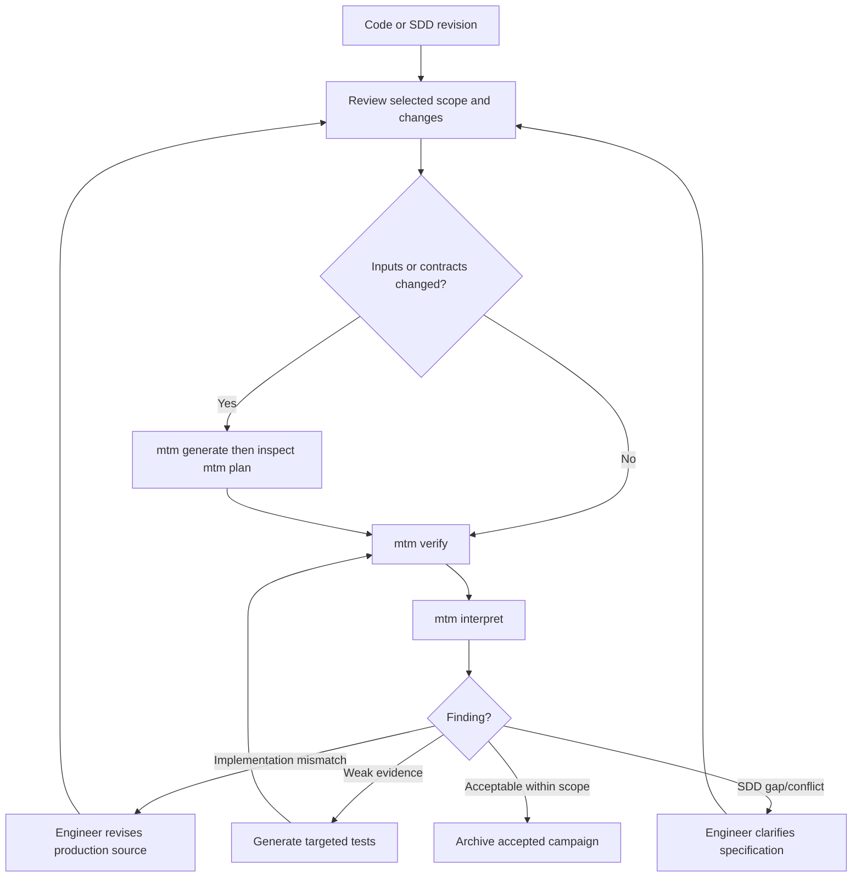

# User workflows and operation

This is a **black-box user guide** defining intended behavior; command examples are **specified CLI targets, not yet implemented**. The user never installs or configures individual test engines.

## First use

\`\`\`mermaid
sequenceDiagram
  actor User as Engineer
  participant CLI as mtm
  participant Engine as Docker engine
  participant Agent as LLM harness
  participant Bench as Host test bench
  User->>CLI: install and init
  CLI->>Engine: Check image and prerequisites
  CLI->>Bench: Save project configuration
  User->>CLI: scope add
  CLI->>Bench: Save selected inputs
  User->>CLI: generate
  CLI->>Engine: Assess selected inputs
  Engine->>Agent: Plan tests and mock dependencies
  Agent-->>Bench: Plan and generated suite
  User->>CLI: plan
  CLI-->>User: Planned versus generated scenarios
  User->>CLI: verify
  CLI->>Engine: Run frozen tests without LLM
  Engine-->>Bench: Immutable execution evidence
  User->>CLI: interpret
  CLI->>Agent: Explain existing evidence
  Agent-->>Bench: Actionable recommendations
\`\`\`

## Core CLI contract

| Command | User intent | Persistent effect |
| --- | --- | --- |
| `mtm install` | Prepare Docker image and prerequisites | User-level install metadata; never modify firmware |
| `mtm doctor` | Diagnose Docker, mounts, credentials and image | Diagnostic report |
| `mtm init` | Establish one bench for workspace | Versioned project config |
| `mtm scope list/add/remove` | Manage selected code, specs and requirements | Versioned scope, invalidation record |
| `mtm assess` | Discover feasible host-executable units | Feasibility assessment with blockers |
| `mtm plan` | View planned scenarios, generated tests, gaps, assumptions and their relationships | Read-only; the plan itself is versioned by generation |
| `mtm generate` | Create/update generated tests and mocks | Reviewable diffs and stable IDs |
| `mtm verify` | Deterministic run of frozen bench | Immutable campaign directory |
| `mtm interpret [run-id]` | Analyze existing evidence with embedded LLM | New, separately versioned interpretation |
| `mtm report [run-id]` | Find/open summary and findings | No test changes |
| `mtm status` | Progress, completed/failed steps and next actions | No changes |
| `mtm workflow view` | Inspect textual DAG and optional graphical UI | No changes |

CLI must stream meaningful progress (stage, inputs, counts, failures, retries), support non-interactive CI, and never require a TUI. The UI for workflow inspection is **optional and disabled by default**.

## Typical ongoing use

### Why separate generate, verify and interpret?\n\n`generate` changes the proposed suite using the LLM; `verify` only compiles and executes the frozen suite, recreating evidence offline and without changing its assertions; `interpret` uses the LLM on a selected run and may be repeated without rerunning tests. `report` opens those results. The plan view must compare **planned → implemented → executed → evidenced** tests and flag missing or weak links; coverage statistics cannot by themselves guarantee SDD correctness.\n\n## Adding, removing and retiring scope

Scope changes never delete historical evidence. Adding an input triggers discovery, impact analysis and proposed tests. Removing an input marks related scenarios out-of-scope or obsolete, shows the impact before applying it, and preserves historical IDs. Regeneration must be incremental; never overwrite previously validated oracles silently. A developer can review proposed edits and explicitly accept or reject them.

## Outputs and audit navigation

- HTML summary: applicability, requirement status, campaign metrics, findings and actionable corrections.
- Requirement details: SDD excerpt/location, expected behavior, test cases, executed evidence and limitations.
- Function details: original location/hash, native adaptation/mocks, tested code, uncovered decisions and relevant mutants.
- Campaign manifest: tool/image versions, flags, inputs, suite hash, environment, statuses, exclusions and artifacts.
- Workflow trace: steps, dependencies, input/output hashes, decisions, retry attempts and root-cause diagnostics.
- Generated assets: C tests, mocks, fuzz harnesses, pinned configuration; reproducible by `mtm verify` without LLM.

Each recommendation should state **why**, **exactly where**, **what change is suggested**, **example acceptance behavior/test**, **risk/side effects**, **supporting evidence** and **confidence/remaining uncertainty**. A recommendation is not an authorized source modification.

## Constraints and user responsibilities

Only explicitly selected roots are inspected; the tool SHALL NOT scan unrelated workspace files. Adding/removing scope triggers feasibility checks internally; Ready/Adapted/Blocked diagnostics appear in generate, plan and status rather than a dedicated assess command. The user provides accessible code and SDDs, selects scope, and resolves unresolved behavioral ambiguities. The engine can decline a unit when compilation, mocking or host fidelity cannot be justified. Docker does not establish target equivalence. SDD-derived oracles require provenance and controlled change. Credentials remain per-user outside the repository. Original inputs are mounted read-only.
